# Explainers: the map across all four courses

Generated by `node tools/explainers.mjs --write` from `explainers.json`. Edit the JSON, not this file.

An explainer is a short narrated clip that teaches one idea, the same grain as a Relic lesson (`LESSONS.md`). The explainers build on each other: `prereqs` are what a student should have seen first, and the tutor can call back to them ("remember when Mags showed you this"); `related` are callbacks across the map that are not prerequisites. Which explainers a student gets depends on their course. Where AA and AI handle an idea differently, there is one shared core explainer and a method explainer for each course that builds on it, not two copies; HL extensions build on the SL explainer (FAL-935).

Every prerequisite is in every course of the explainer that needs it, so no student is sent to an explainer their course does not have. Like lesson prerequisites, they suggest an order and never lock anything.

## In numbers

- **336 explainers**, 496 prerequisite links (86 between islands) and 61 "remember when" links.
- **58** explainers show more than one method; **54** reuse a Relic lesson.

| Course | Explainers | Subtopics covered | Skills taught |
|---|--:|--:|--:|
| AA SL | 181 | 51 / 51 | 286 / 286 |
| AA HL | 273 | 83 / 83 | 452 / 452 |
| AI SL | 117 | 39 / 39 | 211 / 211 |
| AI HL | 222 | 78 / 78 | 409 / 409 |

| Layer | Courses | Explainers |
|---|---|--:|
| Core (all four courses) (`core`) | AA SL, AA HL, AI SL, AI HL | 95 |
| AA, plus AI HL (`aa-ai-hl`) | AA SL, AA HL, AI HL | 41 |
| AA HL, plus AI (`aa-hl-ai`) | AA HL, AI SL, AI HL | 1 |
| AA only (SL and HL) (`aa`) | AA SL, AA HL | 45 |
| AI only (SL and HL) (`ai`) | AI SL, AI HL | 21 |
| HL in both (AA HL and AI HL) (`hl`) | AA HL, AI HL | 22 |
| AA HL only (`aa-hl`) | AA HL | 69 |
| AI HL only (`ai-hl`) | AI HL | 42 |

| Zone | Island | `core` | `aa-ai-hl` | `aa-hl-ai` | `aa` | `ai` | `hl` | `aa-hl` | `ai-hl` | Total |
|---|---|--:|--:|--:|--:|--:|--:|--:|--:|--:|
| Foundations (`foundations`) | prior learning | 11 | – | – | 3 | – | – | – | – | 14 |
| Number and algebra (`algebra`) | Scrap Fields | 14 | 5 | 1 | 8 | 5 | 6 | 16 | 5 | 60 |
| Functions (`functions`) | Signal Tower | 19 | 10 | – | 14 | 5 | – | 14 | 6 | 68 |
| Geometry and trigonometry (`geometry`) | Dry Flats | 12 | 8 | – | 8 | 3 | 8 | 17 | 9 | 65 |
| Statistics and probability (`stats`) | Radio Spires | 24 | – | – | 5 | 6 | 1 | 4 | 17 | 57 |
| Calculus (`calculus`) | Engine Core | 15 | 18 | – | 7 | 2 | 7 | 18 | 5 | 72 |

## How to read the diagrams

Each arrow points from a prerequisite to the explainer that builds on it. The fill is the layer. A dashed box is a prerequisite from another part of the map, with its island and cluster underneath.

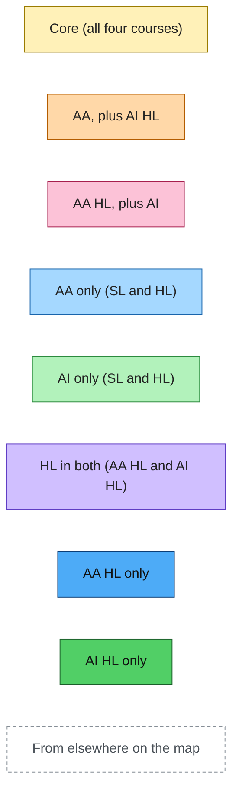

## Links between islands

Each arrow counts the prerequisite links from explainers on one island to explainers on another.

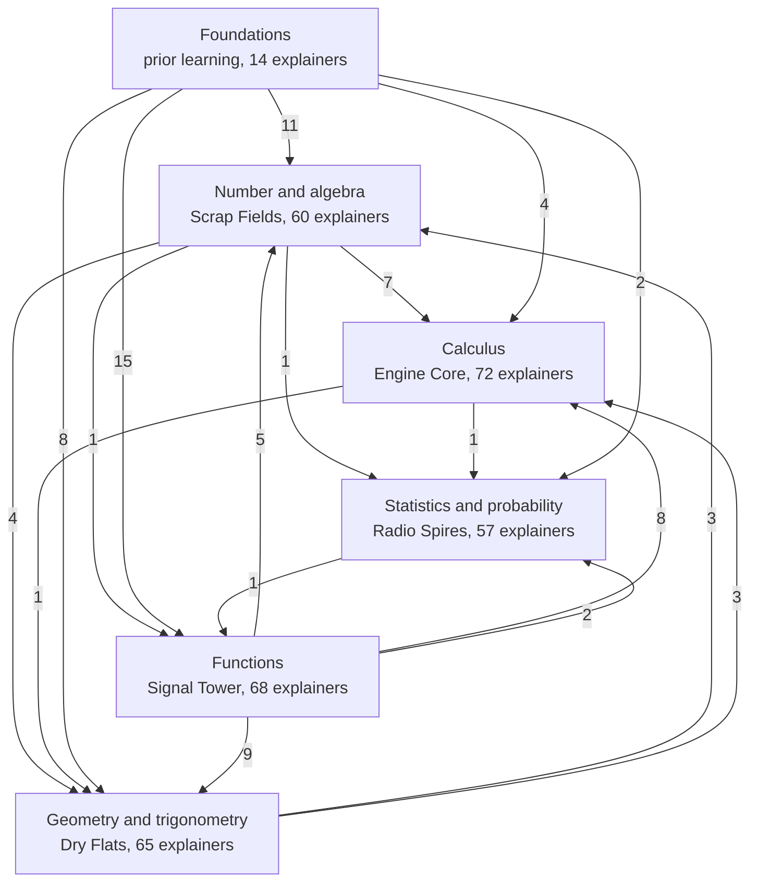

| From | To | Links | Examples |
|---|---|--:|---|
| Foundations | Functions | 15 | `foundations.pre-balance` → `functions.line-equation`, `foundations.pre-substitute` → `functions.function-machine`, `foundations.pre-linear-inequalities` → `functions.domain-range` |
| Foundations | Number and algebra | 11 | `foundations.pre-read-and-round` → `algebra.rounding-accuracy`, `foundations.pre-substitute` → `algebra.arithmetic-sequence`, `foundations.pre-balance` → `algebra.arithmetic-from-terms` |
| Functions | Geometry and trigonometry | 9 | `functions.perpendicular` → `geometry.perpendicular-bisector`, `functions.function-machine` → `geometry.wave-features`, `functions.transform-order` → `geometry.circular-graphs` |
| Foundations | Geometry and trigonometry | 8 | `foundations.pythagoras` → `geometry.right-trig`, `foundations.pythagoras` → `geometry.cosine-rule`, `foundations.distance-midpoint-2d` → `geometry.distance-3d` |
| Functions | Calculus | 8 | `functions.gradient` → `calculus.limits-and-gradient`, `functions.discriminant` → `calculus.monotonic-proof`, `functions.perpendicular` → `calculus.tangent-normal` |
| Number and algebra | Calculus | 7 | `algebra.exponent-laws` → `calculus.power-rule`, `algebra.exponent-laws` → `calculus.rewrite-then-integrate`, `algebra.induction` → `calculus.higher-derivatives` |
| Functions | Number and algebra | 5 | `functions.gdc-solve` → `algebra.arithmetic-sum-unknown`, `functions.gdc-solve` → `algebra.geometric-from-terms`, `functions.log-undoes-power` → `algebra.log-laws` |
| Number and algebra | Geometry and trigonometry | 4 | `algebra.lhs-to-rhs` → `geometry.prove-trig-identity`, `algebra.classify-systems` → `geometry.planes-intersect`, `algebra.matrix-arithmetic` → `geometry.matrix-transformations` |
| Foundations | Calculus | 4 | `foundations.pre-change-subject` → `calculus.build-optimisation-model`, `foundations.pre-simultaneous` → `calculus.stationary-conditions`, `foundations.pre-change-subject` → `calculus.area-y-axis` |
| Geometry and trigonometry | Number and algebra | 3 | `geometry.right-trig` → `algebra.argand-modulus`, `geometry.radian-measure` → `algebra.polar-form`, `geometry.wave-features` → `algebra.add-sinusoids` |
| Geometry and trigonometry | Calculus | 3 | `geometry.radian-measure` → `calculus.standard-derivatives`, `geometry.reciprocal-trig` → `calculus.further-derivatives`, `geometry.inverse-trig` → `calculus.further-derivatives` |
| Foundations | Statistics and probability | 2 | `foundations.pre-read-and-round` → `stats.averages`, `foundations.pre-simultaneous` → `stats.unknown-parameters` |
| Functions | Statistics and probability | 2 | `functions.line-model` → `stats.regression-line`, `functions.choose-a-model` → `stats.nonlinear-regression` |
| Number and algebra | Functions | 1 | `algebra.log-laws` → `functions.linearise-data` |
| Number and algebra | Statistics and probability | 1 | `algebra.matrix-arithmetic` → `stats.markov-chains` |
| Calculus | Geometry and trigonometry | 1 | `calculus.antiderivative` → `geometry.variable-velocity` |
| Calculus | Statistics and probability | 1 | `calculus.definite-integrals` → `stats.continuous-rv` |
| Statistics and probability | Functions | 1 | `stats.regression-line` → `functions.linearise-data` |

## Build order

An explainer always comes after its prerequisites. Among the explainers whose prerequisites are already placed, the next is the one with the most exam weight resting on it: its own **weighted exam parts** plus those of every explainer that needs it, directly or further on (the "Rests on it" column). An explainer's weighted parts are, for each AA SL exam type it prepares for, the type's parts in the bank times the share of the type it covers (its share of the type's skills, or for a lesson explainer the lesson's share of the exam unknowns, whichever is larger). Ties go to its own weight, then to the explainer more others need, then to the ID. Only AA SL types have parts in the bank so far, so AI-only and HL-only explainers have no weight of their own yet and come after the AA SL path; within a course, take this order and skip the explainers the course does not have.

| Rank | Explainer | Layer | Weighted parts | Rests on it | Explainers that need it | Builds on |
|--:|---|---|--:|--:|--:|---|
| 1 | Brackets Round Negatives (`foundations.pre-substitute`) | `core` | 0 | 701.1 | 185 | – |
| 2 | One In, One Out (`functions.function-machine`) | `core` | 21.4 | 533.3 | 125 | `foundations.pre-substitute` |
| 3 | Keep the Scales Level (`foundations.pre-balance`) | `core` | 0 | 448.2 | 134 | `foundations.pre-substitute` |
| 4 | Rise per Step (`functions.gradient`) | `core` | 3.3 | 327.9 | 114 | – |
| 5 | Read the Gauge (`foundations.pre-read-and-round`) | `core` | 0 | 268.2 | 67 | – |
| 6 | Pin and Swing (`functions.line-equation`) | `core` | 6.5 | 255.2 | 92 | `functions.gradient`, `foundations.pre-balance` |
| 7 | Powers Follow Laws (`algebra.exponent-laws`) | `core` | 0 | 235.6 | 83 | – |
| 8 | One Multiplication (`foundations.pre-percent-multiplier`) | `core` | 0 | 233 | 75 | – |
| 9 | Start Plus Rate (`functions.line-model`) | `core` | 0 | 220.4 | 68 | `functions.line-equation` |
| 10 | A Slice of the Circle (`geometry.arc-and-sector`) | `core` | 6.3 | 217.6 | 78 | – |
| 11 | From Chord to Tangent (`calculus.limits-and-gradient`) | `core` | 3.5 | 215.2 | 74 | `functions.gradient` |
| 12 | The Derivative as a Rate (`calculus.derivative-meaning`) | `core` | 5.5 | 211.7 | 71 | `calculus.limits-and-gradient` |
| 13 | Run It Backwards (`functions.inverse-undo`) | `core` | 5.6 | 207.3 | 64 | `functions.function-machine` |
| 14 | The Power Rule (`calculus.power-rule`) | `core` | 4 | 206.2 | 68 | `calculus.derivative-meaning`, `algebra.exponent-laws` |
| 15 | Radians (`geometry.radian-measure`) | `aa-ai-hl` | 9.3 | 204.3 | 76 | `geometry.arc-and-sector` |
| 16 | Multiply, Don't Add (`functions.growth-factor`) | `core` | 6.3 | 191.1 | 64 | `foundations.pre-percent-multiplier`, `functions.line-model` |
| 17 | What Power? (`functions.log-undoes-power`) | `core` | 13.7 | 178.5 | 57 | `functions.growth-factor`, `functions.inverse-undo` |
| 18 | Two Lamps, One Point (`foundations.pre-simultaneous`) | `core` | 0 | 142 | 35 | `foundations.pre-balance` |
| 19 | Fill the Rectangle (`foundations.pre-expand`) | `core` | 0 | 129.7 | 61 | – |
| 20 | The Square on the Long Side (`foundations.pythagoras`) | `core` | 0 | 123.9 | 64 | – |
| 21 | Derivatives of eˣ, ln x, sin x and cos x (`calculus.standard-derivatives`) | `aa-ai-hl` | 2 | 121.4 | 45 | `calculus.power-rule`, `functions.log-undoes-power`, `geometry.radian-measure` |
| 22 | Equally Likely Outcomes (`stats.probability-basics`) | `core` | 2.7 | 121 | 30 | – |
| 23 | An Angle Fixes a Ratio (`geometry.right-trig`) | `core` | 7.5 | 114.9 | 50 | `foundations.pythagoras` |
| 24 | Mean, Median and Mode (`stats.averages`) | `core` | 18 | 114.1 | 31 | `foundations.pre-read-and-round` |
| 25 | How High, and Where? (`functions.how-high-and-where`) | `core` | 19.8 | 112.3 | 28 | `functions.function-machine`, `foundations.pre-read-and-round` |
| 26 | Where the Tracks Cross (`functions.meeting-points`) | `core` | 13.4 | 104.6 | 17 | `functions.function-machine`, `foundations.pre-simultaneous` |
| 27 | The Broken Conveyor (`functions.translation`) | `aa-ai-hl` | 8.5 | 104.6 | 27 | `functions.function-machine` |
| 28 | Two Machines in a Row (`functions.composite`) | `aa-ai-hl` | 16.8 | 101.7 | 24 | `functions.function-machine` |
| 29 | Trees and Sample Spaces (`stats.tree-diagrams`) | `core` | 19 | 101 | 27 | `stats.probability-basics` |
| 30 | Find the Sides (`foundations.pre-factorise`) | `aa` | 0 | 93.4 | 29 | `foundations.pre-expand` |
| 31 | Gradient at a Point (`calculus.gradient-at-point`) | `core` | 5.7 | 86.5 | 20 | `calculus.power-rule` |
| 32 | The Chain Rule (`calculus.chain-rule`) | `aa-ai-hl` | 2 | 84.9 | 23 | `calculus.standard-derivatives`, `functions.composite` |
| 33 | Add the Same Each Step (`algebra.arithmetic-sequence`) | `core` | 4.8 | 75.2 | 23 | `foundations.pre-substitute` |
| 34 | The Tipping See-Saw (`foundations.pre-linear-inequalities`) | `core` | 0 | 68.2 | 22 | `foundations.pre-balance` |
| 35 | Undo the Derivative (`calculus.antiderivative`) | `core` | 6.9 | 68 | 29 | `calculus.power-rule` |
| 36 | Either Valve Shuts It (`functions.zero-product`) | `aa` | 13.7 | 64 | 18 | `foundations.pre-factorise` |
| 37 | The Fountain's Mirror (`functions.parabola-symmetry`) | `core` | 11 | 62.6 | 19 | `functions.how-high-and-where` |
| 38 | Quartiles and Standard Deviation (`stats.quartiles-spread`) | `core` | 6 | 61 | 22 | `stats.averages` |
| 39 | Velocity and Acceleration (`calculus.velocity-acceleration`) | `aa-ai-hl` | 17 | 60 | 2 | `calculus.derivative-meaning`, `calculus.chain-rule` |
| 40 | Integrals of eˣ, 1/x, sin and cos (`calculus.standard-integrals`) | `aa-ai-hl` | 1.4 | 59.3 | 23 | `calculus.antiderivative`, `calculus.standard-derivatives` |
| 41 | Uphill and Downhill (`calculus.increasing-decreasing`) | `core` | 4.3 | 56.4 | 11 | `calculus.gradient-at-point` |
| 42 | The Unit Circle (`geometry.unit-circle`) | `aa-ai-hl` | 1 | 53.9 | 22 | `geometry.radian-measure`, `geometry.right-trig` |
| 43 | Random Variables (`stats.random-variable`) | `core` | 14 | 51 | 16 | `stats.probability-basics`, `stats.tree-diagrams` |
| 44 | The Area Under a Curve (`calculus.definite-integral-area`) | `core` | 0 | 50 | 14 | `calculus.antiderivative` |
| 45 | Evaluating Definite Integrals (`calculus.definite-integrals`) | `aa-ai-hl` | 1.8 | 48.2 | 10 | `calculus.definite-integral-area`, `calculus.standard-integrals` |
| 46 | What Goes In, What Comes Out (`functions.domain-range`) | `core` | 8.9 | 45.6 | 18 | `functions.function-machine`, `foundations.pre-linear-inequalities` |
| 47 | The Spring Press (`functions.stretch`) | `aa-ai-hl` | 8.5 | 45 | 11 | `functions.translation` |
| 48 | Reading a Wave (`geometry.wave-features`) | `core` | 19 | 44 | 8 | `functions.function-machine` |
| 49 | Venn Diagrams (`stats.venn`) | `core` | 12 | 43 | 8 | `stats.probability-basics` |
| 50 | The Bell Curve (`stats.normal-curve`) | `core` | 6 | 43 | 16 | `stats.quartiles-spread` |
| 51 | Multiply the Same Each Step (`algebra.geometric-sequence`) | `core` | 2.3 | 41.9 | 13 | `algebra.arithmetic-sequence`, `foundations.pre-percent-multiplier` |
| 52 | When Algebra Jams (`functions.gdc-solve`) | `core` | 18.1 | 41.8 | 6 | `functions.meeting-points`, `foundations.pre-read-and-round` |
| 53 | Where the Gradient Is Zero (`calculus.stationary-points`) | `core` | 5 | 41 | 6 | `calculus.increasing-decreasing` |
| 54 | The Crane Hook (`functions.vertex-form`) | `aa` | 8.3 | 37.7 | 7 | `functions.translation`, `functions.parabola-symmetry` |
| 55 | Normal Probabilities (`stats.normal-probability`) | `core` | 16 | 37 | 15 | `stats.normal-curve` |
| 56 | Maximum or Minimum? (`calculus.classify-first-derivative`) | `core` | 5 | 36 | 4 | `calculus.stationary-points` |
| 57 | Flip Switches (`functions.reflection`) | `aa-ai-hl` | 3.3 | 36 | 15 | `functions.translation` |
| 58 | Correlation and r (`stats.correlation`) | `core` | 5.8 | 35.1 | 8 | `stats.averages` |
| 59 | Moves in Order (`functions.transform-order`) | `aa-ai-hl` | 4.7 | 32.7 | 9 | `functions.stretch`, `functions.reflection` |
| 60 | Adding Up an Arithmetic Sequence (`algebra.arithmetic-series`) | `core` | 4.8 | 32 | 16 | `algebra.arithmetic-sequence` |
| 61 | Given That (`stats.conditional-from-diagram`) | `core` | 0 | 31 | 7 | `stats.venn`, `stats.tree-diagrams` |
| 62 | Never Divide by Zero (`foundations.pre-algebraic-fractions`) | `aa` | 0 | 29.4 | 12 | `foundations.pre-factorise` |
| 63 | Divide by Almost Nothing (`functions.reciprocal`) | `aa` | 2.3 | 29.4 | 7 | `foundations.pre-algebraic-fractions`, `functions.function-machine` |
| 64 | The Line of Best Fit (`stats.regression-line`) | `core` | 24.3 | 29.3 | 4 | `stats.correlation`, `functions.line-model` |
| 65 | Make It the Subject (`foundations.pre-change-subject`) | `core` | 0 | 29 | 4 | `foundations.pre-balance` |
| 66 | The Quarter Turn (`functions.perpendicular`) | `core` | 3.9 | 28.3 | 11 | `functions.line-equation` |
| 67 | The Conditional Probability Formula (`stats.conditional-formula`) | `aa` | 21 | 27.7 | 2 | `stats.conditional-from-diagram` |
| 68 | Find the Walls (`functions.rational-asymptotes`) | `aa` | 20.4 | 27.1 | 5 | `functions.reciprocal` |
| 69 | Displacement or Distance? (`calculus.displacement-distance`) | `aa-ai-hl` | 26 | 26 | 0 | `calculus.velocity-acceleration`, `calculus.definite-integrals` |
| 70 | Greatest and Least on an Interval (`calculus.global-extremes`) | `core` | 0 | 26 | 2 | `calculus.classify-first-derivative` |
| 71 | Optimising a Given Model (`calculus.optimise-model`) | `core` | 5 | 26 | 1 | `calculus.global-extremes` |
| 72 | Transforming sin and cos (`geometry.circular-graphs`) | `aa-ai-hl` | 5 | 25 | 6 | `geometry.wave-features`, `geometry.unit-circle`, `functions.transform-order` |
| 73 | Tangents and Normals (`calculus.tangent-normal`) | `core` | 18.7 | 24.4 | 7 | `calculus.gradient-at-point`, `functions.perpendicular` |
| 74 | Expected Value (`stats.expected-value`) | `core` | 18 | 24.3 | 9 | `stats.random-variable` |
| 75 | Roots That Split (`foundations.pre-surds`) | `aa` | 0 | 23.1 | 4 | – |
| 76 | Two Clamps, One Centre (`functions.quadratic-formula`) | `aa` | 4 | 23.1 | 3 | `functions.zero-product`, `functions.parabola-symmetry`, `foundations.pre-surds` |
| 77 | Interest on Interest (`algebra.compound-interest`) | `core` | 16 | 23 | 3 | `algebra.geometric-sequence` |
| 78 | Below the Waterline (`functions.quadratic-inequality`) | `aa` | 7.5 | 22.6 | 5 | `functions.zero-product`, `foundations.pre-linear-inequalities`, `functions.parabola-symmetry` |
| 79 | Spot the Impostor (`functions.sketch-features`) | `core` | 21.1 | 21.1 | 8 | `functions.how-high-and-where`, `functions.domain-range` |
| 80 | Build the Model, Then Optimise (`calculus.build-optimisation-model`) | `core` | 21 | 21 | 0 | `calculus.optimise-model`, `foundations.pre-change-subject` |
| 81 | Arcs and Sectors in Radians (`geometry.arcs-in-radians`) | `aa-ai-hl` | 12.7 | 19.7 | 1 | `geometry.radian-measure` |
| 82 | Left Side to Right Side (`algebra.lhs-to-rhs`) | `aa` | 8.5 | 19.3 | 18 | `foundations.pre-expand` |
| 83 | Does It Reach the Floor? (`functions.discriminant`) | `aa` | 4.7 | 19.1 | 2 | `functions.quadratic-formula`, `functions.vertex-form` |
| 84 | Half ab sin C (`geometry.triangle-area`) | `core` | 12 | 19 | 2 | `geometry.right-trig` |
| 85 | Is It Binomial? (`stats.binomial-setup`) | `core` | 3.2 | 19 | 4 | `stats.random-variable` |
| 86 | cos² + sin² = 1 (`geometry.pythagorean-identity`) | `aa-ai-hl` | 2.3 | 18.9 | 9 | `geometry.unit-circle`, `foundations.pythagoras` |
| 87 | Area Below the Axis (`calculus.signed-area`) | `aa-ai-hl` | 1.8 | 18.6 | 4 | `calculus.definite-integrals` |
| 88 | The Cosine Rule (`geometry.cosine-rule`) | `core` | 14.7 | 17.4 | 12 | `geometry.right-trig`, `foundations.pythagoras` |
| 89 | Speed and Motion Graphs (`calculus.motion-graphs`) | `aa-ai-hl` | 17 | 17 | 0 | `calculus.velocity-acceleration` |
| 90 | Area Between Two Curves (`calculus.area-between-curves`) | `aa` | 16.8 | 16.8 | 1 | `calculus.signed-area`, `functions.meeting-points` |
| 91 | Adding Up a Geometric Sequence (`algebra.geometric-series`) | `core` | 5.3 | 16.6 | 8 | `algebra.geometric-sequence`, `algebra.arithmetic-series` |
| 92 | Double-Angle Identities (`geometry.double-angle`) | `aa` | 2.3 | 16.6 | 4 | `geometry.pythagorean-identity` |
| 93 | The Second Derivative (`calculus.second-derivative`) | `aa-ai-hl` | 1.7 | 16.1 | 9 | `calculus.chain-rule` |
| 94 | Inverse Normal (`stats.inverse-normal`) | `core` | 6 | 16 | 5 | `stats.normal-probability` |
| 95 | Pascal's Triangle and nCr (`algebra.pascal-ncr`) | `aa` | 2 | 16 | 9 | – |
| 96 | Cross-Section Times Length (`foundations.area-and-volume`) | `core` | 0 | 16 | 1 | – |
| 97 | Volume and Surface Area of Solids (`geometry.volume-surface`) | `core` | 16 | 16 | 0 | `foundations.area-and-volume` |
| 98 | Binomial Probabilities (`stats.binomial-probability`) | `core` | 9.5 | 15.8 | 2 | `stats.binomial-setup`, `stats.tree-diagrams` |
| 99 | Bring Down the Exponent (`functions.solve-with-logs`) | `aa-ai-hl` | 15.2 | 15.2 | 0 | `functions.log-undoes-power`, `foundations.pre-balance` |
| 100 | Find the Wave's Equation (`geometry.wave-from-graph`) | `aa-ai-hl` | 15 | 15 | 0 | `geometry.circular-graphs` |
| 101 | Standardising (`stats.z-scores`) | `aa` | 5 | 15 | 1 | `stats.normal-probability` |
| 102 | Exact Values (`geometry.exact-values`) | `aa` | 1 | 15 | 11 | `geometry.unit-circle` |
| 103 | Related Angles and the Quadrants (`geometry.related-angles`) | `aa` | 1 | 15 | 5 | `geometry.unit-circle` |
| 104 | The Laws of Logarithms (`algebra.log-laws`) | `aa-ai-hl` | 6 | 14.4 | 3 | `functions.log-undoes-power`, `algebra.exponent-laws` |
| 105 | Concave Up, Concave Down (`calculus.concavity`) | `aa-ai-hl` | 1.7 | 14.4 | 3 | `calculus.second-derivative`, `calculus.increasing-decreasing` |
| 106 | Every Solution in the Interval (`geometry.trig-equations`) | `aa` | 3 | 14 | 3 | `geometry.related-angles`, `geometry.exact-values` |
| 107 | Expanding (a + b)^n (`algebra.binomial-expansion`) | `aa` | 2 | 14 | 7 | `algebra.pascal-ncr`, `foundations.pre-expand` |
| 108 | Working Back from the Terms (`algebra.arithmetic-from-terms`) | `core` | 13.1 | 13.1 | 0 | `algebra.arithmetic-sequence`, `foundations.pre-balance`, `foundations.pre-simultaneous` |
| 109 | Tune k Until It Grazes (`functions.discriminant-parameter`) | `aa` | 12.7 | 12.7 | 0 | `functions.discriminant`, `functions.quadratic-inequality`, `functions.meeting-points` |
| 110 | One Term of an Expansion (`algebra.binomial-term`) | `aa` | 12 | 12 | 0 | `algebra.binomial-expansion`, `algebra.exponent-laws` |
| 111 | The Sine Rule (`geometry.sine-rule`) | `core` | 8.3 | 12 | 2 | `geometry.right-trig` |
| 112 | The Mirror Line (`functions.inverse-reflection`) | `core` | 8.2 | 12 | 3 | `functions.inverse-undo` |
| 113 | Who You Ask Matters (`stats.sampling`) | `core` | 2 | 12 | 4 | – |
| 114 | Angles in the Field (`geometry.elevation-bearings`) | `core` | 7.8 | 10.5 | 1 | `geometry.right-trig` |
| 115 | The Curve That Never Lands (`functions.exp-graph`) | `aa-ai-hl` | 6.3 | 10.1 | 2 | `functions.growth-factor`, `functions.translation` |
| 116 | Finding μ or σ (`stats.unknown-parameters`) | `aa` | 10 | 10 | 0 | `stats.z-scores`, `stats.inverse-normal`, `foundations.pre-simultaneous` |
| 117 | Types of Data and Bias (`stats.data-and-bias`) | `core` | 4 | 10 | 3 | `stats.sampling` |
| 118 | Independent Events (`stats.independence`) | `core` | 3.3 | 10 | 4 | `stats.conditional-from-diagram` |
| 119 | A Quadratic in Disguise (`functions.hidden-quadratic`) | `aa` | 2 | 10 | 1 | `functions.zero-product`, `functions.log-undoes-power` |
| 120 | Halfway and How Far (`foundations.distance-midpoint-2d`) | `core` | 0 | 10 | 24 | `foundations.pythagoras` |
| 121 | Distance and Midpoint in 3D (`geometry.distance-3d`) | `core` | 9 | 10 | 20 | `foundations.distance-midpoint-2d` |
| 122 | Box Plots and Outliers (`stats.box-plots`) | `core` | 9 | 9 | 0 | `stats.quartiles-spread` |
| 123 | Sweep the Beam (`functions.count-solutions`) | `core` | 8.8 | 8.8 | 0 | `functions.meeting-points`, `functions.how-high-and-where` |
| 124 | Does It Make Sense? (`functions.context-check`) | `core` | 8.6 | 8.6 | 1 | `functions.gdc-solve`, `functions.domain-range` |
| 125 | Change of Base (`algebra.change-of-base`) | `aa` | 8.4 | 8.4 | 0 | `algebra.log-laws` |
| 126 | Rewire the Machine (`functions.swap-and-solve`) | `aa-ai-hl` | 8 | 8 | 0 | `functions.inverse-undo`, `foundations.pre-change-subject` |
| 127 | Quadratics in sin and cos (`geometry.quadratic-in-trig`) | `aa` | 8 | 8 | 0 | `geometry.trig-equations`, `functions.hidden-quadratic`, `geometry.double-angle` |
| 128 | The Product Rule (`calculus.product-rule`) | `aa-ai-hl` | 2 | 8 | 8 | `calculus.standard-derivatives` |
| 129 | One More Bolt (`functions.quadratic-from-clues`) | `aa` | 7.3 | 7.3 | 0 | `functions.vertex-form`, `functions.zero-product`, `foundations.pre-simultaneous` |
| 130 | Losing Value (`algebra.depreciation-and-inflation`) | `core` | 7 | 7 | 0 | `algebra.compound-interest` |
| 131 | Sector from Two Conditions (`geometry.sector-two-conditions`) | `aa` | 7 | 7 | 0 | `geometry.arcs-in-radians`, `foundations.pre-simultaneous` |
| 132 | Segments and Shaded Regions (`geometry.segments`) | `core` | 7 | 7 | 0 | `geometry.arc-and-sector`, `geometry.triangle-area` |
| 133 | One Button, One Token (`functions.is-function`) | `core` | 0 | 7 | 6 | `functions.function-machine` |
| 134 | Cut It to Undo It (`functions.inverse-domain`) | `aa-ai-hl` | 7 | 7 | 5 | `functions.inverse-undo`, `functions.domain-range`, `functions.is-function` |
| 135 | Testing for Independence (`stats.test-independence`) | `aa` | 6.7 | 6.7 | 0 | `stats.conditional-formula`, `stats.independence` |
| 136 | Proving Trig Identities (`geometry.prove-trig-identity`) | `aa` | 6.3 | 6.3 | 1 | `geometry.double-angle`, `algebra.lhs-to-rhs` |
| 137 | Mean and Variance of a Binomial (`stats.binomial-mean-variance`) | `core` | 6.3 | 6.3 | 0 | `stats.binomial-probability`, `stats.expected-value` |
| 138 | When a Sum Settles Down (`algebra.convergence`) | `aa-ai-hl` | 1.5 | 6 | 6 | `algebra.geometric-series` |
| 139 | Histograms (`stats.histograms`) | `core` | 0 | 6 | 1 | `stats.data-and-bias` |
| 140 | Cumulative Frequency (`stats.cumulative-frequency`) | `core` | 6 | 6 | 0 | `stats.histograms` |
| 141 | Tangents That Meet Things (`calculus.tangent-problems`) | `core` | 5.7 | 5.7 | 0 | `calculus.tangent-normal`, `functions.meeting-points` |
| 142 | Find f from f′ (`calculus.function-from-derivative`) | `aa-ai-hl` | 5.5 | 5.5 | 4 | `calculus.standard-integrals` |
| 143 | Working Back to r and n (`algebra.geometric-from-terms`) | `core` | 5.3 | 5.3 | 0 | `algebra.geometric-sequence`, `algebra.geometric-series`, `functions.gdc-solve` |
| 144 | Probability in the Long Run (`stats.relative-frequency`) | `core` | 5.3 | 5.3 | 0 | `stats.probability-basics` |
| 145 | Points of Inflexion (`calculus.inflexion`) | `aa-ai-hl` | 5 | 5 | 0 | `calculus.concavity` |
| 146 | The Second Derivative Test (`calculus.second-derivative-test`) | `aa-ai-hl` | 5 | 5 | 0 | `calculus.concavity`, `calculus.classify-first-derivative` |
| 147 | Trig Equations on the GDC (`geometry.trig-equations-graphical`) | `aa-ai-hl` | 5 | 5 | 0 | `functions.gdc-solve`, `geometry.circular-graphs` |
| 148 | The Other Regression Line (`stats.x-on-y`) | `aa` | 5 | 5 | 0 | `stats.regression-line` |
| 149 | Working Back from a Sum (`algebra.arithmetic-sum-unknown`) | `core` | 4.8 | 4.8 | 0 | `algebra.arithmetic-series`, `functions.gdc-solve`, `foundations.pre-simultaneous` |
| 150 | Proofs About Whole Numbers (`algebra.integer-proof`) | `aa` | 4.5 | 4.5 | 3 | `algebra.lhs-to-rhs` |
| 151 | The Sum to Infinity (`algebra.sum-to-infinity`) | `aa-ai-hl` | 4.5 | 4.5 | 0 | `algebra.convergence` |
| 152 | The Quotient Rule (`calculus.quotient-rule`) | `aa-ai-hl` | 2 | 4 | 3 | `calculus.product-rule` |
| 153 | The Mirrored Curve (`functions.log-graph`) | `aa-ai-hl` | 3.8 | 3.8 | 1 | `functions.log-undoes-power`, `functions.inverse-reflection`, `functions.exp-graph` |
| 154 | 1/x in Disguise (`functions.transformed-reciprocal`) | `aa` | 3.8 | 3.8 | 0 | `functions.rational-asymptotes`, `functions.translation`, `functions.stretch` |
| 155 | Constant Change in Context (`algebra.arithmetic-model`) | `core` | 3.5 | 3.5 | 0 | `algebra.arithmetic-series` |
| 156 | Shift and Scale the Data (`stats.shift-and-scale`) | `core` | 3 | 3 | 6 | `stats.quartiles-spread` |
| 157 | The Missing Corner (`functions.complete-square`) | `aa` | 3 | 3 | 2 | `functions.vertex-form`, `foundations.pre-expand` |
| 158 | Stack the Heights (`functions.combine-functions`) | `core` | 3 | 3 | 0 | `functions.function-machine`, `functions.meeting-points` |
| 159 | Equations Like sin 2x = k (`geometry.trig-compound-argument`) | `aa` | 3 | 3 | 0 | `geometry.trig-equations`, `functions.transform-order` |
| 160 | Powers of Ten (`algebra.standard-form`) | `core` | 2 | 3 | 1 | – |
| 161 | The Level It Never Reaches (`functions.long-run-value`) | `aa` | 2.9 | 2.9 | 0 | `functions.rational-asymptotes` |
| 162 | Integrating f(ax + b) (`calculus.linear-composite-integrals`) | `aa-ai-hl` | 1.4 | 2.8 | 3 | `calculus.standard-integrals`, `calculus.chain-rule` |
| 163 | Graphs of f, f′ and f″ (`calculus.derivative-graphs`) | `aa` | 2.7 | 2.7 | 0 | `calculus.concavity` |
| 164 | Two Triangles, One Answer (`geometry.multi-triangle`) | `core` | 2.7 | 2.7 | 0 | `geometry.sine-rule`, `geometry.cosine-rule`, `geometry.elevation-bearings` |
| 165 | Above the Line (`functions.graph-inequality`) | `aa` | 2.4 | 2.4 | 3 | `functions.meeting-points`, `functions.quadratic-inequality` |
| 166 | Sigma Notation (`algebra.sigma-notation`) | `core` | 2.3 | 2.3 | 8 | `algebra.arithmetic-series` |
| 167 | Fractional Powers Are Roots (`algebra.rational-exponents`) | `aa-ai-hl` | 2 | 2 | 0 | `algebra.exponent-laws` |
| 168 | Using the Rules with Values (`calculus.rules-with-values`) | `aa-ai-hl` | 2 | 2 | 0 | `calculus.chain-rule`, `calculus.product-rule` |
| 169 | Show That the Derivative Is… (`calculus.show-derivative-form`) | `aa` | 2 | 2 | 0 | `calculus.quotient-rule`, `calculus.chain-rule` |
| 170 | Unknown Limits and Parameters (`calculus.integral-unknowns`) | `aa` | 1.8 | 1.8 | 0 | `calculus.definite-integrals` |
| 171 | Rate In, Total Out (`calculus.total-change`) | `core` | 1.8 | 1.8 | 0 | `calculus.definite-integral-area` |
| 172 | Always Increasing (`calculus.monotonic-proof`) | `aa` | 1.7 | 1.7 | 0 | `calculus.increasing-decreasing`, `functions.discriminant` |
| 173 | Spot the Derivative Inside (`calculus.inspection-substitution`) | `aa-ai-hl` | 1.4 | 1.4 | 2 | `calculus.linear-composite-integrals` |
| 174 | Rewrite, Then Integrate (`calculus.rewrite-then-integrate`) | `aa` | 1.4 | 1.4 | 0 | `calculus.standard-integrals`, `algebra.exponent-laws` |
| 175 | Calculating in Standard Form (`algebra.standard-form-arithmetic`) | `core` | 1 | 1 | 0 | `algebra.standard-form`, `algebra.exponent-laws` |
| 176 | The Ambiguous Case (`geometry.ambiguous-case`) | `aa-ai-hl` | 1 | 1 | 0 | `geometry.sine-rule`, `geometry.unit-circle` |
| 177 | Angles in 3D (`geometry.angles-3d`) | `core` | 1 | 1 | 0 | `geometry.right-trig`, `geometry.distance-3d` |
| 178 | Vectors and Components (`geometry.vectors-components`) | `hl` | 0 | 0 | 18 | `geometry.distance-3d` |
| 179 | The Number i (`algebra.complex-cartesian`) | `hl` | 0 | 0 | 12 | `foundations.pre-expand` |
| 180 | Matrices and Multiplication (`algebra.matrix-arithmetic`) | `ai-hl` | 0 | 0 | 12 | – |
| 181 | Writing a Differential Equation (`calculus.form-differential-equation`) | `hl` | 0 | 0 | 11 | `calculus.derivative-meaning` |
| 182 | The Vector Equation of a Line (`geometry.vector-line`) | `hl` | 0 | 0 | 11 | `geometry.vectors-components`, `functions.line-equation` |
| 183 | The Scalar Product (`geometry.scalar-product`) | `hl` | 0 | 0 | 10 | `geometry.vectors-components`, `geometry.cosine-rule` |
| 184 | Systems on the GDC (`algebra.linear-systems-technology`) | `aa-hl-ai` | 0 | 0 | 9 | `foundations.pre-simultaneous` |
| 185 | The Argand Diagram (`algebra.argand-modulus`) | `hl` | 0 | 0 | 8 | `algebra.complex-cartesian`, `geometry.right-trig` |
| 186 | Factor and Remainder Theorems (`functions.factor-remainder`) | `aa-hl` | 0 | 0 | 8 | `functions.zero-product` |
| 187 | Hypotheses and p-Values (`stats.hypothesis-test-idea`) | `ai` | 0 | 0 | 8 | `stats.normal-probability` |
| 188 | Proof by Induction (`algebra.induction`) | `aa-hl` | 0 | 0 | 7 | `algebra.lhs-to-rhs`, `algebra.sigma-notation` |
| 189 | Modulus and Argument Form (`algebra.polar-form`) | `hl` | 0 | 0 | 7 | `algebra.argand-modulus`, `geometry.radian-measure` |
| 190 | Factorise and Sketch Polynomials (`functions.factorise-polynomials`) | `aa-hl` | 0 | 0 | 6 | `functions.factor-remainder`, `functions.sketch-features` |
| 191 | The Vector Product (`geometry.vector-product`) | `hl` | 0 | 0 | 6 | `geometry.scalar-product` |
| 192 | Undoing a Matrix (`algebra.matrix-inverse`) | `ai-hl` | 0 | 0 | 5 | `algebra.matrix-arithmetic`, `algebra.linear-systems-technology` |
| 193 | Multiply Means Rotate and Stretch (`algebra.polar-multiply`) | `hl` | 0 | 0 | 5 | `algebra.polar-form`, `algebra.exponent-laws` |
| 194 | Vertices and Edges (`geometry.graph-basics`) | `ai-hl` | 0 | 0 | 5 | – |
| 195 | Scaling a Random Variable (`stats.linear-transform-rv`) | `hl` | 0 | 0 | 5 | `stats.expected-value`, `stats.shift-and-scale` |
| 196 | Binomial Series for Any Power (`algebra.binomial-rational`) | `aa-hl` | 0 | 0 | 4 | `algebra.binomial-expansion`, `algebra.convergence` |
| 197 | True for Every x (`algebra.compare-coefficients`) | `aa` | 0 | 0 | 4 | `algebra.lhs-to-rhs` |
| 198 | Eigenvalues and Eigenvectors (`algebra.eigenvalues`) | `ai-hl` | 0 | 0 | 4 | `algebra.matrix-inverse` |
| 199 | Euler's Method (`calculus.euler-method`) | `hl` | 0 | 0 | 4 | `calculus.form-differential-equation`, `calculus.tangent-normal` |
| 200 | Higher Derivatives (`calculus.higher-derivatives`) | `aa-hl` | 0 | 0 | 4 | `calculus.second-derivative`, `algebra.induction` |
| 201 | Quadratic Models on the GDC (`functions.quadratic-model`) | `ai` | 0 | 0 | 4 | `functions.parabola-symmetry`, `functions.how-high-and-where` |
| 202 | The Equation of a Plane (`geometry.plane-equation`) | `aa-hl` | 0 | 0 | 4 | `geometry.vector-product`, `geometry.vector-line` |
| 203 | sec, cosec and cot (`geometry.reciprocal-trig`) | `aa-hl` | 0 | 0 | 4 | `geometry.pythagorean-identity`, `geometry.exact-values` |
| 204 | Combining Random Variables (`stats.combining-rvs`) | `ai-hl` | 0 | 0 | 4 | `stats.linear-transform-rv` |
| 205 | De Moivre's Theorem (`algebra.de-moivre`) | `hl` | 0 | 0 | 3 | `algebra.polar-multiply` |
| 206 | Split the Fraction (`algebra.partial-fractions`) | `aa-hl` | 0 | 0 | 3 | `algebra.compare-coefficients`, `foundations.pre-algebraic-fractions` |
| 207 | Coupled Systems (`calculus.coupled-euler`) | `ai-hl` | 0 | 0 | 3 | `calculus.euler-method` |
| 208 | Maclaurin Series (`calculus.maclaurin`) | `aa-hl` | 0 | 0 | 3 | `calculus.higher-derivatives`, `algebra.binomial-rational` |
| 209 | Separating the Variables (`calculus.separate-variables`) | `hl` | 0 | 0 | 3 | `calculus.form-differential-equation`, `calculus.function-from-derivative` |
| 210 | Which Model Fits? (`functions.choose-a-model`) | `ai` | 0 | 0 | 3 | `functions.line-model`, `functions.growth-factor`, `functions.quadratic-model` |
| 211 | arcsin, arccos and arctan (`geometry.inverse-trig`) | `aa-hl` | 0 | 0 | 3 | `functions.inverse-domain`, `geometry.circular-graphs` |
| 212 | Adding Normal Variables (`stats.combine-normals`) | `ai-hl` | 0 | 0 | 3 | `stats.combining-rvs`, `stats.normal-probability` |
| 213 | Critical Regions and Errors (`stats.critical-regions`) | `ai-hl` | 0 | 0 | 3 | `stats.hypothesis-test-idea`, `stats.inverse-normal` |
| 214 | Elimination by Hand (`algebra.elimination-3x3`) | `aa-hl` | 0 | 0 | 2 | `algebra.linear-systems-technology` |
| 215 | Continuity and Differentiability (`calculus.continuity-limits`) | `aa-hl` | 0 | 0 | 2 | `calculus.limits-and-gradient` |
| 216 | Exact Solutions with Eigenvalues (`calculus.coupled-exact`) | `ai-hl` | 0 | 0 | 2 | `calculus.coupled-euler`, `algebra.eigenvalues` |
| 217 | Further Standard Derivatives (`calculus.further-derivatives`) | `aa-hl` | 0 | 0 | 2 | `calculus.chain-rule`, `geometry.reciprocal-trig`, `geometry.inverse-trig` |
| 218 | Volume of Revolution About the x-Axis (`calculus.volume-x-axis`) | `hl` | 0 | 0 | 2 | `calculus.definite-integrals` |
| 219 | Odd and Even Functions (`functions.odd-even`) | `aa-hl` | 0 | 0 | 2 | `functions.reflection` |
| 220 | Polynomial Inequalities (`functions.polynomial-inequality`) | `aa-hl` | 0 | 0 | 2 | `functions.graph-inequality`, `functions.factorise-polynomials` |
| 221 | Quadratic over Linear, Linear over Quadratic (`functions.rational-quadratic`) | `aa-hl` | 0 | 0 | 2 | `functions.rational-asymptotes`, `functions.factorise-polynomials` |
| 222 | Parallel and Collinear (`geometry.parallel-vectors`) | `hl` | 0 | 0 | 2 | `geometry.vectors-components` |
| 223 | Equally Far from Both (`geometry.perpendicular-bisector`) | `ai` | 0 | 0 | 2 | `functions.perpendicular`, `foundations.distance-midpoint-2d` |
| 224 | Motion with Constant Velocity (`geometry.vector-kinematics`) | `hl` | 0 | 0 | 2 | `geometry.vector-line` |
| 225 | χ² Test for Independence (`stats.chi-squared-independence`) | `ai` | 0 | 0 | 2 | `stats.hypothesis-test-idea`, `stats.independence` |
| 226 | The Poisson Distribution (`stats.poisson`) | `ai-hl` | 0 | 0 | 2 | `stats.random-variable` |
| 227 | The Central Limit Theorem (`stats.sample-mean-clt`) | `ai-hl` | 0 | 0 | 2 | `stats.combine-normals` |
| 228 | Paying Off a Loan (`algebra.amortisation`) | `ai` | 0 | 0 | 1 | `algebra.compound-interest` |
| 229 | One, None or Infinitely Many (`algebra.classify-systems`) | `aa-hl` | 0 | 0 | 1 | `algebra.elimination-3x3` |
| 230 | Roots Below the Axis (`algebra.complex-quadratic-roots`) | `hl` | 0 | 0 | 1 | `algebra.complex-cartesian` |
| 231 | Multiply the Choices (`algebra.counting-principle`) | `aa-hl` | 0 | 0 | 1 | – |
| 232 | Sensible Accuracy (`algebra.rounding-accuracy`) | `ai` | 0 | 0 | 1 | `foundations.pre-read-and-round` |
| 233 | Area Against the y-Axis (`calculus.area-y-axis`) | `hl` | 0 | 0 | 1 | `calculus.signed-area`, `foundations.pre-change-subject` |
| 234 | Integration by Parts (`calculus.by-parts`) | `aa-hl` | 0 | 0 | 1 | `calculus.standard-integrals`, `calculus.product-rule` |
| 235 | Further Standard Integrals (`calculus.further-integrals`) | `aa-hl` | 0 | 0 | 1 | `calculus.further-derivatives`, `calculus.standard-integrals`, `algebra.partial-fractions`, `functions.complete-square` |
| 236 | L'Hôpital's Rule (`calculus.lhopital`) | `aa-hl` | 0 | 0 | 1 | `calculus.continuity-limits`, `calculus.quotient-rule` |
| 237 | Phase Portraits (`calculus.phase-portraits`) | `ai-hl` | 0 | 0 | 1 | `calculus.coupled-exact` |
| 238 | Integration by Substitution (`calculus.substitution`) | `aa-hl` | 0 | 0 | 1 | `calculus.inspection-substitution` |
| 239 | The Trapezoidal Rule (`calculus.trapezoidal-rule`) | `ai` | 0 | 0 | 1 | `calculus.definite-integral-area` |
| 240 | Logarithmic Scales (`functions.log-scales`) | `ai-hl` | 0 | 0 | 1 | `functions.log-undoes-power` |
| 241 | The Modulus Graphs (`functions.modulus-graphs`) | `aa-hl` | 0 | 0 | 1 | `functions.reflection` |
| 242 | Adjacency Matrices and Walks (`geometry.adjacency-walks`) | `ai-hl` | 0 | 0 | 1 | `geometry.graph-basics`, `algebra.matrix-arithmetic` |
| 243 | The Angle Between Two Lines (`geometry.angle-between-lines`) | `aa-hl` | 0 | 0 | 1 | `geometry.vector-line`, `geometry.scalar-product` |
| 244 | Compound Angle Formulae (`geometry.compound-angles`) | `aa-hl` | 0 | 0 | 1 | `geometry.exact-values` |
| 245 | Do Two Lines Meet? (`geometry.lines-intersect`) | `aa-hl` | 0 | 0 | 1 | `geometry.vector-line`, `foundations.pre-simultaneous` |
| 246 | Matrices Move the Plane (`geometry.matrix-transformations`) | `ai-hl` | 0 | 0 | 1 | `algebra.matrix-arithmetic` |
| 247 | Minimum Spanning Trees (`geometry.spanning-trees`) | `ai-hl` | 0 | 0 | 1 | `geometry.graph-basics` |
| 248 | Symmetries of the Trig Graphs (`geometry.trig-symmetry`) | `aa-hl` | 0 | 0 | 1 | `geometry.related-angles`, `functions.odd-even` |
| 249 | Voronoi Diagrams (`geometry.voronoi`) | `ai` | 0 | 0 | 1 | `geometry.perpendicular-bisector` |
| 250 | χ² Goodness of Fit (`stats.chi-squared-gof`) | `ai` | 0 | 0 | 1 | `stats.chi-squared-independence` |
| 251 | Probability Density Functions (`stats.continuous-rv`) | `aa-hl` | 0 | 0 | 1 | `stats.random-variable`, `calculus.definite-integrals` |
| 252 | Variance of a Discrete Variable (`stats.discrete-variance`) | `aa-hl` | 0 | 0 | 1 | `stats.expected-value` |
| 253 | Transition Matrices (`stats.markov-chains`) | `ai-hl` | 0 | 0 | 1 | `algebra.matrix-arithmetic`, `stats.tree-diagrams` |
| 254 | Non-Linear Regression (`stats.nonlinear-regression`) | `ai-hl` | 0 | 0 | 1 | `stats.regression-line`, `functions.choose-a-model` |
| 255 | Spearman's Rank (`stats.spearman`) | `ai` | 0 | 0 | 1 | `stats.correlation` |
| 256 | Unbiased Estimates (`stats.unbiased-estimates`) | `ai-hl` | 0 | 0 | 1 | `stats.quartiles-spread` |
| 257 | Adding Waves with Complex Numbers (`algebra.add-sinusoids`) | `ai-hl` | 0 | 0 | 0 | `algebra.polar-form`, `geometry.wave-features` |
| 258 | Saving Up and Paying Out (`algebra.annuities`) | `ai` | 0 | 0 | 0 | `algebra.amortisation` |
| 259 | Bounds and Percentage Error (`algebra.bounds-and-error`) | `ai` | 0 | 0 | 0 | `algebra.rounding-accuracy` |
| 260 | Same Base, Same Power (`algebra.common-base`) | `aa` | 0 | 0 | 0 | `algebra.exponent-laws` |
| 261 | Conjugate Root Pairs (`algebra.conjugate-roots`) | `aa-hl` | 0 | 0 | 0 | `algebra.complex-quadratic-roots`, `functions.factor-remainder` |
| 262 | Proof by Contradiction (`algebra.contradiction`) | `aa-hl` | 0 | 0 | 0 | `algebra.integer-proof` |
| 263 | One Counterexample Is Enough (`algebra.counterexample`) | `aa-hl` | 0 | 0 | 0 | `algebra.integer-proof` |
| 264 | Proving De Moivre (`algebra.de-moivre-proof`) | `aa-hl` | 0 | 0 | 0 | `algebra.de-moivre`, `algebra.induction` |
| 265 | Diagonalising for Powers (`algebra.diagonalise`) | `ai-hl` | 0 | 0 | 0 | `algebra.eigenvalues` |
| 266 | Equate Real and Imaginary Parts (`algebra.equate-parts`) | `aa-hl` | 0 | 0 | 0 | `algebra.complex-cartesian` |
| 267 | Sums in Euler Form (`algebra.euler-sums`) | `aa-hl` | 0 | 0 | 0 | `algebra.polar-multiply` |
| 268 | Induction Beyond Series (`algebra.induction-divisibility`) | `aa-hl` | 0 | 0 | 0 | `algebra.induction`, `algebra.integer-proof` |
| 269 | Solving Log Equations (`algebra.log-equations`) | `aa-ai-hl` | 0 | 0 | 0 | `algebra.log-laws` |
| 270 | Multiple-Angle Identities (`algebra.multiple-angle`) | `aa-hl` | 0 | 0 | 0 | `algebra.de-moivre`, `algebra.binomial-expansion` |
| 271 | The nth Roots (`algebra.nth-roots`) | `aa-hl` | 0 | 0 | 0 | `algebra.de-moivre` |
| 272 | Order Matters, or It Doesn't (`algebra.permutations-combinations`) | `aa-hl` | 0 | 0 | 0 | `algebra.counting-principle`, `algebra.pascal-ncr` |
| 273 | Polynomial Roots on the GDC (`algebra.polynomial-roots-gdc`) | `ai` | 0 | 0 | 0 | `functions.gdc-solve` |
| 274 | Which Integration Technique? (`calculus.choose-technique`) | `aa-hl` | 0 | 0 | 0 | `calculus.substitution`, `calculus.by-parts`, `calculus.further-integrals` |
| 275 | Differentiation from First Principles (`calculus.first-principles`) | `aa-hl` | 0 | 0 | 0 | `calculus.limits-and-gradient`, `foundations.pre-expand` |
| 276 | Homogeneous Equations (`calculus.homogeneous-de`) | `aa-hl` | 0 | 0 | 0 | `calculus.separate-variables` |
| 277 | Implicit Differentiation (`calculus.implicit-differentiation`) | `aa-hl` | 0 | 0 | 0 | `calculus.chain-rule`, `calculus.tangent-normal` |
| 278 | The Integrating Factor (`calculus.integrating-factor`) | `aa-hl` | 0 | 0 | 0 | `calculus.separate-variables`, `calculus.product-rule` |
| 279 | Limits by Maclaurin Series (`calculus.limits-by-maclaurin`) | `aa-hl` | 0 | 0 | 0 | `calculus.maclaurin`, `calculus.lhopital` |
| 280 | The Logistic Equation (`calculus.logistic-de`) | `aa-hl` | 0 | 0 | 0 | `calculus.separate-variables`, `algebra.partial-fractions` |
| 281 | Building New Series (`calculus.maclaurin-manipulate`) | `aa-hl` | 0 | 0 | 0 | `calculus.maclaurin` |
| 282 | Related Rates (`calculus.related-rates`) | `hl` | 0 | 0 | 0 | `calculus.chain-rule` |
| 283 | Second-Order Equations (`calculus.second-order-de`) | `ai-hl` | 0 | 0 | 0 | `calculus.coupled-euler`, `calculus.phase-portraits` |
| 284 | Series from a Differential Equation (`calculus.series-from-de`) | `aa-hl` | 0 | 0 | 0 | `calculus.maclaurin`, `calculus.form-differential-equation` |
| 285 | Slope Fields (`calculus.slope-fields`) | `ai-hl` | 0 | 0 | 0 | `calculus.form-differential-equation` |
| 286 | Stationary Points with Unknowns (`calculus.stationary-conditions`) | `aa` | 0 | 0 | 0 | `calculus.stationary-points`, `foundations.pre-simultaneous` |
| 287 | Over or Under? (`calculus.trapezoid-accuracy`) | `ai` | 0 | 0 | 0 | `calculus.trapezoidal-rule` |
| 288 | Volumes Between Two Curves (`calculus.volume-between-curves`) | `aa-hl` | 0 | 0 | 0 | `calculus.volume-x-axis`, `calculus.area-between-curves` |
| 289 | Volume of Revolution About the y-Axis (`calculus.volume-y-axis`) | `hl` | 0 | 0 | 0 | `calculus.volume-x-axis`, `calculus.area-y-axis` |
| 290 | Cubic Models (`functions.cubic-model`) | `ai` | 0 | 0 | 0 | `functions.how-high-and-where` |
| 291 | Fit It, Then Use It (`functions.fit-and-use-model`) | `ai` | 0 | 0 | 0 | `functions.choose-a-model`, `functions.context-check` |
| 292 | Half-Life and Decay (`functions.half-life`) | `ai-hl` | 0 | 0 | 0 | `functions.growth-factor`, `functions.log-undoes-power` |
| 293 | The Graph of f(ax + b) (`functions.linear-input`) | `aa-hl` | 0 | 0 | 0 | `functions.transform-order` |
| 294 | Straighten the Data (`functions.linearise-data`) | `ai-hl` | 0 | 0 | 0 | `functions.log-scales`, `algebra.log-laws`, `stats.regression-line` |
| 295 | Logarithmic Models (`functions.log-model`) | `ai-hl` | 0 | 0 | 0 | `functions.log-graph` |
| 296 | Growth with a Ceiling (`functions.logistic-model`) | `ai-hl` | 0 | 0 | 0 | `functions.growth-factor` |
| 297 | Modulus Equations and Inequalities (`functions.modulus-equations`) | `aa-hl` | 0 | 0 | 0 | `functions.modulus-graphs`, `functions.polynomial-inequality` |
| 298 | Slanted Asymptotes (`functions.oblique-asymptote`) | `aa-hl` | 0 | 0 | 0 | `functions.rational-quadratic` |
| 299 | Piecewise Models (`functions.piecewise-model`) | `ai-hl` | 0 | 0 | 0 | `functions.domain-range`, `functions.line-model` |
| 300 | Rational Inequalities (`functions.rational-inequality`) | `aa-hl` | 0 | 0 | 0 | `functions.polynomial-inequality`, `functions.rational-quadratic` |
| 301 | Graphs of 1/f(x) and [f(x)]² (`functions.reciprocal-of-f`) | `aa-hl` | 0 | 0 | 0 | `functions.reciprocal`, `functions.sketch-features` |
| 302 | Restrict, Then Invert (`functions.restrict-for-inverse`) | `aa-hl` | 0 | 0 | 0 | `functions.inverse-domain` |
| 303 | Self-Inverse Functions (`functions.self-inverse`) | `aa-hl` | 0 | 0 | 0 | `functions.inverse-reflection` |
| 304 | Sum and Product of Roots (`functions.sum-product-roots`) | `aa-hl` | 0 | 0 | 0 | `functions.factorise-polynomials` |
| 305 | Power and Variation Models (`functions.variation-model`) | `ai` | 0 | 0 | 0 | `functions.function-machine` |
| 306 | Angles with Planes (`geometry.angles-planes`) | `aa-hl` | 0 | 0 | 0 | `geometry.plane-equation`, `geometry.angle-between-lines` |
| 307 | Closest Approach (`geometry.closest-approach`) | `hl` | 0 | 0 | 0 | `geometry.vector-kinematics`, `geometry.scalar-product` |
| 308 | Combining Transformations (`geometry.compose-transformations`) | `ai-hl` | 0 | 0 | 0 | `geometry.matrix-transformations` |
| 309 | Doubles from Compounds (`geometry.double-from-compound`) | `aa-hl` | 0 | 0 | 0 | `geometry.compound-angles`, `geometry.double-angle` |
| 310 | Eulerian Trails and the Chinese Postman (`geometry.eulerian-routes`) | `ai-hl` | 0 | 0 | 0 | `geometry.graph-basics` |
| 311 | Random Walks on a Graph (`geometry.graph-transition`) | `ai-hl` | 0 | 0 | 0 | `geometry.adjacency-walks` |
| 312 | Where a Line Meets a Plane (`geometry.line-meets-plane`) | `aa-hl` | 0 | 0 | 0 | `geometry.plane-equation` |
| 313 | Planes from Conditions (`geometry.plane-conditions`) | `aa-hl` | 0 | 0 | 0 | `geometry.plane-equation` |
| 314 | Where Planes Meet (`geometry.planes-intersect`) | `aa-hl` | 0 | 0 | 0 | `geometry.plane-equation`, `algebra.classify-systems` |
| 315 | Using the New Identities (`geometry.reciprocal-identities`) | `aa-hl` | 0 | 0 | 0 | `geometry.reciprocal-trig`, `geometry.prove-trig-identity` |
| 316 | Properties of the Scalar Product (`geometry.scalar-product-properties`) | `aa-hl` | 0 | 0 | 0 | `geometry.scalar-product` |
| 317 | Skew Lines (`geometry.skew-lines`) | `aa-hl` | 0 | 0 | 0 | `geometry.lines-intersect`, `geometry.parallel-vectors` |
| 318 | Solutions from Symmetry (`geometry.symmetric-solutions`) | `aa-hl` | 0 | 0 | 0 | `geometry.trig-symmetry`, `geometry.trig-equations` |
| 319 | The Travelling Salesman (`geometry.travelling-salesman`) | `ai-hl` | 0 | 0 | 0 | `geometry.spanning-trees` |
| 320 | Variable Velocity in the Plane (`geometry.variable-velocity`) | `ai-hl` | 0 | 0 | 0 | `geometry.vector-kinematics`, `calculus.antiderivative` |
| 321 | Proofs with Vectors (`geometry.vector-geometry`) | `aa-hl` | 0 | 0 | 0 | `geometry.parallel-vectors` |
| 322 | Areas from the Vector Product (`geometry.vector-product-area`) | `hl` | 0 | 0 | 0 | `geometry.vector-product`, `geometry.triangle-area` |
| 323 | Using a Voronoi Diagram (`geometry.voronoi-problems`) | `ai` | 0 | 0 | 0 | `geometry.voronoi` |
| 324 | Bayes' Theorem (`stats.bayes`) | `aa-hl` | 0 | 0 | 0 | `stats.conditional-formula`, `stats.tree-diagrams` |
| 325 | Degrees of Freedom and Merged Cells (`stats.chi-squared-refinements`) | `ai-hl` | 0 | 0 | 0 | `stats.chi-squared-gof` |
| 326 | Pearson or Spearman? (`stats.choose-coefficient`) | `ai` | 0 | 0 | 0 | `stats.spearman` |
| 327 | How Good Is the Fit? (`stats.coefficient-determination`) | `ai-hl` | 0 | 0 | 0 | `stats.nonlinear-regression` |
| 328 | Confidence Intervals (`stats.confidence-intervals`) | `ai-hl` | 0 | 0 | 0 | `stats.sample-mean-clt`, `stats.unbiased-estimates` |
| 329 | Mean, Median and Mode of a pdf (`stats.continuous-mean-median`) | `aa-hl` | 0 | 0 | 0 | `stats.continuous-rv`, `stats.discrete-variance` |
| 330 | Testing a Correlation (`stats.correlation-test`) | `ai-hl` | 0 | 0 | 0 | `stats.critical-regions`, `stats.correlation` |
| 331 | Using the Poisson Model (`stats.poisson-applications`) | `ai-hl` | 0 | 0 | 0 | `stats.poisson`, `stats.binomial-setup` |
| 332 | The Steady State (`stats.steady-state`) | `ai-hl` | 0 | 0 | 0 | `stats.markov-chains` |
| 333 | Designing a Data Collection (`stats.survey-design`) | `ai-hl` | 0 | 0 | 0 | `stats.data-and-bias` |
| 334 | The t-Test (`stats.t-test`) | `ai` | 0 | 0 | 0 | `stats.hypothesis-test-idea` |
| 335 | Testing a Mean (`stats.test-mean`) | `ai-hl` | 0 | 0 | 0 | `stats.critical-regions`, `stats.sample-mean-clt` |
| 336 | Testing a Proportion or a Rate (`stats.test-proportion-rate`) | `ai-hl` | 0 | 0 | 0 | `stats.critical-regions`, `stats.binomial-probability`, `stats.poisson` |

## Foundations (`foundations`, prior learning)

14 explainers, narrated by the foundations tutor (`tin-can-tess` in `tools/explainer-clips/teachers.json`).

### Algebra toolkit

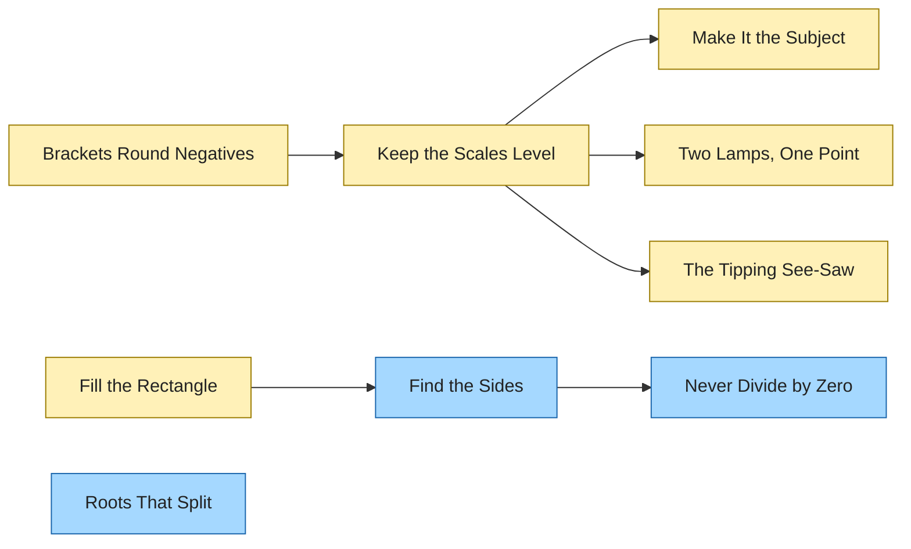

| Explainer | Idea | Courses | Syllabus | Builds on | Methods | Lesson |
|---|---|---|---|---|---|---|
| **Brackets Round Negatives**<br/>`foundations.pre-substitute` | Substitute a value into an expression by putting it in brackets, so a negative input is squared or multiplied correctly. | AA SL, AA HL, AI SL, AI HL | SL2.2 | – | – | Brackets Round Negatives (`lesson.fn.pre-substitute`) |
| **Keep the Scales Level**<br/>`foundations.pre-balance` | Solve a linear equation by doing the same thing to both sides until the unknown stands alone. | AA SL, AA HL, AI SL, AI HL | SL2.1 | `foundations.pre-substitute` | – | Keep the Scales Level (`lesson.fn.pre-balance`) |
| **Make It the Subject**<br/>`foundations.pre-change-subject` | Rearrange a formula to make another letter the subject by undoing its operations in reverse order. | AA SL, AA HL, AI SL, AI HL | SL2.5, SL2.1 | `foundations.pre-balance` | – | Make It the Subject (`lesson.fn.pre-change-subject`) |
| **Two Lamps, One Point**<br/>`foundations.pre-simultaneous` | Solve two linear equations together by substitution or elimination, and read the answer as the point where two lines cross. | AA SL, AA HL, AI SL, AI HL | SL2.1, AI-SL1.8 | `foundations.pre-balance` | substitution, elimination | Two Lamps, One Point (`lesson.fn.pre-simultaneous`) |
| **The Tipping See-Saw**<br/>`foundations.pre-linear-inequalities` | Solve a linear inequality like an equation, flipping the sign whenever both sides are multiplied or divided by a negative. | AA SL, AA HL, AI SL, AI HL | SL2.7, SL2.2 | `foundations.pre-balance` | – | The Tipping See-Saw (`lesson.fn.pre-linear-inequalities`) |
| **Fill the Rectangle**<br/>`foundations.pre-expand` | Expand brackets by multiplying every term in one bracket by every term in the other, as the areas of a split rectangle. | AA SL, AA HL, AI SL, AI HL | SL2.6, AI-SL2.5 | – | – | Fill the Rectangle (`lesson.fn.pre-expand`) |
| **Find the Sides**<br/>`foundations.pre-factorise` | Factorise a quadratic by finding the two brackets whose product it is, undoing expansion. | AA SL, AA HL | SL2.6, SL2.7 | `foundations.pre-expand` | – | Find the Sides (`lesson.fn.pre-factorise`) |
| **Roots That Split**<br/>`foundations.pre-surds` | Simplify a surd by taking out square factors, so answers like √48 become 4√3. | AA SL, AA HL | SL2.7 | – | – | Roots That Split (`lesson.fn.pre-surds`) |
| **Never Divide by Zero**<br/>`foundations.pre-algebraic-fractions` | Simplify an algebraic fraction by cancelling common factors, never terms, and note the values that make the denominator zero. | AA SL, AA HL | SL2.8 | `foundations.pre-factorise` | – | Never Divide by Zero (`lesson.fn.pre-algebraic-fractions`) |

### Number and measure toolkit

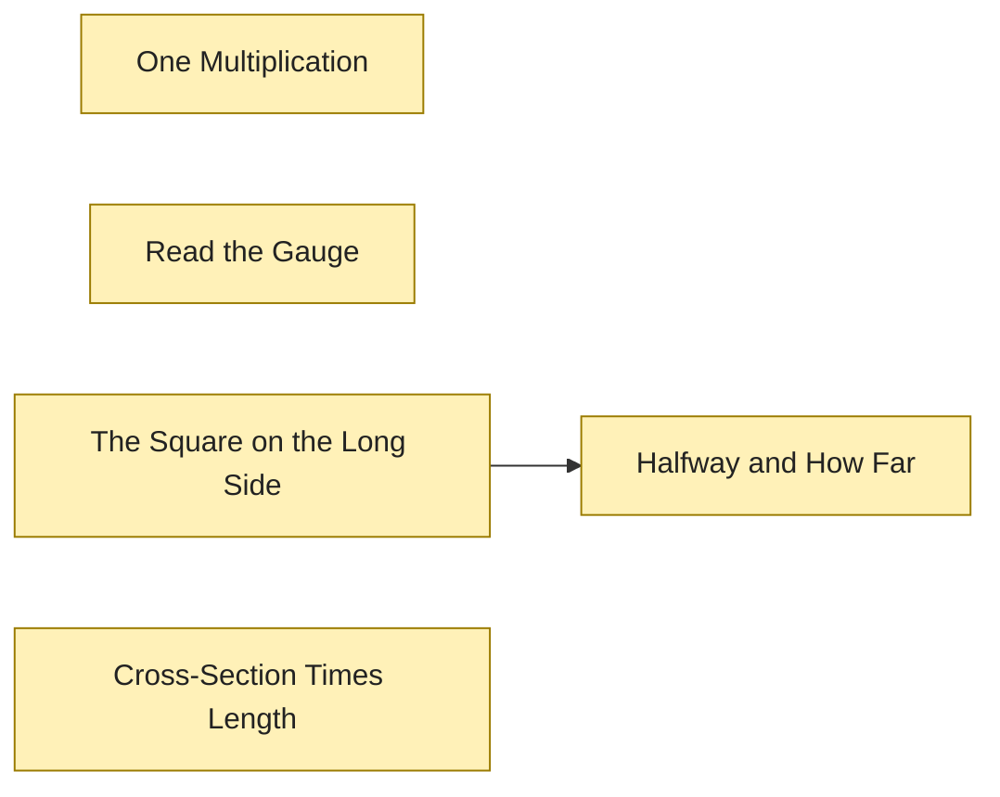

| Explainer | Idea | Courses | Syllabus | Builds on | Methods | Lesson |
|---|---|---|---|---|---|---|
| **One Multiplication**<br/>`foundations.pre-percent-multiplier` | Turn a percentage increase or decrease into a single multiplier, so a 4% rise is ×1.04 and a 4% fall is ×0.96. | AA SL, AA HL, AI SL, AI HL | SL2.9, SL1.4 | – | – | One Multiplication (`lesson.fn.pre-percent-multiplier`) |
| **Read the Gauge**<br/>`foundations.pre-read-and-round` | Read values from a scale, a table or a GDC screen and round them to three significant figures only at the end. | AA SL, AA HL, AI SL, AI HL | SL2.3 | – | – | Read the Gauge (`lesson.fn.pre-read-and-round`) |
| **The Square on the Long Side**<br/>`foundations.pythagoras` | In a right-angled triangle the square on the hypotenuse equals the sum of the squares on the other two sides. | AA SL, AA HL, AI SL, AI HL | SL3.2, SL3.1 | – | – | – |
| **Halfway and How Far**<br/>`foundations.distance-midpoint-2d` | Find the midpoint of two points by averaging their coordinates and the distance between them with Pythagoras. | AA SL, AA HL, AI SL, AI HL | SL2.1, SL3.1 | `foundations.pythagoras` | – | – |
| **Cross-Section Times Length**<br/>`foundations.area-and-volume` | Find the area of basic shapes and the volume of a prism or cylinder as cross-section area times length. | AA SL, AA HL, AI SL, AI HL | SL3.1 | – | – | – |

## Number and algebra (`algebra`, Scrap Fields)

60 explainers, narrated by the algebra tutor (`mags-the-ledger` in `tools/explainer-clips/teachers.json`).

### Standard form, approximation and error

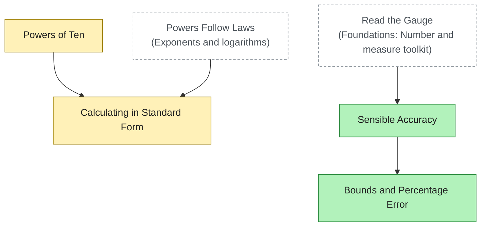

| Explainer | Idea | Courses | Syllabus | Builds on | Methods | Lesson |
|---|---|---|---|---|---|---|
| **Powers of Ten**<br/>`algebra.standard-form` | Write a number as a × 10^k with 1 ≤ a < 10, so very large and very small quantities can be compared at a glance. | AA SL, AA HL, AI SL, AI HL | SL1.1 | – | – | – |
| **Calculating in Standard Form**<br/>`algebra.standard-form-arithmetic` | Multiply and divide numbers in standard form by handling the a parts and the powers of ten separately, then tidy the result back into standard form. | AA SL, AA HL, AI SL, AI HL | SL1.1 | `algebra.standard-form`, `algebra.exponent-laws` | by-hand, gdc | – |
| **Sensible Accuracy**<br/>`algebra.rounding-accuracy` | Round to decimal places or significant figures that suit the data and the context, and check an answer against a quick estimate. | AI SL, AI HL | AI-SL1.6 | `foundations.pre-read-and-round` | – | – |
| **Bounds and Percentage Error**<br/>`algebra.bounds-and-error` | A rounded measurement lies between half a unit below and half a unit above, and the percentage error compares the error with the exact value. | AI SL, AI HL | AI-SL1.6 | `algebra.rounding-accuracy` | – | – |

### Sequences and series

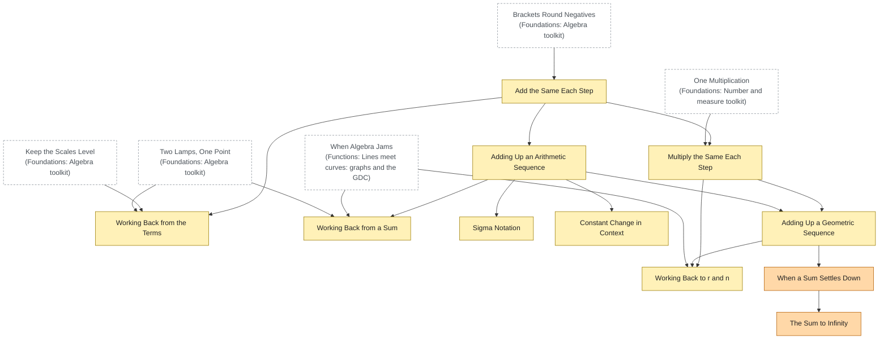

| Explainer | Idea | Courses | Syllabus | Builds on | Methods | Lesson |
|---|---|---|---|---|---|---|
| **Add the Same Each Step**<br/>`algebra.arithmetic-sequence` | An arithmetic sequence adds the common difference d at every step, so u_n = u₁ + (n − 1)d.<br/>Remember: `functions.gradient`, `functions.line-model` | AA SL, AA HL, AI SL, AI HL | SL1.2 | `foundations.pre-substitute` | – | – |
| **Working Back from the Terms**<br/>`algebra.arithmetic-from-terms` | Set uₙ = u₁ + (n − 1)d equal to the terms you are given and solve for the missing u₁, d or n, counting the gaps between terms rather than the terms.<br/>Remember: `functions.gradient` | AA SL, AA HL, AI SL, AI HL | SL1.2 | `algebra.arithmetic-sequence`, `foundations.pre-balance`, `foundations.pre-simultaneous` | simultaneous-equations, count-the-gaps | – |
| **Adding Up an Arithmetic Sequence**<br/>`algebra.arithmetic-series` | The sum of an arithmetic sequence is the number of terms times the average of the first and last terms. | AA SL, AA HL, AI SL, AI HL | SL1.2 | `algebra.arithmetic-sequence` | formula-with-d, formula-with-last-term | – |
| **Working Back from a Sum**<br/>`algebra.arithmetic-sum-unknown` | Put what you know into the sum formula and solve for the unknown: a quadratic in n when the number of terms is missing, or linear equations in u₁ and d when n is known.<br/>Remember: `algebra.arithmetic-from-terms` | AA SL, AA HL, AI SL, AI HL | SL1.2 | `algebra.arithmetic-series`, `functions.gdc-solve`, `foundations.pre-simultaneous` | quadratic-in-n, gdc-table | – |
| **Sigma Notation**<br/>`algebra.sigma-notation` | Σ is an instruction to substitute each value of the counter in turn and add the results. | AA SL, AA HL, AI SL, AI HL | SL1.2, SL1.3 | `algebra.arithmetic-series` | – | – |
| **Constant Change in Context**<br/>`algebra.arithmetic-model` | A quantity that changes by the same amount each period is an arithmetic sequence, and the question decides whether you want a term or a sum.<br/>Remember: `functions.line-model` | AA SL, AA HL, AI SL, AI HL | SL1.2 | `algebra.arithmetic-series` | – | – |
| **Multiply the Same Each Step**<br/>`algebra.geometric-sequence` | A geometric sequence multiplies by the common ratio r at every step, so u_n = u₁r^(n − 1).<br/>Remember: `functions.growth-factor` | AA SL, AA HL, AI SL, AI HL | SL1.3 | `algebra.arithmetic-sequence`, `foundations.pre-percent-multiplier` | – | – |
| **Adding Up a Geometric Sequence**<br/>`algebra.geometric-series` | The sum of a geometric sequence comes from subtracting r times the sum from the sum, which leaves only the first and last pieces. | AA SL, AA HL, AI SL, AI HL | SL1.3 | `algebra.geometric-sequence`, `algebra.arithmetic-series` | formula, gdc | – |
| **Working Back to r and n**<br/>`algebra.geometric-from-terms` | Divide one given term by another so u₁ cancels and leaves a power of r, then find n for a given term or sum with logarithms or a GDC table.<br/>Remember: `algebra.arithmetic-from-terms`, `functions.solve-with-logs` | AA SL, AA HL, AI SL, AI HL | SL1.3 | `algebra.geometric-sequence`, `algebra.geometric-series`, `functions.gdc-solve` | logs, gdc-table | – |
| **When a Sum Settles Down**<br/>`algebra.convergence` | An infinite geometric series has a finite sum only when |r| < 1, because then each new term is too small to push the total past a limit.<br/>Remember: `functions.long-run-value` | AA SL, AA HL, AI HL | SL1.8 | `algebra.geometric-series` | – | – |
| **The Sum to Infinity**<br/>`algebra.sum-to-infinity` | When |r| < 1 the infinite sum is u₁/(1 − r), and an equation in that formula finds a missing term or ratio. | AA SL, AA HL, AI HL | SL1.8 | `algebra.convergence` | – | – |

### Money: interest, depreciation and loans

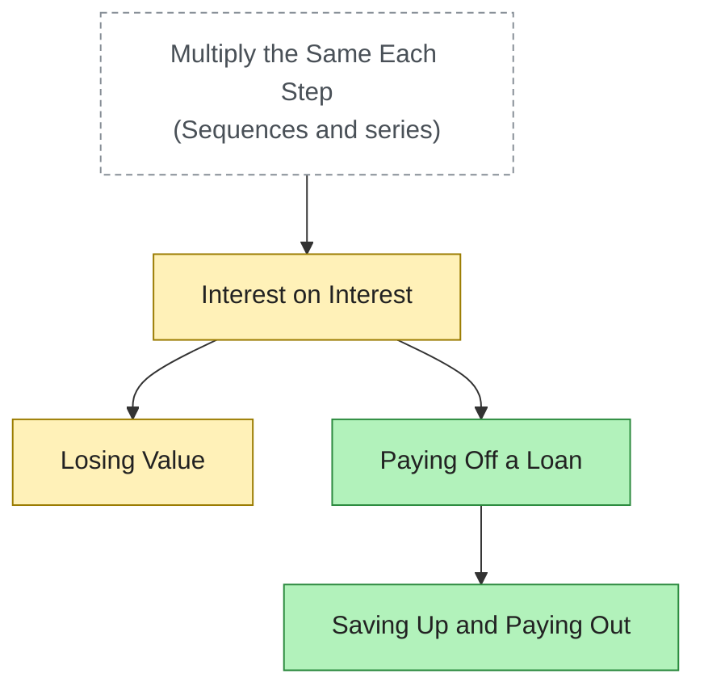

| Explainer | Idea | Courses | Syllabus | Builds on | Methods | Lesson |
|---|---|---|---|---|---|---|
| **Interest on Interest**<br/>`algebra.compound-interest` | Compound interest multiplies the balance by the same factor every period, so it is a geometric sequence in money.<br/>Remember: `functions.growth-factor` | AA SL, AA HL, AI SL, AI HL | SL1.4 | `algebra.geometric-sequence` | formula, tvm-solver | – |
| **Losing Value**<br/>`algebra.depreciation-and-inflation` | Depreciation multiplies by a factor below 1, and inflation shrinks what money is really worth, so compare options in today's money. | AA SL, AA HL, AI SL, AI HL | SL1.4 | `algebra.compound-interest` | formula, tvm-solver | – |
| **Paying Off a Loan**<br/>`algebra.amortisation` | A loan is paid off by equal instalments while interest keeps growing the balance, and the TVM solver balances the two. | AI SL, AI HL | AI-SL1.7 | `algebra.compound-interest` | tvm-solver, amortisation-table | – |
| **Saving Up and Paying Out**<br/>`algebra.annuities` | An annuity is the same regular payment in or out of an account that earns compound interest, solved with the same TVM inputs as a loan. | AI SL, AI HL | AI-SL1.7 | `algebra.amortisation` | – | – |

### Exponents and logarithms

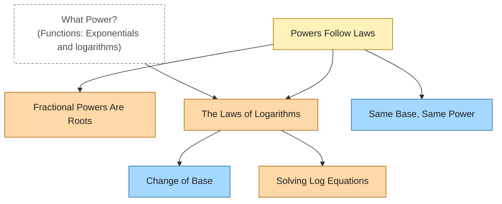

| Explainer | Idea | Courses | Syllabus | Builds on | Methods | Lesson |
|---|---|---|---|---|---|---|
| **Powers Follow Laws**<br/>`algebra.exponent-laws` | Multiplying powers of the same base adds the exponents, dividing subtracts them, a⁰ = 1 and a negative power is a reciprocal. | AA SL, AA HL, AI SL, AI HL | SL1.5 | – | – | – |
| **Fractional Powers Are Roots**<br/>`algebra.rational-exponents` | a^(1/n) is the nth root of a, so a^(m/n) is a root and a power together, and the same laws still hold. | AA SL, AA HL, AI HL | SL1.7, AI-AHL1.10 | `algebra.exponent-laws` | – | – |
| **The Laws of Logarithms**<br/>`algebra.log-laws` | Because logs are exponents, the log of a product is a sum, the log of a quotient is a difference and the log of a power brings the power down.<br/>Remember: `functions.complete-square` | AA SL, AA HL, AI HL | SL1.7, AI-AHL1.9 | `functions.log-undoes-power`, `algebra.exponent-laws` | – | – |
| **Change of Base**<br/>`algebra.change-of-base` | Any logarithm can be rewritten in another base as log_b a = log_c a / log_c b, which turns unfamiliar bases into ones you can handle. | AA SL, AA HL | SL1.7 | `algebra.log-laws` | – | – |
| **Same Base, Same Power**<br/>`algebra.common-base` | When both sides of an exponential equation can be written as powers of the same base, the exponents must be equal.<br/>Remember: `functions.solve-with-logs` | AA SL, AA HL | SL1.7 | `algebra.exponent-laws` | – | – |
| **Solving Log Equations**<br/>`algebra.log-equations` | Combine the logs into a single log, rewrite it as a power, solve, then reject any answer that would take the log of a non-positive number. | AA SL, AA HL, AI HL | SL1.7, AI-AHL1.9 | `algebra.log-laws` | – | – |

### Proof

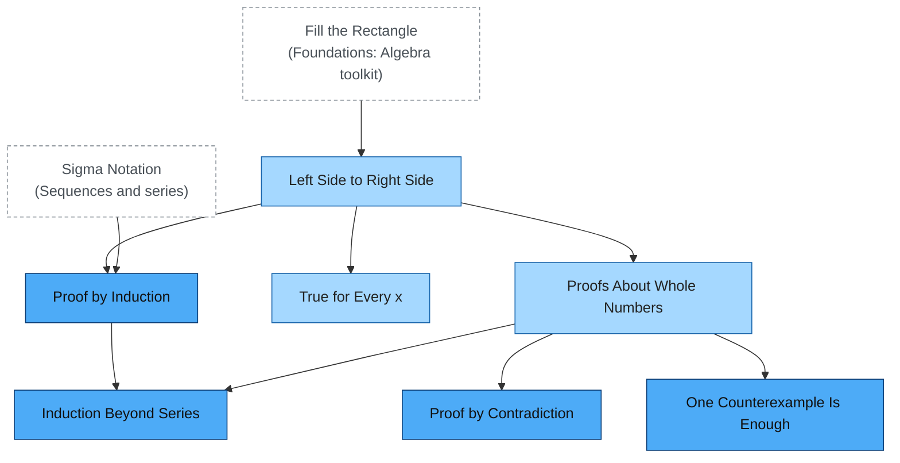

| Explainer | Idea | Courses | Syllabus | Builds on | Methods | Lesson |
|---|---|---|---|---|---|---|
| **Left Side to Right Side**<br/>`algebra.lhs-to-rhs` | Prove an identity by starting from one side and rewriting it step by step until it becomes the other, never working on both at once.<br/>Remember: `functions.complete-square` | AA SL, AA HL | SL1.6 | `foundations.pre-expand` | – | – |
| **Proofs About Whole Numbers**<br/>`algebra.integer-proof` | Write a general even, odd or consecutive integer in algebra, such as 2n or 2n + 1, and the proof becomes a short expansion. | AA SL, AA HL | SL1.6 | `algebra.lhs-to-rhs` | – | – |
| **True for Every x**<br/>`algebra.compare-coefficients` | When two expressions are equal for every x, their coefficients of each power of x must match, which finds unknown constants.<br/>Remember: `functions.complete-square` | AA SL, AA HL | SL1.6 | `algebra.lhs-to-rhs` | – | – |
| **Proof by Induction**<br/>`algebra.induction` | Show a statement is true for the first case and that truth for k forces truth for k + 1, and it holds for every case like toppling dominoes. | AA HL | AHL1.15 | `algebra.lhs-to-rhs`, `algebra.sigma-notation` | – | – |
| **Induction Beyond Series**<br/>`algebra.induction-divisibility` | The same induction step proves divisibility, inequalities and derivative patterns, by writing the k + 1 case in terms of the k case. | AA HL | AHL1.15 | `algebra.induction`, `algebra.integer-proof` | – | – |
| **Proof by Contradiction**<br/>`algebra.contradiction` | Assume the opposite of what you want, follow the logic to something impossible, and the assumption must be false. | AA HL | AHL1.15 | `algebra.integer-proof` | – | – |
| **One Counterexample Is Enough**<br/>`algebra.counterexample` | A single case where a claim fails disproves it, however many cases it works for. | AA HL | AHL1.15 | `algebra.integer-proof` | – | – |

### The binomial theorem and counting

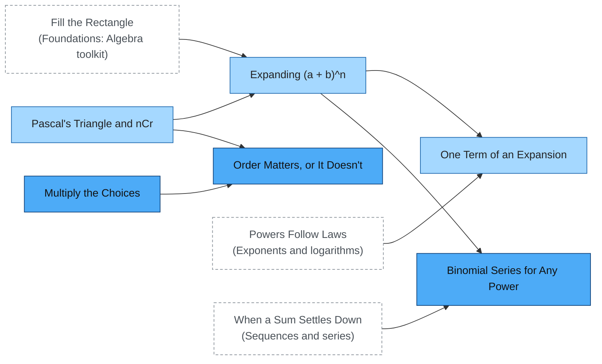

| Explainer | Idea | Courses | Syllabus | Builds on | Methods | Lesson |
|---|---|---|---|---|---|---|
| **Pascal's Triangle and nCr**<br/>`algebra.pascal-ncr` | Each entry of Pascal's triangle is the sum of the two above it and equals nCr, the number of ways to choose r items from n.<br/>Remember: `stats.binomial-probability` | AA SL, AA HL | SL1.9 | – | – | – |
| **Expanding (a + b)^n**<br/>`algebra.binomial-expansion` | The terms of (a + b)^n are nCr a^(n − r) b^r, so the coefficients come straight from a row of Pascal's triangle. | AA SL, AA HL | SL1.9 | `algebra.pascal-ncr`, `foundations.pre-expand` | pascal-row, ncr-formula | – |
| **One Term of an Expansion**<br/>`algebra.binomial-term` | Write the general term, set its power of x to the one you want, and the term follows without expanding everything. | AA SL, AA HL | SL1.9 | `algebra.binomial-expansion`, `algebra.exponent-laws` | – | – |
| **Multiply the Choices**<br/>`algebra.counting-principle` | When choices are made one after another, multiply the number of options at each stage; when they are alternatives, add. | AA HL | AHL1.10 | – | – | – |
| **Order Matters, or It Doesn't**<br/>`algebra.permutations-combinations` | Permutations count arrangements where order matters and combinations count selections where it does not, so nPr = nCr × r!. | AA HL | AHL1.10 | `algebra.counting-principle`, `algebra.pascal-ncr` | direct, complement | – |
| **Binomial Series for Any Power**<br/>`algebra.binomial-rational` | For a fractional or negative power, (1 + x)^n becomes an infinite series that converges only when |x| < 1, and its first terms approximate the value. | AA HL | AHL1.10 | `algebra.binomial-expansion`, `algebra.convergence` | – | – |

### Partial fractions and systems

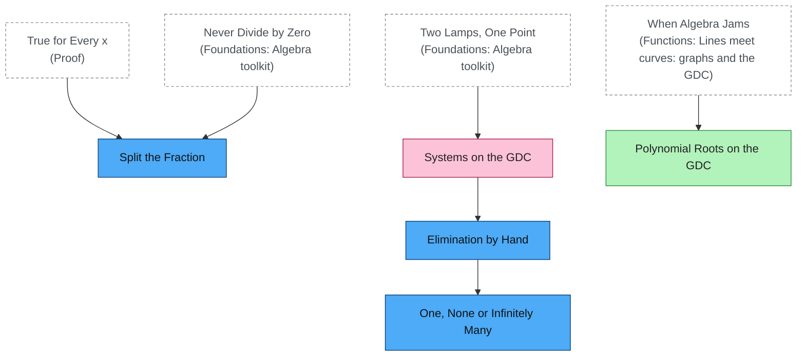

| Explainer | Idea | Courses | Syllabus | Builds on | Methods | Lesson |
|---|---|---|---|---|---|---|
| **Split the Fraction**<br/>`algebra.partial-fractions` | A fraction with a factorised denominator splits into simpler fractions, one per factor, found by substituting roots or comparing coefficients. | AA HL | AHL1.11 | `algebra.compare-coefficients`, `foundations.pre-algebraic-fractions` | substitute-roots, compare-coefficients | – |
| **Systems on the GDC**<br/>`algebra.linear-systems-technology` | Write each condition as a linear equation in the unknowns and let the GDC solve the system, including finding a curve through given points. | AA HL, AI SL, AI HL | AHL1.16, AI-SL1.8 | `foundations.pre-simultaneous` | – | – |
| **Elimination by Hand**<br/>`algebra.elimination-3x3` | Eliminate one unknown at a time from three equations until one equation in one unknown remains, then substitute back. | AA HL | AHL1.16 | `algebra.linear-systems-technology` | – | – |
| **One, None or Infinitely Many**<br/>`algebra.classify-systems` | A system has a unique solution, none or infinitely many, and when there are infinitely many the general solution uses a parameter. | AA HL | AHL1.16 | `algebra.elimination-3x3` | – | – |
| **Polynomial Roots on the GDC**<br/>`algebra.polynomial-roots-gdc` | The polynomial solver gives every real root of a polynomial equation, and the context decides which roots make sense. | AI SL, AI HL | AI-SL1.8 | `functions.gdc-solve` | – | – |

### Complex numbers: forms

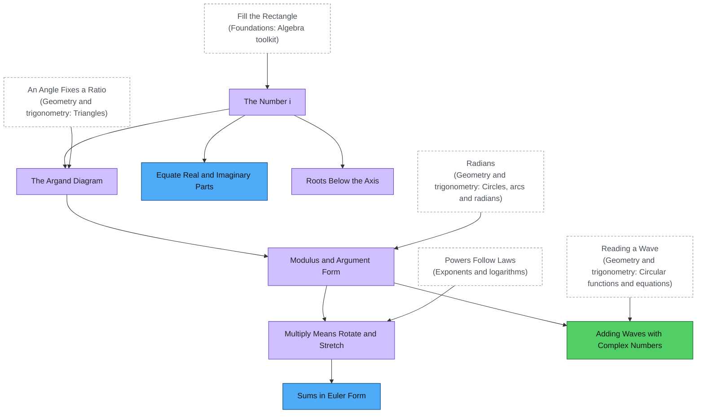

| Explainer | Idea | Courses | Syllabus | Builds on | Methods | Lesson |
|---|---|---|---|---|---|---|
| **The Number i**<br/>`algebra.complex-cartesian` | With i² = −1, complex numbers a + bi add and multiply like brackets, and dividing uses the conjugate to make the denominator real. | AA HL, AI HL | AHL1.12, AI-AHL1.12 | `foundations.pre-expand` | by-hand, gdc | – |
| **The Argand Diagram**<br/>`algebra.argand-modulus` | A complex number is a point on the Argand diagram, with its modulus as the distance from 0 and its argument as the angle from the positive real axis.<br/>Remember: `geometry.vectors-components` | AA HL, AI HL | AHL1.12, AI-AHL1.12 | `algebra.complex-cartesian`, `geometry.right-trig` | – | – |
| **Equate Real and Imaginary Parts**<br/>`algebra.equate-parts` | Two complex numbers are equal only when their real parts and their imaginary parts are both equal, which turns one equation into two.<br/>Remember: `algebra.compare-coefficients` | AA HL | AHL1.12 | `algebra.complex-cartesian` | – | – |
| **Roots Below the Axis**<br/>`algebra.complex-quadratic-roots` | A quadratic with a negative discriminant has two complex roots that are conjugates of each other.<br/>Remember: `functions.discriminant` | AA HL, AI HL | AHL1.14, AI-AHL1.12 | `algebra.complex-cartesian` | formula, gdc | – |
| **Modulus and Argument Form**<br/>`algebra.polar-form` | The same complex number can be written as a + bi, as r cis θ or as re^(iθ), and each form makes different calculations easy.<br/>Remember: `functions.complete-square` | AA HL, AI HL | AHL1.13, AI-AHL1.13 | `algebra.argand-modulus`, `geometry.radian-measure` | – | – |
| **Multiply Means Rotate and Stretch**<br/>`algebra.polar-multiply` | Multiplying complex numbers multiplies their moduli and adds their arguments, so on the Argand diagram it is a stretch and a rotation. | AA HL, AI HL | AHL1.13, AI-AHL1.13 | `algebra.polar-form`, `algebra.exponent-laws` | – | – |
| **Sums in Euler Form**<br/>`algebra.euler-sums` | Adding or factorising numbers in Euler form, such as e^(iθ) + 1, reveals exact trigonometric values and identities. | AA HL | AHL1.13 | `algebra.polar-multiply` | – | – |
| **Adding Waves with Complex Numbers**<br/>`algebra.add-sinusoids` | Two waves of the same frequency add to one wave, whose amplitude and phase come from adding the matching complex numbers. | AI HL | AI-AHL1.13 | `algebra.polar-form`, `geometry.wave-features` | – | – |

### Complex numbers: powers and roots

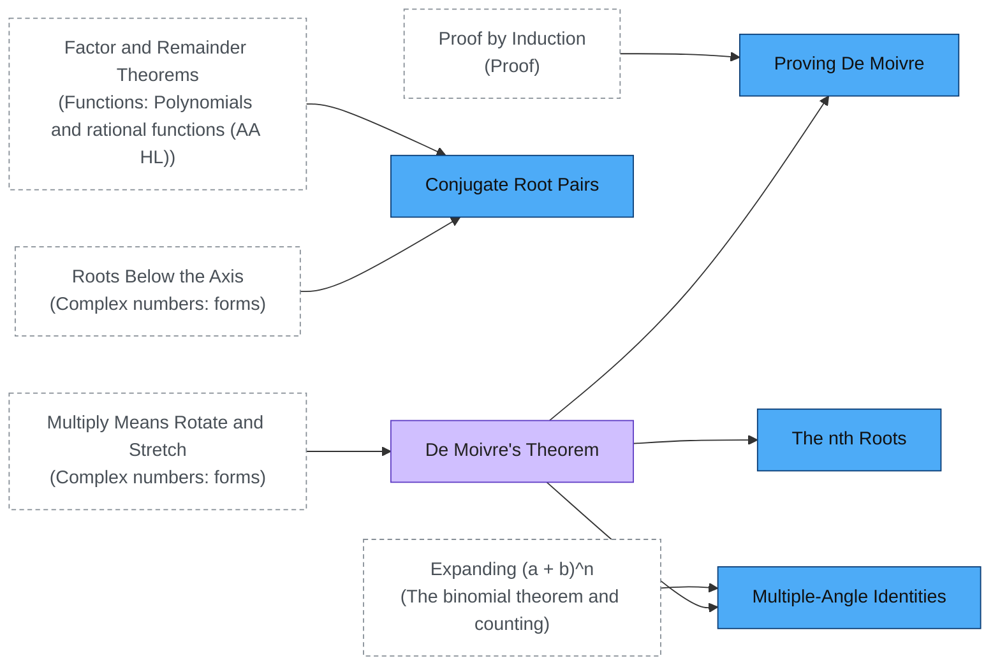

| Explainer | Idea | Courses | Syllabus | Builds on | Methods | Lesson |
|---|---|---|---|---|---|---|
| **De Moivre's Theorem**<br/>`algebra.de-moivre` | Raising r cis θ to the power n gives rⁿ cis nθ, so powers of complex numbers are quick in polar form. | AA HL, AI HL | AHL1.14, AI-AHL1.13 | `algebra.polar-multiply` | polar-form, gdc | – |
| **Proving De Moivre**<br/>`algebra.de-moivre-proof` | De Moivre's theorem for positive integers follows by induction using the compound angle formulae. | AA HL | AHL1.14 | `algebra.de-moivre`, `algebra.induction` | – | – |
| **Multiple-Angle Identities**<br/>`algebra.multiple-angle` | Expanding (cos θ + i sin θ)ⁿ by the binomial theorem and comparing with cos nθ + i sin nθ gives identities for cos nθ and sin nθ.<br/>Remember: `geometry.compound-angles` | AA HL | AHL1.14 | `algebra.de-moivre`, `algebra.binomial-expansion` | – | – |
| **The nth Roots**<br/>`algebra.nth-roots` | A complex number has n distinct nth roots, equally spaced round a circle on the Argand diagram.<br/>Remember: `geometry.related-angles` | AA HL | AHL1.14 | `algebra.de-moivre` | – | – |
| **Conjugate Root Pairs**<br/>`algebra.conjugate-roots` | A polynomial with real coefficients has its complex roots in conjugate pairs, so knowing one root gives a quadratic factor. | AA HL | AHL1.14 | `algebra.complex-quadratic-roots`, `functions.factor-remainder` | – | – |

### Matrices

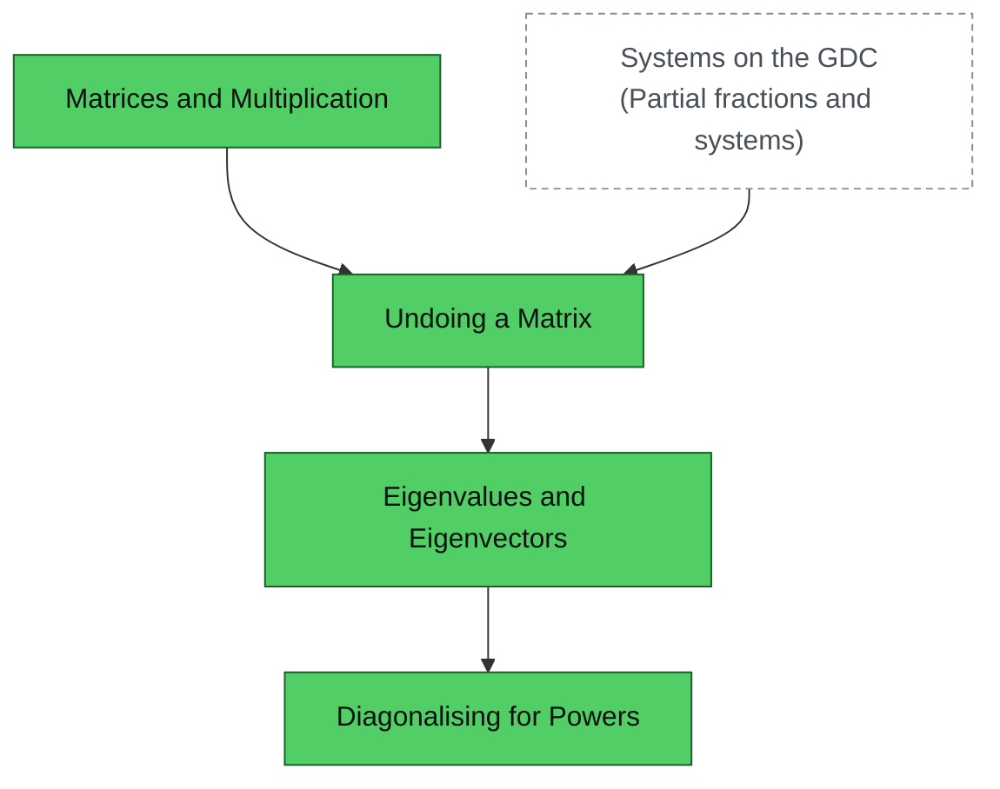

| Explainer | Idea | Courses | Syllabus | Builds on | Methods | Lesson |
|---|---|---|---|---|---|---|
| **Matrices and Multiplication**<br/>`algebra.matrix-arithmetic` | A matrix is a table of numbers that adds entry by entry and multiplies row by column, and order matters because AB need not equal BA. | AI HL | AI-AHL1.14 | – | by-hand, gdc | – |
| **Undoing a Matrix**<br/>`algebra.matrix-inverse` | A matrix with a non-zero determinant has an inverse that undoes it, so AX = B is solved by X = A⁻¹B.<br/>Remember: `functions.inverse-undo` | AI HL | AI-AHL1.14 | `algebra.matrix-arithmetic`, `algebra.linear-systems-technology` | – | – |
| **Eigenvalues and Eigenvectors**<br/>`algebra.eigenvalues` | An eigenvector keeps its direction when the matrix acts on it and is only scaled by its eigenvalue, found from det(A − λI) = 0. | AI HL | AI-AHL1.15 | `algebra.matrix-inverse` | – | – |
| **Diagonalising for Powers**<br/>`algebra.diagonalise` | Writing A = PDP⁻¹ with the eigenvalues in D makes Aⁿ = PDⁿP⁻¹, which predicts the long-run behaviour of a model. | AI HL | AI-AHL1.15 | `algebra.eigenvalues` | – | – |

## Functions (`functions`, Signal Tower)

68 explainers, narrated by the functions tutor (`rook-dead-air` in `tools/explainer-clips/teachers.json`).

### Lines

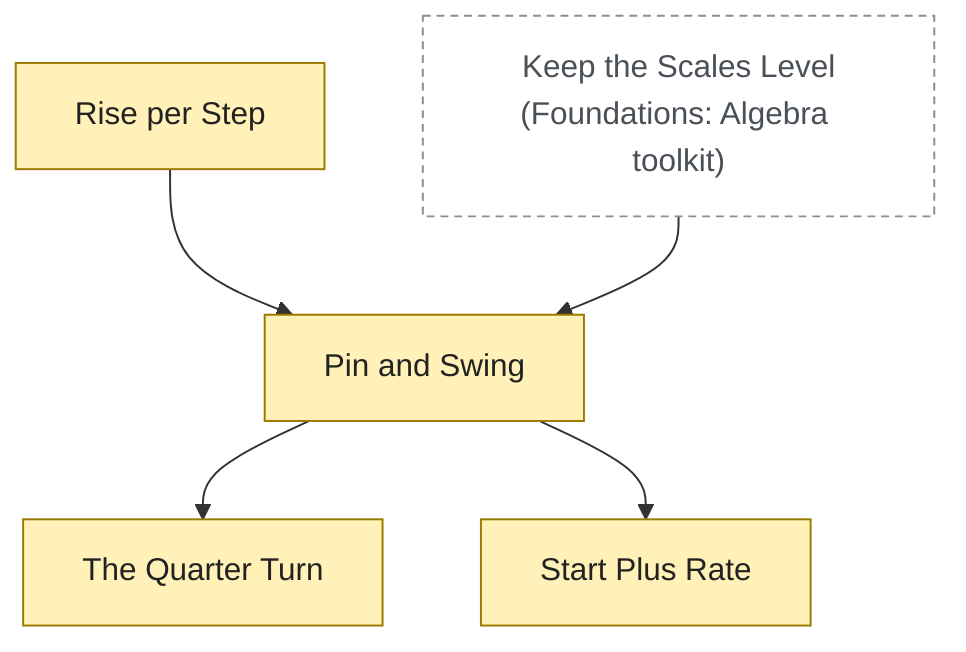

| Explainer | Idea | Courses | Syllabus | Builds on | Methods | Lesson |
|---|---|---|---|---|---|---|
| **Rise per Step**<br/>`functions.gradient` | The gradient of a line is the change in y for each step of 1 in x, the same everywhere along the line.<br/>Remember: `algebra.arithmetic-sequence`, `calculus.derivative-meaning` | AA SL, AA HL, AI SL, AI HL | SL2.1 | – | – | Rise per Step (`lesson.fn.gradient`) |
| **Pin and Swing**<br/>`functions.line-equation` | One point and a gradient pin down a line, written as y − y₁ = m(x − x₁), y = mx + c or ax + by + d = 0. | AA SL, AA HL, AI SL, AI HL | SL2.1 | `functions.gradient`, `foundations.pre-balance` | point-gradient, slope-intercept | Pin and Swing (`lesson.fn.line-equation`) |
| **The Quarter Turn**<br/>`functions.perpendicular` | Parallel lines share a gradient, and perpendicular gradients multiply to −1 because a quarter turn swaps rise and run and flips a sign. | AA SL, AA HL, AI SL, AI HL | SL2.1 | `functions.line-equation` | – | The Quarter Turn (`lesson.fn.perpendicular`) |
| **Start Plus Rate**<br/>`functions.line-model` | A linear model is a starting value plus a constant rate, so the intercept and the gradient each mean something in context.<br/>Remember: `algebra.arithmetic-model`, `stats.regression-line` | AA SL, AA HL, AI SL, AI HL | SL2.1, AI-SL2.5 | `functions.line-equation` | – | Start Plus Rate (`lesson.fn.line-model`) |

### Function basics

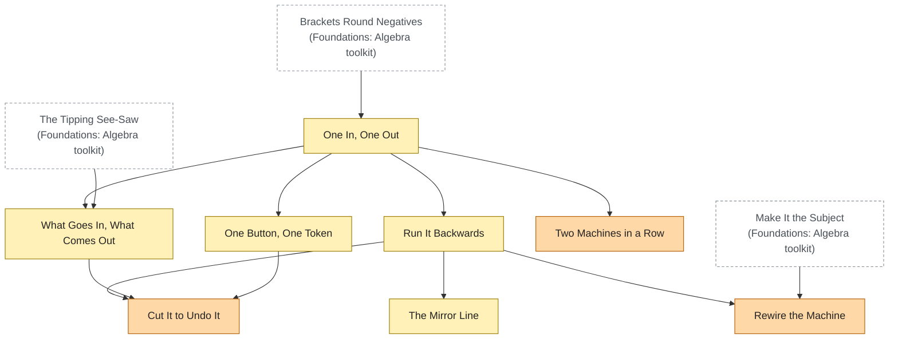

| Explainer | Idea | Courses | Syllabus | Builds on | Methods | Lesson |
|---|---|---|---|---|---|---|
| **One In, One Out**<br/>`functions.function-machine` | A function takes each input to exactly one output, and f(3) means the output when the input is 3. | AA SL, AA HL, AI SL, AI HL | SL2.2 | `foundations.pre-substitute` | – | One In, One Out (`lesson.fn.function-machine`) |
| **One Button, One Token**<br/>`functions.is-function` | A relation is a function when every input has exactly one output, which the vertical line test checks on a graph. | AA SL, AA HL, AI SL, AI HL | SL2.2 | `functions.function-machine` | – | One Button, One Token (`lesson.fn.is-function`) |
| **What Goes In, What Comes Out**<br/>`functions.domain-range` | The domain is the set of inputs a function accepts and the range is the set of outputs it can produce. | AA SL, AA HL, AI SL, AI HL | SL2.2 | `functions.function-machine`, `foundations.pre-linear-inequalities` | – | What Goes In, What Comes Out (`lesson.fn.domain-range`) |
| **Run It Backwards**<br/>`functions.inverse-undo` | An inverse function undoes the original, taking each output back to the input that made it.<br/>Remember: `calculus.antiderivative`, `stats.inverse-normal` | AA SL, AA HL, AI SL, AI HL | SL2.2 | `functions.function-machine` | – | Run It Backwards (`lesson.fn.inverse-undo`) |
| **The Mirror Line**<br/>`functions.inverse-reflection` | The graph of an inverse function is the reflection of the original in the line y = x, because inputs and outputs swap. | AA SL, AA HL, AI SL, AI HL | SL2.2 | `functions.inverse-undo` | – | The Mirror Line (`lesson.fn.inverse-reflection`) |
| **Two Machines in a Row**<br/>`functions.composite` | A composite function f(g(x)) feeds the output of g into f, so the function nearest x acts first. | AA SL, AA HL, AI HL | SL2.5, AI-AHL2.7 | `functions.function-machine` | – | Two Machines in a Row (`lesson.fn.composite`) |
| **Rewire the Machine**<br/>`functions.swap-and-solve` | To find an inverse algebraically, write y = f(x), swap x and y, and make y the subject. | AA SL, AA HL, AI HL | SL2.5, SL2.8, AI-AHL2.7 | `functions.inverse-undo`, `foundations.pre-change-subject` | – | Rewire the Machine (`lesson.fn.swap-and-solve`) |
| **Cut It to Undo It**<br/>`functions.inverse-domain` | A function has an inverse only if it is one-to-one, so restrict its domain, and the domain and range swap for the inverse. | AA SL, AA HL, AI HL | SL2.5, AI-AHL2.7 | `functions.inverse-undo`, `functions.domain-range`, `functions.is-function` | – | Cut It to Undo It (`lesson.fn.inverse-domain`) |

### Lines meet curves: graphs and the GDC

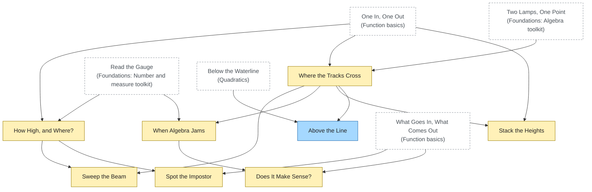

| Explainer | Idea | Courses | Syllabus | Builds on | Methods | Lesson |
|---|---|---|---|---|---|---|
| **How High, and Where?**<br/>`functions.how-high-and-where` | A graph shows its highest and lowest points and its intercepts, and the GDC finds them to three significant figures. | AA SL, AA HL, AI SL, AI HL | SL2.4, SL2.3, SL2.6 | `functions.function-machine`, `foundations.pre-read-and-round` | gdc-maximum, gdc-zero | How High, and Where? (`lesson.fn.how-high-and-where`) |
| **Where the Tracks Cross**<br/>`functions.meeting-points` | Where two graphs cross, their equations are both true, so solving f(x) = g(x) and finding the intersection are the same job. | AA SL, AA HL, AI SL, AI HL | SL2.4, SL2.10, SL2.1 | `functions.function-machine`, `foundations.pre-simultaneous` | algebra, gdc-intersect | Where the Tracks Cross (`lesson.fn.meeting-points`) |
| **Sweep the Beam**<br/>`functions.count-solutions` | The number of solutions of f(x) = k is the number of times the horizontal line y = k meets the graph. | AA SL, AA HL, AI SL, AI HL | SL2.10, SL2.4 | `functions.meeting-points`, `functions.how-high-and-where` | – | Sweep the Beam (`lesson.fn.count-solutions`) |
| **When Algebra Jams**<br/>`functions.gdc-solve` | When an equation has no algebraic method, graph both sides on the GDC and read off the intersections. | AA SL, AA HL, AI SL, AI HL | SL2.10, SL2.4 | `functions.meeting-points`, `foundations.pre-read-and-round` | intersect, zero-of-difference | When Algebra Jams (`lesson.fn.gdc-solve`) |
| **Spot the Impostor**<br/>`functions.sketch-features` | A sketch shows the shape and the key features, labelled intercepts, turning points and asymptotes, over the right domain. | AA SL, AA HL, AI SL, AI HL | SL2.3, SL2.4 | `functions.how-high-and-where`, `functions.domain-range` | – | Spot the Impostor (`lesson.fn.sketch-features`) |
| **Stack the Heights**<br/>`functions.combine-functions` | The graph of f + g adds the heights of the two graphs at each x, and f − g measures the gap between them. | AA SL, AA HL, AI SL, AI HL | SL2.3 | `functions.function-machine`, `functions.meeting-points` | – | Stack the Heights (`lesson.fn.combine-functions`) |
| **Above the Line**<br/>`functions.graph-inequality` | f(x) > g(x) wherever the graph of f is above the graph of g, so the intersections mark where the answer changes. | AA SL, AA HL | SL2.10 | `functions.meeting-points`, `functions.quadratic-inequality` | – | Above the Line (`lesson.fn.graph-inequality`) |
| **Does It Make Sense?**<br/>`functions.context-check` | After solving a model, keep only the answers that fit the domain and the story, and state them in its units. | AA SL, AA HL, AI SL, AI HL | SL2.10, AI-SL2.6 | `functions.gdc-solve`, `functions.domain-range` | – | Does It Make Sense? (`lesson.fn.context-check`) |

### Quadratics

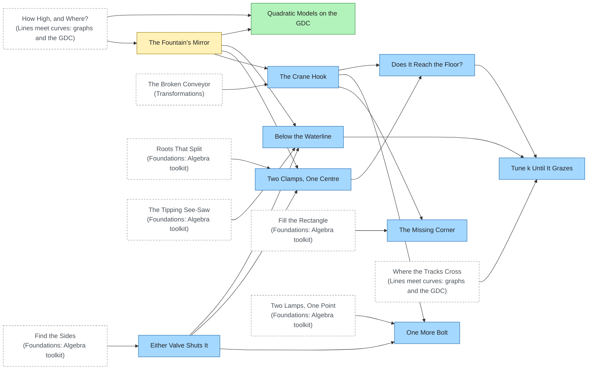

| Explainer | Idea | Courses | Syllabus | Builds on | Methods | Lesson |
|---|---|---|---|---|---|---|
| **Either Valve Shuts It**<br/>`functions.zero-product` | If a product is zero, one of its factors is zero, so the roots of a(x − p)(x − q) = 0 are p and q. | AA SL, AA HL | SL2.6, SL2.7 | `foundations.pre-factorise` | – | Either Valve Shuts It (`lesson.fn.zero-product`) |
| **The Fountain's Mirror**<br/>`functions.parabola-symmetry` | A parabola is symmetric about a vertical line through its vertex, halfway between any two points at the same height. | AA SL, AA HL, AI SL, AI HL | SL2.6, SL2.4 | `functions.how-high-and-where` | midpoint-of-roots, minus-b-over-2a | The Fountain's Mirror (`lesson.fn.parabola-symmetry`) |
| **The Crane Hook**<br/>`functions.vertex-form` | In y = a(x − h)² + k the vertex is (h, k), because the graph is y = ax² translated by (h, k).<br/>Remember: `geometry.circular-graphs` | AA SL, AA HL | SL2.6 | `functions.translation`, `functions.parabola-symmetry` | – | The Crane Hook (`lesson.fn.vertex-form`) |
| **The Missing Corner**<br/>`functions.complete-square` | Completing the square rewrites ax² + bx + c in vertex form by adding the missing corner of a square.<br/>Remember: `algebra.lhs-to-rhs` | AA SL, AA HL | SL2.6 | `functions.vertex-form`, `foundations.pre-expand` | – | The Missing Corner (`lesson.fn.complete-square`) |
| **One More Bolt**<br/>`functions.quadratic-from-clues` | Choose the form that matches the clues, vertex or roots, and one more point fixes the value of a. | AA SL, AA HL | SL2.6 | `functions.vertex-form`, `functions.zero-product`, `foundations.pre-simultaneous` | vertex-form, intercept-form, simultaneous | One More Bolt (`lesson.fn.quadratic-from-clues`) |
| **Two Clamps, One Centre**<br/>`functions.quadratic-formula` | The quadratic formula gives the roots as the axis of symmetry plus or minus a distance, which is why it has the ± sign. | AA SL, AA HL | SL2.7 | `functions.zero-product`, `functions.parabola-symmetry`, `foundations.pre-surds` | factorise, formula, complete-square, gdc | Two Clamps, One Centre (`lesson.fn.quadratic-formula`) |
| **Does It Reach the Floor?**<br/>`functions.discriminant` | The discriminant b² − 4ac tells you whether a quadratic has two, one or no real roots before you solve it.<br/>Remember: `algebra.complex-quadratic-roots` | AA SL, AA HL | SL2.7 | `functions.quadratic-formula`, `functions.vertex-form` | – | Does It Reach the Floor? (`lesson.fn.discriminant`) |
| **Tune k Until It Grazes**<br/>`functions.discriminant-parameter` | Setting the discriminant to zero, positive or negative finds the values of a parameter where a line touches, cuts or misses a curve.<br/>Remember: `calculus.tangent-problems` | AA SL, AA HL | SL2.7 | `functions.discriminant`, `functions.quadratic-inequality`, `functions.meeting-points` | – | Tune k Until It Grazes (`lesson.fn.discriminant-parameter`) |
| **Below the Waterline**<br/>`functions.quadratic-inequality` | Solve a quadratic inequality by finding the roots and reading from the sketch where the parabola is above or below the axis. | AA SL, AA HL | SL2.7 | `functions.zero-product`, `foundations.pre-linear-inequalities`, `functions.parabola-symmetry` | – | Below the Waterline (`lesson.fn.quadratic-inequality`) |
| **Quadratic Models on the GDC**<br/>`functions.quadratic-model` | A quadratic model has one turning point, and the GDC gives its vertex, zeros and the parameters from data. | AI SL, AI HL | AI-SL2.5 | `functions.parabola-symmetry`, `functions.how-high-and-where` | regression, simultaneous | – |

### Exponentials and logarithms

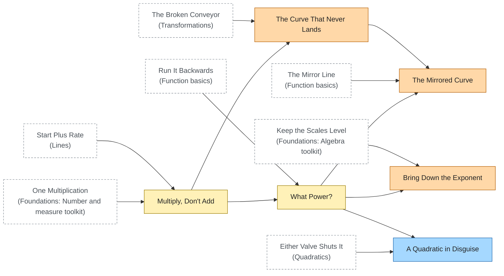

| Explainer | Idea | Courses | Syllabus | Builds on | Methods | Lesson |
|---|---|---|---|---|---|---|
| **Multiply, Don't Add**<br/>`functions.growth-factor` | Exponential growth multiplies by the same factor in each equal step of time, where linear growth adds the same amount.<br/>Remember: `algebra.geometric-sequence`, `algebra.compound-interest` | AA SL, AA HL, AI SL, AI HL | SL2.9, AI-SL2.5 | `foundations.pre-percent-multiplier`, `functions.line-model` | – | Multiply, Don't Add (`lesson.fn.growth-factor`) |
| **The Curve That Never Lands**<br/>`functions.exp-graph` | The graph of a^x passes through (0, 1) and approaches a horizontal asymptote, which moves when the graph is translated. | AA SL, AA HL, AI HL | SL2.9, AI-SL2.5 | `functions.growth-factor`, `functions.translation` | – | The Curve That Never Lands (`lesson.fn.exp-graph`) |
| **What Power?**<br/>`functions.log-undoes-power` | A logarithm answers the question what power, so log_a b = c means a^c = b. | AA SL, AA HL, AI SL, AI HL | SL1.5, SL2.9 | `functions.growth-factor`, `functions.inverse-undo` | – | What Power? (`lesson.fn.log-undoes-power`) |
| **Bring Down the Exponent**<br/>`functions.solve-with-logs` | Taking logs of both sides brings an unknown exponent down, so a^x = b gives x = log b / log a. | AA SL, AA HL, AI HL | SL1.7, SL2.9, AI-AHL1.9 | `functions.log-undoes-power`, `foundations.pre-balance` | logs, gdc | Bring Down the Exponent (`lesson.fn.solve-with-logs`) |
| **The Mirrored Curve**<br/>`functions.log-graph` | The graph of log_a x is the reflection of a^x in y = x, so it passes through (1, 0) and has a vertical asymptote. | AA SL, AA HL, AI HL | SL2.9, AI-AHL2.9 | `functions.log-undoes-power`, `functions.inverse-reflection`, `functions.exp-graph` | – | The Mirrored Curve (`lesson.fn.log-graph`) |
| **A Quadratic in Disguise**<br/>`functions.hidden-quadratic` | An equation such as 4^x − 5·2^x + 4 = 0 becomes a quadratic when you substitute u = 2^x.<br/>Remember: `geometry.quadratic-in-trig` | AA SL, AA HL | SL2.7, SL1.7 | `functions.zero-product`, `functions.log-undoes-power` | – | A Quadratic in Disguise (`lesson.fn.hidden-quadratic`) |

### Rational functions

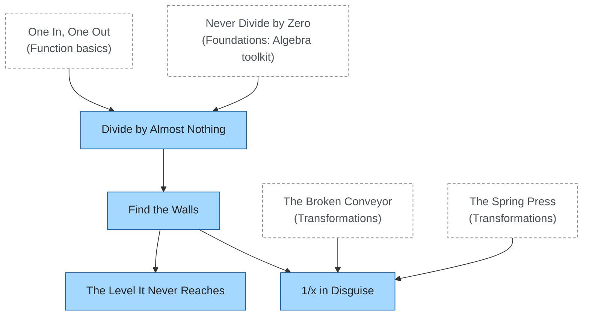

| Explainer | Idea | Courses | Syllabus | Builds on | Methods | Lesson |
|---|---|---|---|---|---|---|
| **Divide by Almost Nothing**<br/>`functions.reciprocal` | The graph of 1/x shoots off near x = 0 and fades towards 0 for large x, so both axes are asymptotes. | AA SL, AA HL | SL2.8 | `foundations.pre-algebraic-fractions`, `functions.function-machine` | – | Divide by Almost Nothing (`lesson.fn.reciprocal`) |
| **Find the Walls**<br/>`functions.rational-asymptotes` | The vertical asymptote of (ax + b)/(cx + d) is where the denominator is zero, and the horizontal asymptote is y = a/c. | AA SL, AA HL | SL2.8, SL2.4 | `functions.reciprocal` | – | Find the Walls (`lesson.fn.rational-asymptotes`) |
| **1/x in Disguise**<br/>`functions.transformed-reciprocal` | Every (ax + b)/(cx + d) is 1/x stretched and translated, so its asymptotes are the moved axes. | AA SL, AA HL | SL2.8 | `functions.rational-asymptotes`, `functions.translation`, `functions.stretch` | – | 1/x in Disguise (`lesson.fn.transformed-reciprocal`) |
| **The Level It Never Reaches**<br/>`functions.long-run-value` | In a model, a horizontal asymptote is the long-run value the quantity approaches but never reaches.<br/>Remember: `algebra.convergence` | AA SL, AA HL | SL2.8 | `functions.rational-asymptotes` | – | The Level It Never Reaches (`lesson.fn.long-run-value`) |

### Transformations

```mermaid
flowchart TD
  functions_translation["The Broken Conveyor"]:::aa_ai_hl
  functions_stretch["The Spring Press"]:::aa_ai_hl
  functions_reflection["Flip Switches"]:::aa_ai_hl
  functions_transform_order["Moves in Order"]:::aa_ai_hl
  functions_function_machine["One In, One Out<br/>(Function basics)"]:::outside
  functions_function_machine --> functions_translation
  functions_translation --> functions_stretch
  functions_translation --> functions_reflection
  functions_stretch --> functions_transform_order
  functions_reflection --> functions_transform_order
  classDef aa_ai_hl fill:#ffd8a8,stroke:#b35c00,color:#222
  classDef outside fill:#ffffff,stroke:#868e96,stroke-dasharray:4 3,color:#495057
```

| Explainer | Idea | Courses | Syllabus | Builds on | Methods | Lesson |
|---|---|---|---|---|---|---|
| **The Broken Conveyor**<br/>`functions.translation` | f(x − a) + b moves every point of the graph by the vector (a, b), so the shape stays the same. | AA SL, AA HL, AI HL | SL2.11 | `functions.function-machine` | – | The Broken Conveyor (`lesson.fn.translation`) |
| **The Spring Press**<br/>`functions.stretch` | a·f(x) stretches a graph vertically by a, and f(bx) squashes it horizontally by the factor 1/b. | AA SL, AA HL, AI HL | SL2.11 | `functions.translation` | – | The Spring Press (`lesson.fn.stretch`) |
| **Flip Switches**<br/>`functions.reflection` | −f(x) reflects a graph in the x-axis and f(−x) reflects it in the y-axis: outside changes y and inside changes x. | AA SL, AA HL, AI HL | SL2.11 | `functions.translation` | – | Flip Switches (`lesson.fn.reflection`) |
| **Moves in Order**<br/>`functions.transform-order` | When several transformations act together, the order matters, so follow each point through them one at a time.<br/>Remember: `stats.shift-and-scale` | AA SL, AA HL, AI HL | SL2.11 | `functions.stretch`, `functions.reflection` | – | Moves in Order (`lesson.fn.transform-order`) |

### Modelling (AI)

```mermaid
flowchart LR
  functions_variation_model["Power and Variation Models"]:::ai
  functions_cubic_model["Cubic Models"]:::ai
  functions_choose_a_model["Which Model Fits?"]:::ai
  functions_fit_and_use_model["Fit It, Then Use It"]:::ai
  functions_half_life["Half-Life and Decay"]:::ai_hl
  functions_log_model["Logarithmic Models"]:::ai_hl
  functions_logistic_model["Growth with a Ceiling"]:::ai_hl
  functions_piecewise_model["Piecewise Models"]:::ai_hl
  functions_log_scales["Logarithmic Scales"]:::ai_hl
  functions_linearise_data["Straighten the Data"]:::ai_hl
  functions_function_machine["One In, One Out<br/>(Function basics)"]:::outside
  functions_how_high_and_where["How High, and Where?<br/>(Lines meet curves: graphs and the GDC)"]:::outside
  functions_line_model["Start Plus Rate<br/>(Lines)"]:::outside
  functions_growth_factor["Multiply, Don't Add<br/>(Exponentials and logarithms)"]:::outside
  functions_quadratic_model["Quadratic Models on the GDC<br/>(Quadratics)"]:::outside
  functions_context_check["Does It Make Sense?<br/>(Lines meet curves: graphs and the GDC)"]:::outside
  functions_log_undoes_power["What Power?<br/>(Exponentials and logarithms)"]:::outside
  functions_log_graph["The Mirrored Curve<br/>(Exponentials and logarithms)"]:::outside
  functions_domain_range["What Goes In, What Comes Out<br/>(Function basics)"]:::outside
  algebra_log_laws["The Laws of Logarithms<br/>(Number and algebra: Exponents and logarithms)"]:::outside
  stats_regression_line["The Line of Best Fit<br/>(Statistics and probability: Correlation and regression)"]:::outside
  functions_function_machine --> functions_variation_model
  functions_how_high_and_where --> functions_cubic_model
  functions_line_model --> functions_choose_a_model
  functions_growth_factor --> functions_choose_a_model
  functions_quadratic_model --> functions_choose_a_model
  functions_choose_a_model --> functions_fit_and_use_model
  functions_context_check --> functions_fit_and_use_model
  functions_growth_factor --> functions_half_life
  functions_log_undoes_power --> functions_half_life
  functions_log_graph --> functions_log_model
  functions_growth_factor --> functions_logistic_model
  functions_domain_range --> functions_piecewise_model
  functions_line_model --> functions_piecewise_model
  functions_log_undoes_power --> functions_log_scales
  functions_log_scales --> functions_linearise_data
  algebra_log_laws --> functions_linearise_data
  stats_regression_line --> functions_linearise_data
  classDef ai fill:#b2f2bb,stroke:#2b8a3e,color:#222
  classDef ai_hl fill:#51cf66,stroke:#1b5e2a,color:#111
  classDef outside fill:#ffffff,stroke:#868e96,stroke-dasharray:4 3,color:#495057
```

| Explainer | Idea | Courses | Syllabus | Builds on | Methods | Lesson |
|---|---|---|---|---|---|---|
| **Power and Variation Models**<br/>`functions.variation-model` | In direct and inverse variation, y = kxⁿ, and one pair of values fixes the constant k. | AI SL, AI HL | AI-SL2.5 | `functions.function-machine` | – | – |
| **Cubic Models**<br/>`functions.cubic-model` | A cubic model can rise, fall and rise again, and the GDC finds its turning points and fits it to data. | AI SL, AI HL | AI-SL2.5 | `functions.how-high-and-where` | – | – |
| **Which Model Fits?**<br/>`functions.choose-a-model` | Pick a model from the shape of the data and the story, then test it against values it was not built from. | AI SL, AI HL | AI-SL2.6 | `functions.line-model`, `functions.growth-factor`, `functions.quadratic-model` | – | – |
| **Fit It, Then Use It**<br/>`functions.fit-and-use-model` | Find a model's parameters from given points or by regression, then use it only on a domain where it makes sense. | AI SL, AI HL | AI-SL2.6 | `functions.choose-a-model`, `functions.context-check` | simultaneous, regression | – |
| **Half-Life and Decay**<br/>`functions.half-life` | Exponential decay halves the amount in every half-life, so N = N₀(½)^(t/h) and logs find the time. | AI HL | AI-AHL2.9 | `functions.growth-factor`, `functions.log-undoes-power` | – | – |
| **Logarithmic Models**<br/>`functions.log-model` | A logarithmic model y = a + b ln x keeps growing but ever more slowly, which suits quantities like loudness or learning. | AI HL | AI-AHL2.9 | `functions.log-graph` | – | – |
| **Growth with a Ceiling**<br/>`functions.logistic-model` | A logistic model starts like exponential growth and levels off at a carrying capacity L. | AI HL | AI-AHL2.9 | `functions.growth-factor` | – | – |
| **Piecewise Models**<br/>`functions.piecewise-model` | A piecewise model uses a different rule on each part of the domain, and the pieces join up when the model is continuous. | AI HL | AI-AHL2.9 | `functions.domain-range`, `functions.line-model` | – | – |
| **Logarithmic Scales**<br/>`functions.log-scales` | On a log scale each equal step multiplies the value by the same factor, so huge ranges fit on one axis. | AI HL | AI-AHL2.10 | `functions.log-undoes-power` | – | – |
| **Straighten the Data**<br/>`functions.linearise-data` | Taking logs turns an exponential relationship into a straight line on a semi-log plot and a power law into one on a log-log plot. | AI HL | AI-AHL2.10 | `functions.log-scales`, `algebra.log-laws`, `stats.regression-line` | semi-log, log-log | – |

### Polynomials and rational functions (AA HL)

```mermaid
flowchart TD
  functions_factor_remainder["Factor and Remainder Theorems"]:::aa_hl
  functions_factorise_polynomials["Factorise and Sketch Polynomials"]:::aa_hl
  functions_sum_product_roots["Sum and Product of Roots"]:::aa_hl
  functions_rational_quadratic["Quadratic over Linear, Linear over Quadratic"]:::aa_hl
  functions_oblique_asymptote["Slanted Asymptotes"]:::aa_hl
  functions_zero_product["Either Valve Shuts It<br/>(Quadratics)"]:::outside
  functions_sketch_features["Spot the Impostor<br/>(Lines meet curves: graphs and the GDC)"]:::outside
  functions_rational_asymptotes["Find the Walls<br/>(Rational functions)"]:::outside
  functions_zero_product --> functions_factor_remainder
  functions_factor_remainder --> functions_factorise_polynomials
  functions_sketch_features --> functions_factorise_polynomials
  functions_factorise_polynomials --> functions_sum_product_roots
  functions_rational_asymptotes --> functions_rational_quadratic
  functions_factorise_polynomials --> functions_rational_quadratic
  functions_rational_quadratic --> functions_oblique_asymptote
  classDef aa_hl fill:#4dabf7,stroke:#0b3d75,color:#111
  classDef outside fill:#ffffff,stroke:#868e96,stroke-dasharray:4 3,color:#495057
```

| Explainer | Idea | Courses | Syllabus | Builds on | Methods | Lesson |
|---|---|---|---|---|---|---|
| **Factor and Remainder Theorems**<br/>`functions.factor-remainder` | The remainder when p(x) is divided by (x − a) is p(a), so (x − a) is a factor exactly when p(a) = 0. | AA HL | AHL2.12 | `functions.zero-product` | – | – |
| **Factorise and Sketch Polynomials**<br/>`functions.factorise-polynomials` | Once a factor is found, divide it out and repeat, and the factors give the roots and the shape of the graph. | AA HL | AHL2.12 | `functions.factor-remainder`, `functions.sketch-features` | division, compare-coefficients | – |
| **Sum and Product of Roots**<br/>`functions.sum-product-roots` | The coefficients of a polynomial give the sum and the product of its roots without solving it.<br/>Remember: `algebra.compare-coefficients` | AA HL | AHL2.12 | `functions.factorise-polynomials` | – | – |
| **Quadratic over Linear, Linear over Quadratic**<br/>`functions.rational-quadratic` | For a rational function, vertical asymptotes are the zeros of the denominator and the degrees decide the horizontal asymptote. | AA HL | AHL2.13 | `functions.rational-asymptotes`, `functions.factorise-polynomials` | – | – |
| **Slanted Asymptotes**<br/>`functions.oblique-asymptote` | When the numerator has degree one more than the denominator, division gives a slanted asymptote the graph approaches. | AA HL | AHL2.13 | `functions.rational-quadratic` | – | – |

### Symmetry, inverses, inequalities and modulus (AA HL)

```mermaid
flowchart LR
  functions_odd_even["Odd and Even Functions"]:::aa_hl
  functions_self_inverse["Self-Inverse Functions"]:::aa_hl
  functions_restrict_for_inverse["Restrict, Then Invert"]:::aa_hl
  functions_polynomial_inequality["Polynomial Inequalities"]:::aa_hl
  functions_rational_inequality["Rational Inequalities"]:::aa_hl
  functions_modulus_graphs["The Modulus Graphs"]:::aa_hl
  functions_reciprocal_of_f["Graphs of 1/f(x) and [f(x)]²"]:::aa_hl
  functions_linear_input["The Graph of f(ax + b)"]:::aa_hl
  functions_modulus_equations["Modulus Equations and Inequalities"]:::aa_hl
  functions_reflection["Flip Switches<br/>(Transformations)"]:::outside
  functions_inverse_reflection["The Mirror Line<br/>(Function basics)"]:::outside
  functions_inverse_domain["Cut It to Undo It<br/>(Function basics)"]:::outside
  functions_graph_inequality["Above the Line<br/>(Lines meet curves: graphs and the GDC)"]:::outside
  functions_factorise_polynomials["Factorise and Sketch Polynomials<br/>(Polynomials and rational functions (AA HL))"]:::outside
  functions_rational_quadratic["Quadratic over Linear, Linear over Quadratic<br/>(Polynomials and rational functions (AA HL))"]:::outside
  functions_reciprocal["Divide by Almost Nothing<br/>(Rational functions)"]:::outside
  functions_sketch_features["Spot the Impostor<br/>(Lines meet curves: graphs and the GDC)"]:::outside
  functions_transform_order["Moves in Order<br/>(Transformations)"]:::outside
  functions_reflection --> functions_odd_even
  functions_inverse_reflection --> functions_self_inverse
  functions_inverse_domain --> functions_restrict_for_inverse
  functions_graph_inequality --> functions_polynomial_inequality
  functions_factorise_polynomials --> functions_polynomial_inequality
  functions_polynomial_inequality --> functions_rational_inequality
  functions_rational_quadratic --> functions_rational_inequality
  functions_reflection --> functions_modulus_graphs
  functions_reciprocal --> functions_reciprocal_of_f
  functions_sketch_features --> functions_reciprocal_of_f
  functions_transform_order --> functions_linear_input
  functions_modulus_graphs --> functions_modulus_equations
  functions_polynomial_inequality --> functions_modulus_equations
  classDef aa_hl fill:#4dabf7,stroke:#0b3d75,color:#111
  classDef outside fill:#ffffff,stroke:#868e96,stroke-dasharray:4 3,color:#495057
```

| Explainer | Idea | Courses | Syllabus | Builds on | Methods | Lesson |
|---|---|---|---|---|---|---|
| **Odd and Even Functions**<br/>`functions.odd-even` | An even function satisfies f(−x) = f(x) and is symmetric in the y-axis, and an odd function satisfies f(−x) = −f(x) and has rotational symmetry about the origin.<br/>Remember: `functions.parabola-symmetry` | AA HL | AHL2.14 | `functions.reflection` | – | – |
| **Self-Inverse Functions**<br/>`functions.self-inverse` | A self-inverse function is its own inverse, so its graph is symmetric in the line y = x. | AA HL | AHL2.14 | `functions.inverse-reflection` | – | – |
| **Restrict, Then Invert**<br/>`functions.restrict-for-inverse` | Choose the largest domain on which a function is one-to-one, and the graphs of f and f⁻¹ then meet on the line y = x. | AA HL | AHL2.14 | `functions.inverse-domain` | – | – |
| **Polynomial Inequalities**<br/>`functions.polynomial-inequality` | Find where f(x) = g(x), then a sketch or a sign table shows on which intervals f(x) ≥ g(x). | AA HL | AHL2.15 | `functions.graph-inequality`, `functions.factorise-polynomials` | sign-table, sketch, gdc | – |
| **Rational Inequalities**<br/>`functions.rational-inequality` | Never multiply an inequality by an expression whose sign you do not know; bring everything to one side and use a sign table instead. | AA HL | AHL2.15 | `functions.polynomial-inequality`, `functions.rational-quadratic` | – | – |
| **The Modulus Graphs**<br/>`functions.modulus-graphs` | y = |f(x)| reflects the parts below the x-axis upwards, and y = f(|x|) copies the right half of the graph onto the left. | AA HL | AHL2.16 | `functions.reflection` | – | – |
| **Graphs of 1/f(x) and [f(x)]²**<br/>`functions.reciprocal-of-f` | The graph of 1/f(x) has asymptotes where f is zero and turning points where f does, and squaring makes every height positive. | AA HL | AHL2.16 | `functions.reciprocal`, `functions.sketch-features` | – | – |
| **The Graph of f(ax + b)**<br/>`functions.linear-input` | f(ax + b) is a translation followed by a horizontal stretch, and the order is fixed by how the input is built. | AA HL | AHL2.16 | `functions.transform-order` | – | – |
| **Modulus Equations and Inequalities**<br/>`functions.modulus-equations` | Solve |f(x)| = g(x) by taking each sign of the modulus in turn and checking every answer against the graph. | AA HL | AHL2.16 | `functions.modulus-graphs`, `functions.polynomial-inequality` | cases, squaring, graph | – |

## Geometry and trigonometry (`geometry`, Dry Flats)

65 explainers, narrated by the geometry tutor (`kara-meridian` in `tools/explainer-clips/teachers.json`).

### Triangles

```mermaid
flowchart TD
  geometry_right_trig["An Angle Fixes a Ratio"]:::core
  geometry_sine_rule["The Sine Rule"]:::core
  geometry_cosine_rule["The Cosine Rule"]:::core
  geometry_triangle_area["Half ab sin C"]:::core
  geometry_elevation_bearings["Angles in the Field"]:::core
  geometry_multi_triangle["Two Triangles, One Answer"]:::core
  foundations_pythagoras["The Square on the Long Side<br/>(Foundations: Number and measure toolkit)"]:::outside
  foundations_pythagoras --> geometry_right_trig
  geometry_right_trig --> geometry_sine_rule
  geometry_right_trig --> geometry_cosine_rule
  foundations_pythagoras --> geometry_cosine_rule
  geometry_right_trig --> geometry_triangle_area
  geometry_right_trig --> geometry_elevation_bearings
  geometry_sine_rule --> geometry_multi_triangle
  geometry_cosine_rule --> geometry_multi_triangle
  geometry_elevation_bearings --> geometry_multi_triangle
  classDef core fill:#fff1b8,stroke:#9a7b00,color:#222
  classDef outside fill:#ffffff,stroke:#868e96,stroke-dasharray:4 3,color:#495057
```

| Explainer | Idea | Courses | Syllabus | Builds on | Methods | Lesson |
|---|---|---|---|---|---|---|
| **An Angle Fixes a Ratio**<br/>`geometry.right-trig` | In similar right-angled triangles the ratios of sides depend only on the angle, which gives sine, cosine and tangent. | AA SL, AA HL, AI SL, AI HL | SL3.2 | `foundations.pythagoras` | – | – |
| **The Sine Rule**<br/>`geometry.sine-rule` | In any triangle each side divided by the sine of its opposite angle gives the same value. | AA SL, AA HL, AI SL, AI HL | SL3.2 | `geometry.right-trig` | – | – |
| **The Cosine Rule**<br/>`geometry.cosine-rule` | The cosine rule is Pythagoras with a correction term, and it finds a side from two sides and the angle between them or an angle from three sides. | AA SL, AA HL, AI SL, AI HL | SL3.2 | `geometry.right-trig`, `foundations.pythagoras` | – | – |
| **Half ab sin C**<br/>`geometry.triangle-area` | The area of a triangle is ½ab sin C, because b sin C is the height above the side a. | AA SL, AA HL, AI SL, AI HL | SL3.2 | `geometry.right-trig` | – | – |
| **Angles in the Field**<br/>`geometry.elevation-bearings` | Angles of elevation and depression are measured from the horizontal and bearings clockwise from north, so draw the diagram before choosing a ratio. | AA SL, AA HL, AI SL, AI HL | SL3.3 | `geometry.right-trig` | – | – |
| **Two Triangles, One Answer**<br/>`geometry.multi-triangle` | Split a problem into triangles that share a side, solve the one with enough information first and carry the shared side across. | AA SL, AA HL, AI SL, AI HL | SL3.3 | `geometry.sine-rule`, `geometry.cosine-rule`, `geometry.elevation-bearings` | sine-rule, cosine-rule, right-trig | – |

### Solids and space

```mermaid
flowchart TD
  geometry_distance_3d["Distance and Midpoint in 3D"]:::core
  geometry_volume_surface["Volume and Surface Area of Solids"]:::core
  geometry_angles_3d["Angles in 3D"]:::core
  foundations_distance_midpoint_2d["Halfway and How Far<br/>(Foundations: Number and measure toolkit)"]:::outside
  foundations_area_and_volume["Cross-Section Times Length<br/>(Foundations: Number and measure toolkit)"]:::outside
  geometry_right_trig["An Angle Fixes a Ratio<br/>(Triangles)"]:::outside
  foundations_distance_midpoint_2d --> geometry_distance_3d
  foundations_area_and_volume --> geometry_volume_surface
  geometry_right_trig --> geometry_angles_3d
  geometry_distance_3d --> geometry_angles_3d
  classDef core fill:#fff1b8,stroke:#9a7b00,color:#222
  classDef outside fill:#ffffff,stroke:#868e96,stroke-dasharray:4 3,color:#495057
```

| Explainer | Idea | Courses | Syllabus | Builds on | Methods | Lesson |
|---|---|---|---|---|---|---|
| **Distance and Midpoint in 3D**<br/>`geometry.distance-3d` | Distance in 3D is Pythagoras applied twice, √(Δx² + Δy² + Δz²), and the midpoint averages each coordinate. | AA SL, AA HL, AI SL, AI HL | SL3.1 | `foundations.distance-midpoint-2d` | – | – |
| **Volume and Surface Area of Solids**<br/>`geometry.volume-surface` | Use the volume and surface area formulae for pyramids, cones and spheres, and add or subtract parts for combined solids. | AA SL, AA HL, AI SL, AI HL | SL3.1 | `foundations.area-and-volume` | – | – |
| **Angles in 3D**<br/>`geometry.angles-3d` | To find an angle in a solid, find a right-angled triangle inside it that contains the angle. | AA SL, AA HL, AI SL, AI HL | SL3.1 | `geometry.right-trig`, `geometry.distance-3d` | right-trig, cosine-rule | – |

### Circles, arcs and radians

```mermaid
flowchart TD
  geometry_arc_and_sector["A Slice of the Circle"]:::core
  geometry_radian_measure["Radians"]:::aa_ai_hl
  geometry_arcs_in_radians["Arcs and Sectors in Radians"]:::aa_ai_hl
  geometry_segments["Segments and Shaded Regions"]:::core
  geometry_sector_two_conditions["Sector from Two Conditions"]:::aa
  geometry_triangle_area["Half ab sin C<br/>(Triangles)"]:::outside
  foundations_pre_simultaneous["Two Lamps, One Point<br/>(Foundations: Algebra toolkit)"]:::outside
  geometry_arc_and_sector --> geometry_radian_measure
  geometry_radian_measure --> geometry_arcs_in_radians
  geometry_arc_and_sector --> geometry_segments
  geometry_triangle_area --> geometry_segments
  geometry_arcs_in_radians --> geometry_sector_two_conditions
  foundations_pre_simultaneous --> geometry_sector_two_conditions
  classDef core fill:#fff1b8,stroke:#9a7b00,color:#222
  classDef aa_ai_hl fill:#ffd8a8,stroke:#b35c00,color:#222
  classDef aa fill:#a5d8ff,stroke:#1864ab,color:#222
  classDef outside fill:#ffffff,stroke:#868e96,stroke-dasharray:4 3,color:#495057
```

| Explainer | Idea | Courses | Syllabus | Builds on | Methods | Lesson |
|---|---|---|---|---|---|---|
| **A Slice of the Circle**<br/>`geometry.arc-and-sector` | An arc and a sector are the fraction θ/360 of the whole circumference and the whole area. | AA SL, AA HL, AI SL, AI HL | AI-SL3.4, SL3.4 | – | – | – |
| **Radians**<br/>`geometry.radian-measure` | A radian is the angle that cuts off an arc equal to the radius, so a full turn is 2π radians. | AA SL, AA HL, AI HL | SL3.4, AI-AHL3.7 | `geometry.arc-and-sector` | – | – |
| **Arcs and Sectors in Radians**<br/>`geometry.arcs-in-radians` | In radians the arc length is rθ and the sector area is ½r²θ, because θ/2π of the circle is taken. | AA SL, AA HL, AI HL | SL3.4, AI-AHL3.7 | `geometry.radian-measure` | – | – |
| **Segments and Shaded Regions**<br/>`geometry.segments` | A segment is a sector with its triangle removed, and other shaded regions are built by adding and subtracting such pieces. | AA SL, AA HL, AI SL, AI HL | SL3.4, AI-SL3.4, AI-AHL3.7 | `geometry.arc-and-sector`, `geometry.triangle-area` | degrees, radians | – |
| **Sector from Two Conditions**<br/>`geometry.sector-two-conditions` | When the perimeter and the area of a sector are both given, the two formulae become simultaneous equations in r and θ. | AA SL, AA HL | SL3.4 | `geometry.arcs-in-radians`, `foundations.pre-simultaneous` | – | – |

### Perpendicular bisectors and Voronoi diagrams

```mermaid
flowchart TD
  geometry_perpendicular_bisector["Equally Far from Both"]:::ai
  geometry_voronoi["Voronoi Diagrams"]:::ai
  geometry_voronoi_problems["Using a Voronoi Diagram"]:::ai
  functions_perpendicular["The Quarter Turn<br/>(Functions: Lines)"]:::outside
  foundations_distance_midpoint_2d["Halfway and How Far<br/>(Foundations: Number and measure toolkit)"]:::outside
  functions_perpendicular --> geometry_perpendicular_bisector
  foundations_distance_midpoint_2d --> geometry_perpendicular_bisector
  geometry_perpendicular_bisector --> geometry_voronoi
  geometry_voronoi --> geometry_voronoi_problems
  classDef ai fill:#b2f2bb,stroke:#2b8a3e,color:#222
  classDef outside fill:#ffffff,stroke:#868e96,stroke-dasharray:4 3,color:#495057
```

| Explainer | Idea | Courses | Syllabus | Builds on | Methods | Lesson |
|---|---|---|---|---|---|---|
| **Equally Far from Both**<br/>`geometry.perpendicular-bisector` | Every point on the perpendicular bisector of AB is the same distance from A and B, and it passes through the midpoint at right angles. | AI SL, AI HL | AI-SL3.5 | `functions.perpendicular`, `foundations.distance-midpoint-2d` | – | – |
| **Voronoi Diagrams**<br/>`geometry.voronoi` | A Voronoi diagram splits the plane into cells of points closest to each site, with edges on perpendicular bisectors. | AI SL, AI HL | AI-SL3.6 | `geometry.perpendicular-bisector` | – | – |
| **Using a Voronoi Diagram**<br/>`geometry.voronoi-problems` | Edge equations, cell areas and the point furthest from every site, the toxic waste dump problem, all come from the bisectors. | AI SL, AI HL | AI-SL3.6 | `geometry.voronoi` | – | – |

### The unit circle and identities

```mermaid
flowchart TD
  geometry_unit_circle["The Unit Circle"]:::aa_ai_hl
  geometry_exact_values["Exact Values"]:::aa
  geometry_related_angles["Related Angles and the Quadrants"]:::aa
  geometry_ambiguous_case["The Ambiguous Case"]:::aa_ai_hl
  geometry_pythagorean_identity["cos² + sin² = 1"]:::aa_ai_hl
  geometry_double_angle["Double-Angle Identities"]:::aa
  geometry_prove_trig_identity["Proving Trig Identities"]:::aa
  geometry_radian_measure["Radians<br/>(Circles, arcs and radians)"]:::outside
  geometry_right_trig["An Angle Fixes a Ratio<br/>(Triangles)"]:::outside
  geometry_sine_rule["The Sine Rule<br/>(Triangles)"]:::outside
  foundations_pythagoras["The Square on the Long Side<br/>(Foundations: Number and measure toolkit)"]:::outside
  algebra_lhs_to_rhs["Left Side to Right Side<br/>(Number and algebra: Proof)"]:::outside
  geometry_radian_measure --> geometry_unit_circle
  geometry_right_trig --> geometry_unit_circle
  geometry_unit_circle --> geometry_exact_values
  geometry_unit_circle --> geometry_related_angles
  geometry_sine_rule --> geometry_ambiguous_case
  geometry_unit_circle --> geometry_ambiguous_case
  geometry_unit_circle --> geometry_pythagorean_identity
  foundations_pythagoras --> geometry_pythagorean_identity
  geometry_pythagorean_identity --> geometry_double_angle
  geometry_double_angle --> geometry_prove_trig_identity
  algebra_lhs_to_rhs --> geometry_prove_trig_identity
  classDef aa_ai_hl fill:#ffd8a8,stroke:#b35c00,color:#222
  classDef aa fill:#a5d8ff,stroke:#1864ab,color:#222
  classDef outside fill:#ffffff,stroke:#868e96,stroke-dasharray:4 3,color:#495057
```

| Explainer | Idea | Courses | Syllabus | Builds on | Methods | Lesson |
|---|---|---|---|---|---|---|
| **The Unit Circle**<br/>`geometry.unit-circle` | On the unit circle a point at angle θ is (cos θ, sin θ), which defines sine and cosine for any angle. | AA SL, AA HL, AI HL | SL3.5, AI-AHL3.8 | `geometry.radian-measure`, `geometry.right-trig` | – | – |
| **Exact Values**<br/>`geometry.exact-values` | The 45° and 30–60° triangles give exact values such as sin(π/6) = ½ and cos(π/4) = √2/2. | AA SL, AA HL | SL3.5 | `geometry.unit-circle` | – | – |
| **Related Angles and the Quadrants**<br/>`geometry.related-angles` | Angles symmetric on the unit circle share a ratio up to sign, so one acute angle gives the values in all four quadrants.<br/>Remember: `functions.parabola-symmetry` | AA SL, AA HL | SL3.5 | `geometry.unit-circle` | – | – |
| **The Ambiguous Case**<br/>`geometry.ambiguous-case` | Because sin θ = sin(180° − θ), the sine rule can give two possible triangles, and both may fit the information. | AA SL, AA HL, AI HL | SL3.5, AI-AHL3.8 | `geometry.sine-rule`, `geometry.unit-circle` | – | – |
| **cos² + sin² = 1**<br/>`geometry.pythagorean-identity` | Pythagoras on the unit circle gives cos²θ + sin²θ = 1, so one ratio and a quadrant give the others. | AA SL, AA HL, AI HL | SL3.6, AI-AHL3.8 | `geometry.unit-circle`, `foundations.pythagoras` | – | – |
| **Double-Angle Identities**<br/>`geometry.double-angle` | sin 2θ = 2 sin θ cos θ and cos 2θ has three forms, and choosing the right form is the skill.<br/>Remember: `functions.complete-square` | AA SL, AA HL | SL3.6 | `geometry.pythagorean-identity` | – | – |
| **Proving Trig Identities**<br/>`geometry.prove-trig-identity` | Prove a trigonometric identity like any other: start on one side and rewrite it using known identities until it becomes the other. | AA SL, AA HL | SL3.6 | `geometry.double-angle`, `algebra.lhs-to-rhs` | – | – |

### Circular functions and equations

```mermaid
flowchart LR
  geometry_wave_features["Reading a Wave"]:::core
  geometry_circular_graphs["Transforming sin and cos"]:::aa_ai_hl
  geometry_wave_from_graph["Find the Wave's Equation"]:::aa_ai_hl
  geometry_trig_equations_graphical["Trig Equations on the GDC"]:::aa_ai_hl
  geometry_trig_equations["Every Solution in the Interval"]:::aa
  geometry_trig_compound_argument["Equations Like sin 2x = k"]:::aa
  geometry_quadratic_in_trig["Quadratics in sin and cos"]:::aa
  functions_function_machine["One In, One Out<br/>(Functions: Function basics)"]:::outside
  geometry_unit_circle["The Unit Circle<br/>(The unit circle and identities)"]:::outside
  functions_transform_order["Moves in Order<br/>(Functions: Transformations)"]:::outside
  functions_gdc_solve["When Algebra Jams<br/>(Functions: Lines meet curves: graphs and the GDC)"]:::outside
  geometry_related_angles["Related Angles and the Quadrants<br/>(The unit circle and identities)"]:::outside
  geometry_exact_values["Exact Values<br/>(The unit circle and identities)"]:::outside
  functions_hidden_quadratic["A Quadratic in Disguise<br/>(Functions: Exponentials and logarithms)"]:::outside
  geometry_double_angle["Double-Angle Identities<br/>(The unit circle and identities)"]:::outside
  functions_function_machine --> geometry_wave_features
  geometry_wave_features --> geometry_circular_graphs
  geometry_unit_circle --> geometry_circular_graphs
  functions_transform_order --> geometry_circular_graphs
  geometry_circular_graphs --> geometry_wave_from_graph
  functions_gdc_solve --> geometry_trig_equations_graphical
  geometry_circular_graphs --> geometry_trig_equations_graphical
  geometry_related_angles --> geometry_trig_equations
  geometry_exact_values --> geometry_trig_equations
  geometry_trig_equations --> geometry_trig_compound_argument
  functions_transform_order --> geometry_trig_compound_argument
  geometry_trig_equations --> geometry_quadratic_in_trig
  functions_hidden_quadratic --> geometry_quadratic_in_trig
  geometry_double_angle --> geometry_quadratic_in_trig
  classDef core fill:#fff1b8,stroke:#9a7b00,color:#222
  classDef aa_ai_hl fill:#ffd8a8,stroke:#b35c00,color:#222
  classDef aa fill:#a5d8ff,stroke:#1864ab,color:#222
  classDef outside fill:#ffffff,stroke:#868e96,stroke-dasharray:4 3,color:#495057
```

| Explainer | Idea | Courses | Syllabus | Builds on | Methods | Lesson |
|---|---|---|---|---|---|---|
| **Reading a Wave**<br/>`geometry.wave-features` | For a sinusoidal wave the amplitude is half the height from minimum to maximum, the principal axis is halfway between them and the period is the length of one cycle. | AA SL, AA HL, AI SL, AI HL | SL3.7, AI-SL2.5 | `functions.function-machine` | – | – |
| **Transforming sin and cos**<br/>`geometry.circular-graphs` | a sin(b(x − c)) + d is sin x stretched and translated, so a, b, c and d set the amplitude, period, phase and axis.<br/>Remember: `functions.vertex-form` | AA SL, AA HL, AI HL | SL3.7, AI-AHL2.9 | `geometry.wave-features`, `geometry.unit-circle`, `functions.transform-order` | – | – |
| **Find the Wave's Equation**<br/>`geometry.wave-from-graph` | Read the maximum, minimum and period from a graph or a context to find a, b, c and d. | AA SL, AA HL, AI HL | SL3.7, AI-AHL2.9 | `geometry.circular-graphs` | – | – |
| **Trig Equations on the GDC**<br/>`geometry.trig-equations-graphical` | Graph both sides over the given interval and read every intersection, since a trigonometric equation has many solutions.<br/>Remember: `functions.count-solutions` | AA SL, AA HL, AI HL | SL3.8, AI-AHL3.8 | `functions.gdc-solve`, `geometry.circular-graphs` | – | – |
| **Every Solution in the Interval**<br/>`geometry.trig-equations` | Find one solution, use the symmetry of the unit circle to find its partner, then add whole periods to collect every solution in the interval. | AA SL, AA HL | SL3.8 | `geometry.related-angles`, `geometry.exact-values` | unit-circle, graph | – |
| **Equations Like sin 2x = k**<br/>`geometry.trig-compound-argument` | For sin(bx + c) = k, solve for the whole argument over a stretched interval first, then undo to find x. | AA SL, AA HL | SL3.8 | `geometry.trig-equations`, `functions.transform-order` | – | – |
| **Quadratics in sin and cos**<br/>`geometry.quadratic-in-trig` | Use an identity to write the equation in one ratio, solve the quadratic, and factorise instead of dividing so no solution is lost. | AA SL, AA HL | SL3.8 | `geometry.trig-equations`, `functions.hidden-quadratic`, `geometry.double-angle` | – | – |

### Further trigonometry (AA HL)

```mermaid
flowchart LR
  geometry_reciprocal_trig["sec, cosec and cot"]:::aa_hl
  geometry_reciprocal_identities["Using the New Identities"]:::aa_hl
  geometry_inverse_trig["arcsin, arccos and arctan"]:::aa_hl
  geometry_compound_angles["Compound Angle Formulae"]:::aa_hl
  geometry_double_from_compound["Doubles from Compounds"]:::aa_hl
  geometry_trig_symmetry["Symmetries of the Trig Graphs"]:::aa_hl
  geometry_symmetric_solutions["Solutions from Symmetry"]:::aa_hl
  geometry_pythagorean_identity["cos² + sin² = 1<br/>(The unit circle and identities)"]:::outside
  geometry_exact_values["Exact Values<br/>(The unit circle and identities)"]:::outside
  geometry_prove_trig_identity["Proving Trig Identities<br/>(The unit circle and identities)"]:::outside
  functions_inverse_domain["Cut It to Undo It<br/>(Functions: Function basics)"]:::outside
  geometry_circular_graphs["Transforming sin and cos<br/>(Circular functions and equations)"]:::outside
  geometry_double_angle["Double-Angle Identities<br/>(The unit circle and identities)"]:::outside
  geometry_related_angles["Related Angles and the Quadrants<br/>(The unit circle and identities)"]:::outside
  functions_odd_even["Odd and Even Functions<br/>(Functions: Symmetry, inverses, inequalities and modulus (AA HL))"]:::outside
  geometry_trig_equations["Every Solution in the Interval<br/>(Circular functions and equations)"]:::outside
  geometry_pythagorean_identity --> geometry_reciprocal_trig
  geometry_exact_values --> geometry_reciprocal_trig
  geometry_reciprocal_trig --> geometry_reciprocal_identities
  geometry_prove_trig_identity --> geometry_reciprocal_identities
  functions_inverse_domain --> geometry_inverse_trig
  geometry_circular_graphs --> geometry_inverse_trig
  geometry_exact_values --> geometry_compound_angles
  geometry_compound_angles --> geometry_double_from_compound
  geometry_double_angle --> geometry_double_from_compound
  geometry_related_angles --> geometry_trig_symmetry
  functions_odd_even --> geometry_trig_symmetry
  geometry_trig_symmetry --> geometry_symmetric_solutions
  geometry_trig_equations --> geometry_symmetric_solutions
  classDef aa_hl fill:#4dabf7,stroke:#0b3d75,color:#111
  classDef outside fill:#ffffff,stroke:#868e96,stroke-dasharray:4 3,color:#495057
```

| Explainer | Idea | Courses | Syllabus | Builds on | Methods | Lesson |
|---|---|---|---|---|---|---|
| **sec, cosec and cot**<br/>`geometry.reciprocal-trig` | sec, cosec and cot are the reciprocals of cos, sin and tan, and dividing cos² + sin² = 1 gives two new Pythagorean identities. | AA HL | AHL3.9 | `geometry.pythagorean-identity`, `geometry.exact-values` | – | – |
| **Using the New Identities**<br/>`geometry.reciprocal-identities` | Rewrite expressions with 1 + tan² = sec² or 1 + cot² = cosec² to simplify, prove and solve. | AA HL | AHL3.9 | `geometry.reciprocal-trig`, `geometry.prove-trig-identity` | – | – |
| **arcsin, arccos and arctan**<br/>`geometry.inverse-trig` | The inverse trigonometric functions undo sin, cos and tan on a restricted domain, so they return only one angle. | AA HL | AHL3.9 | `functions.inverse-domain`, `geometry.circular-graphs` | – | – |
| **Compound Angle Formulae**<br/>`geometry.compound-angles` | sin(A ± B) and cos(A ± B) expand into products of the separate ratios, which gives exact values for angles like 75°. | AA HL | AHL3.10 | `geometry.exact-values` | – | – |
| **Doubles from Compounds**<br/>`geometry.double-from-compound` | Setting A = B in the compound formulae gives the double-angle identities, including tan 2θ. | AA HL | AHL3.10 | `geometry.compound-angles`, `geometry.double-angle` | – | – |
| **Symmetries of the Trig Graphs**<br/>`geometry.trig-symmetry` | cos is even and sin is odd, and shifting by π/2 turns one into the other, which explains every related-angle identity. | AA HL | AHL3.11 | `geometry.related-angles`, `functions.odd-even` | – | – |
| **Solutions from Symmetry**<br/>`geometry.symmetric-solutions` | The symmetry of a trigonometric graph gives the other solutions of an equation from the first one. | AA HL | AHL3.11 | `geometry.trig-symmetry`, `geometry.trig-equations` | – | – |

### Vectors and their products

```mermaid
flowchart TD
  geometry_vectors_components["Vectors and Components"]:::hl
  geometry_parallel_vectors["Parallel and Collinear"]:::hl
  geometry_vector_geometry["Proofs with Vectors"]:::aa_hl
  geometry_scalar_product["The Scalar Product"]:::hl
  geometry_scalar_product_properties["Properties of the Scalar Product"]:::aa_hl
  geometry_vector_product["The Vector Product"]:::hl
  geometry_vector_product_area["Areas from the Vector Product"]:::hl
  geometry_distance_3d["Distance and Midpoint in 3D<br/>(Solids and space)"]:::outside
  geometry_cosine_rule["The Cosine Rule<br/>(Triangles)"]:::outside
  geometry_triangle_area["Half ab sin C<br/>(Triangles)"]:::outside
  geometry_distance_3d --> geometry_vectors_components
  geometry_vectors_components --> geometry_parallel_vectors
  geometry_parallel_vectors --> geometry_vector_geometry
  geometry_vectors_components --> geometry_scalar_product
  geometry_cosine_rule --> geometry_scalar_product
  geometry_scalar_product --> geometry_scalar_product_properties
  geometry_scalar_product --> geometry_vector_product
  geometry_vector_product --> geometry_vector_product_area
  geometry_triangle_area --> geometry_vector_product_area
  classDef hl fill:#d0bfff,stroke:#5f3dc4,color:#222
  classDef aa_hl fill:#4dabf7,stroke:#0b3d75,color:#111
  classDef outside fill:#ffffff,stroke:#868e96,stroke-dasharray:4 3,color:#495057
```

| Explainer | Idea | Courses | Syllabus | Builds on | Methods | Lesson |
|---|---|---|---|---|---|---|
| **Vectors and Components**<br/>`geometry.vectors-components` | A vector says how far to move in each direction, and vectors add component by component and have a length called the magnitude.<br/>Remember: `functions.translation` | AA HL, AI HL | AHL3.12, AI-AHL3.10 | `geometry.distance-3d` | – | – |
| **Parallel and Collinear**<br/>`geometry.parallel-vectors` | Parallel vectors are scalar multiples of each other, and three points are collinear when two of the vectors between them are parallel. | AA HL, AI HL | AHL3.12, AI-AHL3.10 | `geometry.vectors-components` | – | – |
| **Proofs with Vectors**<br/>`geometry.vector-geometry` | Divide a line in a ratio and prove geometric facts by expressing every vector in terms of two base vectors. | AA HL | AHL3.12 | `geometry.parallel-vectors` | – | – |
| **The Scalar Product**<br/>`geometry.scalar-product` | a · b multiplies matching components and adds them, equals |a||b| cos θ and is zero exactly when the vectors are perpendicular. | AA HL, AI HL | AHL3.13, AI-AHL3.13 | `geometry.vectors-components`, `geometry.cosine-rule` | – | – |
| **Properties of the Scalar Product**<br/>`geometry.scalar-product-properties` | The scalar product is commutative and distributes over addition, and a · a = |a|², which makes vector algebra work like expanding brackets. | AA HL | AHL3.13 | `geometry.scalar-product` | – | – |
| **The Vector Product**<br/>`geometry.vector-product` | a × b is a vector perpendicular to both a and b, with magnitude |a||b| sin θ. | AA HL, AI HL | AHL3.16, AI-AHL3.13 | `geometry.scalar-product` | determinant, gdc | – |
| **Areas from the Vector Product**<br/>`geometry.vector-product-area` | The magnitude of a × b is the area of the parallelogram the vectors span, and half of it is the area of the triangle. | AA HL, AI HL | AHL3.16, AI-AHL3.13 | `geometry.vector-product`, `geometry.triangle-area` | – | – |

### Vector lines, motion and planes

```mermaid
flowchart LR
  geometry_vector_line["The Vector Equation of a Line"]:::hl
  geometry_angle_between_lines["The Angle Between Two Lines"]:::aa_hl
  geometry_vector_kinematics["Motion with Constant Velocity"]:::hl
  geometry_closest_approach["Closest Approach"]:::hl
  geometry_variable_velocity["Variable Velocity in the Plane"]:::ai_hl
  geometry_lines_intersect["Do Two Lines Meet?"]:::aa_hl
  geometry_skew_lines["Skew Lines"]:::aa_hl
  geometry_plane_equation["The Equation of a Plane"]:::aa_hl
  geometry_plane_conditions["Planes from Conditions"]:::aa_hl
  geometry_line_meets_plane["Where a Line Meets a Plane"]:::aa_hl
  geometry_planes_intersect["Where Planes Meet"]:::aa_hl
  geometry_angles_planes["Angles with Planes"]:::aa_hl
  geometry_vectors_components["Vectors and Components<br/>(Vectors and their products)"]:::outside
  functions_line_equation["Pin and Swing<br/>(Functions: Lines)"]:::outside
  geometry_scalar_product["The Scalar Product<br/>(Vectors and their products)"]:::outside
  calculus_antiderivative["Undo the Derivative<br/>(Calculus: Integration)"]:::outside
  foundations_pre_simultaneous["Two Lamps, One Point<br/>(Foundations: Algebra toolkit)"]:::outside
  geometry_parallel_vectors["Parallel and Collinear<br/>(Vectors and their products)"]:::outside
  geometry_vector_product["The Vector Product<br/>(Vectors and their products)"]:::outside
  algebra_classify_systems["One, None or Infinitely Many<br/>(Number and algebra: Partial fractions and systems)"]:::outside
  geometry_vectors_components --> geometry_vector_line
  functions_line_equation --> geometry_vector_line
  geometry_vector_line --> geometry_angle_between_lines
  geometry_scalar_product --> geometry_angle_between_lines
  geometry_vector_line --> geometry_vector_kinematics
  geometry_vector_kinematics --> geometry_closest_approach
  geometry_scalar_product --> geometry_closest_approach
  geometry_vector_kinematics --> geometry_variable_velocity
  calculus_antiderivative --> geometry_variable_velocity
  geometry_vector_line --> geometry_lines_intersect
  foundations_pre_simultaneous --> geometry_lines_intersect
  geometry_lines_intersect --> geometry_skew_lines
  geometry_parallel_vectors --> geometry_skew_lines
  geometry_vector_product --> geometry_plane_equation
  geometry_vector_line --> geometry_plane_equation
  geometry_plane_equation --> geometry_plane_conditions
  geometry_plane_equation --> geometry_line_meets_plane
  geometry_plane_equation --> geometry_planes_intersect
  algebra_classify_systems --> geometry_planes_intersect
  geometry_plane_equation --> geometry_angles_planes
  geometry_angle_between_lines --> geometry_angles_planes
  classDef hl fill:#d0bfff,stroke:#5f3dc4,color:#222
  classDef aa_hl fill:#4dabf7,stroke:#0b3d75,color:#111
  classDef ai_hl fill:#51cf66,stroke:#1b5e2a,color:#111
  classDef outside fill:#ffffff,stroke:#868e96,stroke-dasharray:4 3,color:#495057
```

| Explainer | Idea | Courses | Syllabus | Builds on | Methods | Lesson |
|---|---|---|---|---|---|---|
| **The Vector Equation of a Line**<br/>`geometry.vector-line` | r = a + λb reaches every point on a line by starting at a and moving any multiple of the direction b. | AA HL, AI HL | AHL3.14, AI-AHL3.11 | `geometry.vectors-components`, `functions.line-equation` | – | – |
| **The Angle Between Two Lines**<br/>`geometry.angle-between-lines` | The angle between two lines is the angle between their direction vectors, found with the scalar product. | AA HL | AHL3.14 | `geometry.vector-line`, `geometry.scalar-product` | – | – |
| **Motion with Constant Velocity**<br/>`geometry.vector-kinematics` | A position r = a + tv is a line where the parameter is time and the direction is the velocity. | AA HL, AI HL | AHL3.14, AI-AHL3.12 | `geometry.vector-line` | – | – |
| **Closest Approach**<br/>`geometry.closest-approach` | Two objects are closest when the vector between them is perpendicular to their relative motion, and they collide only if they are at the same point at the same time. | AA HL, AI HL | AHL3.14, AI-AHL3.12 | `geometry.vector-kinematics`, `geometry.scalar-product` | perpendicular-dot, minimise-distance, gdc | – |
| **Variable Velocity in the Plane**<br/>`geometry.variable-velocity` | When velocity changes with time, differentiate or integrate each component separately to move between position, velocity and acceleration. | AI HL | AI-AHL3.12 | `geometry.vector-kinematics`, `calculus.antiderivative` | – | – |
| **Do Two Lines Meet?**<br/>`geometry.lines-intersect` | Two lines meet if one pair of parameter values satisfies all three component equations; otherwise they are parallel or skew. | AA HL | AHL3.15 | `geometry.vector-line`, `foundations.pre-simultaneous` | – | – |
| **Skew Lines**<br/>`geometry.skew-lines` | Skew lines are neither parallel nor intersecting, which happens only in three dimensions. | AA HL | AHL3.15 | `geometry.lines-intersect`, `geometry.parallel-vectors` | – | – |
| **The Equation of a Plane**<br/>`geometry.plane-equation` | A plane is fixed by a point and a normal vector n, giving r · n = a · n, or ax + by + cz = d in Cartesian form. | AA HL | AHL3.17 | `geometry.vector-product`, `geometry.vector-line` | vector-form, normal-form | – |
| **Planes from Conditions**<br/>`geometry.plane-conditions` | Three points, or a line and a point, give two direction vectors in the plane, and their vector product is the normal. | AA HL | AHL3.17 | `geometry.plane-equation` | – | – |
| **Where a Line Meets a Plane**<br/>`geometry.line-meets-plane` | Substitute the line's parametric form into the plane's equation to find the parameter at the point where they meet. | AA HL | AHL3.18 | `geometry.plane-equation` | – | – |
| **Where Planes Meet**<br/>`geometry.planes-intersect` | Two planes meet in a line, and three planes meet in a point, a line or nowhere, which is a system of three equations. | AA HL | AHL3.18 | `geometry.plane-equation`, `algebra.classify-systems` | – | – |
| **Angles with Planes**<br/>`geometry.angles-planes` | Angles involving planes use the normal vector, so the angle between a line and a plane is 90° minus the angle with the normal. | AA HL | AHL3.18 | `geometry.plane-equation`, `geometry.angle-between-lines` | – | – |

### Matrix transformations (AI HL)

```mermaid
flowchart TD
  geometry_matrix_transformations["Matrices Move the Plane"]:::ai_hl
  geometry_compose_transformations["Combining Transformations"]:::ai_hl
  algebra_matrix_arithmetic["Matrices and Multiplication<br/>(Number and algebra: Matrices)"]:::outside
  algebra_matrix_arithmetic --> geometry_matrix_transformations
  geometry_matrix_transformations --> geometry_compose_transformations
  classDef ai_hl fill:#51cf66,stroke:#1b5e2a,color:#111
  classDef outside fill:#ffffff,stroke:#868e96,stroke-dasharray:4 3,color:#495057
```

| Explainer | Idea | Courses | Syllabus | Builds on | Methods | Lesson |
|---|---|---|---|---|---|---|
| **Matrices Move the Plane**<br/>`geometry.matrix-transformations` | The columns of a 2 × 2 matrix are where the unit vectors go, which fixes a rotation, reflection, stretch or enlargement.<br/>Remember: `functions.transform-order` | AI HL | AI-AHL3.9 | `algebra.matrix-arithmetic` | – | – |
| **Combining Transformations**<br/>`geometry.compose-transformations` | Doing transformation A then B is the matrix BA, and the determinant is the factor that multiplies every area. | AI HL | AI-AHL3.9 | `geometry.matrix-transformations` | – | – |

### Graph theory (AI HL)

```mermaid
flowchart TD
  geometry_graph_basics["Vertices and Edges"]:::ai_hl
  geometry_adjacency_walks["Adjacency Matrices and Walks"]:::ai_hl
  geometry_graph_transition["Random Walks on a Graph"]:::ai_hl
  geometry_eulerian_routes["Eulerian Trails and the Chinese Postman"]:::ai_hl
  geometry_spanning_trees["Minimum Spanning Trees"]:::ai_hl
  geometry_travelling_salesman["The Travelling Salesman"]:::ai_hl
  algebra_matrix_arithmetic["Matrices and Multiplication<br/>(Number and algebra: Matrices)"]:::outside
  geometry_graph_basics --> geometry_adjacency_walks
  algebra_matrix_arithmetic --> geometry_adjacency_walks
  geometry_adjacency_walks --> geometry_graph_transition
  geometry_graph_basics --> geometry_eulerian_routes
  geometry_graph_basics --> geometry_spanning_trees
  geometry_spanning_trees --> geometry_travelling_salesman
  classDef ai_hl fill:#51cf66,stroke:#1b5e2a,color:#111
  classDef outside fill:#ffffff,stroke:#868e96,stroke-dasharray:4 3,color:#495057
```

| Explainer | Idea | Courses | Syllabus | Builds on | Methods | Lesson |
|---|---|---|---|---|---|---|
| **Vertices and Edges**<br/>`geometry.graph-basics` | A graph is a set of vertices joined by edges, and the degree of a vertex counts the edges that meet it. | AI HL | AI-AHL3.14 | – | – | – |
| **Adjacency Matrices and Walks**<br/>`geometry.adjacency-walks` | The entries of Aᵏ count the walks of length k between each pair of vertices. | AI HL | AI-AHL3.15 | `geometry.graph-basics`, `algebra.matrix-arithmetic` | – | – |
| **Random Walks on a Graph**<br/>`geometry.graph-transition` | Scaling each column of an adjacency matrix to add to 1 gives a transition matrix for a random walk on the graph.<br/>Remember: `stats.markov-chains` | AI HL | AI-AHL3.15 | `geometry.adjacency-walks` | – | – |
| **Eulerian Trails and the Chinese Postman**<br/>`geometry.eulerian-routes` | A route that uses every edge once exists when the odd vertices number zero or two, and the Chinese postman repeats the cheapest pairing of odd vertices. | AI HL | AI-AHL3.16 | `geometry.graph-basics` | – | – |
| **Minimum Spanning Trees**<br/>`geometry.spanning-trees` | Kruskal's and Prim's algorithms connect every vertex at the least total cost by adding the cheapest edge that makes no cycle. | AI HL | AI-AHL3.16 | `geometry.graph-basics` | kruskal, prim | – |
| **The Travelling Salesman**<br/>`geometry.travelling-salesman` | The best cycle through every vertex is hard to find, so trap its length between an upper bound from nearest neighbour and a lower bound from a spanning tree. | AI HL | AI-AHL3.16 | `geometry.spanning-trees` | – | – |

## Statistics and probability (`stats`, Radio Spires)

57 explainers, narrated by the stats tutor (`lucky-lenoir` in `tools/explainer-clips/teachers.json`).

### Data: collecting and showing

```mermaid
flowchart TD
  stats_sampling["Who You Ask Matters"]:::core
  stats_data_and_bias["Types of Data and Bias"]:::core
  stats_survey_design["Designing a Data Collection"]:::ai_hl
  stats_histograms["Histograms"]:::core
  stats_cumulative_frequency["Cumulative Frequency"]:::core
  stats_box_plots["Box Plots and Outliers"]:::core
  stats_quartiles_spread["Quartiles and Standard Deviation<br/>(Centre and spread)"]:::outside
  stats_sampling --> stats_data_and_bias
  stats_data_and_bias --> stats_survey_design
  stats_data_and_bias --> stats_histograms
  stats_histograms --> stats_cumulative_frequency
  stats_quartiles_spread --> stats_box_plots
  classDef core fill:#fff1b8,stroke:#9a7b00,color:#222
  classDef ai_hl fill:#51cf66,stroke:#1b5e2a,color:#111
  classDef outside fill:#ffffff,stroke:#868e96,stroke-dasharray:4 3,color:#495057
```

| Explainer | Idea | Courses | Syllabus | Builds on | Methods | Lesson |
|---|---|---|---|---|---|---|
| **Who You Ask Matters**<br/>`stats.sampling` | A sample stands in for a population only if it is chosen fairly, by a method such as simple random, systematic, stratified or quota sampling. | AA SL, AA HL, AI SL, AI HL | SL4.1 | – | – | – |
| **Types of Data and Bias**<br/>`stats.data-and-bias` | Data are discrete or continuous, and bias in how they are collected or which outliers are dropped changes what they can show. | AA SL, AA HL, AI SL, AI HL | SL4.1 | `stats.sampling` | – | – |
| **Designing a Data Collection**<br/>`stats.survey-design` | Good questions and well-chosen variables make data valid, and repeating a measurement checks that it is reliable. | AI HL | AI-AHL4.12 | `stats.data-and-bias` | – | – |
| **Histograms**<br/>`stats.histograms` | A histogram shows grouped continuous data as bars with no gaps, whose heights are the frequencies. | AA SL, AA HL, AI SL, AI HL | SL4.2 | `stats.data-and-bias` | – | – |
| **Cumulative Frequency**<br/>`stats.cumulative-frequency` | A cumulative frequency graph plots the running total against upper class boundaries, so the median and quartiles are read across from the right heights. | AA SL, AA HL, AI SL, AI HL | SL4.2 | `stats.histograms` | – | – |
| **Box Plots and Outliers**<br/>`stats.box-plots` | A box plot draws the five-number summary, a value more than 1.5 IQR beyond a quartile is an outlier, and two plots compare centre and spread. | AA SL, AA HL, AI SL, AI HL | SL4.2 | `stats.quartiles-spread` | – | – |

### Centre and spread

```mermaid
flowchart TD
  stats_averages["Mean, Median and Mode"]:::core
  stats_quartiles_spread["Quartiles and Standard Deviation"]:::core
  stats_shift_and_scale["Shift and Scale the Data"]:::core
  stats_unbiased_estimates["Unbiased Estimates"]:::ai_hl
  foundations_pre_read_and_round["Read the Gauge<br/>(Foundations: Number and measure toolkit)"]:::outside
  foundations_pre_read_and_round --> stats_averages
  stats_averages --> stats_quartiles_spread
  stats_quartiles_spread --> stats_shift_and_scale
  stats_quartiles_spread --> stats_unbiased_estimates
  classDef core fill:#fff1b8,stroke:#9a7b00,color:#222
  classDef ai_hl fill:#51cf66,stroke:#1b5e2a,color:#111
  classDef outside fill:#ffffff,stroke:#868e96,stroke-dasharray:4 3,color:#495057
```

| Explainer | Idea | Courses | Syllabus | Builds on | Methods | Lesson |
|---|---|---|---|---|---|---|
| **Mean, Median and Mode**<br/>`stats.averages` | The mean shares the total equally, the median is the middle value and the mode is the most common, and outliers decide which suits the data. | AA SL, AA HL, AI SL, AI HL | SL4.3 | `foundations.pre-read-and-round` | by-hand, gdc | – |
| **Quartiles and Standard Deviation**<br/>`stats.quartiles-spread` | The interquartile range measures the spread of the middle half, and the standard deviation measures the typical distance from the mean. | AA SL, AA HL, AI SL, AI HL | SL4.3 | `stats.averages` | by-hand, gdc | – |
| **Shift and Scale the Data**<br/>`stats.shift-and-scale` | Adding a constant to every value moves the centre but not the spread, while multiplying scales both.<br/>Remember: `functions.transform-order` | AA SL, AA HL, AI SL, AI HL | SL4.3 | `stats.quartiles-spread` | – | – |
| **Unbiased Estimates**<br/>`stats.unbiased-estimates` | The sample mean estimates the population mean, but the variance needs dividing by n − 1 to be unbiased. | AI HL | AI-AHL4.14 | `stats.quartiles-spread` | – | – |

### Correlation and regression

```mermaid
flowchart TD
  stats_correlation["Correlation and r"]:::core
  stats_regression_line["The Line of Best Fit"]:::core
  stats_x_on_y["The Other Regression Line"]:::aa
  stats_spearman["Spearman's Rank"]:::ai
  stats_choose_coefficient["Pearson or Spearman?"]:::ai
  stats_nonlinear_regression["Non-Linear Regression"]:::ai_hl
  stats_coefficient_determination["How Good Is the Fit?"]:::ai_hl
  stats_averages["Mean, Median and Mode<br/>(Centre and spread)"]:::outside
  functions_line_model["Start Plus Rate<br/>(Functions: Lines)"]:::outside
  functions_choose_a_model["Which Model Fits?<br/>(Functions: Modelling (AI))"]:::outside
  stats_averages --> stats_correlation
  stats_correlation --> stats_regression_line
  functions_line_model --> stats_regression_line
  stats_regression_line --> stats_x_on_y
  stats_correlation --> stats_spearman
  stats_spearman --> stats_choose_coefficient
  stats_regression_line --> stats_nonlinear_regression
  functions_choose_a_model --> stats_nonlinear_regression
  stats_nonlinear_regression --> stats_coefficient_determination
  classDef core fill:#fff1b8,stroke:#9a7b00,color:#222
  classDef aa fill:#a5d8ff,stroke:#1864ab,color:#222
  classDef ai fill:#b2f2bb,stroke:#2b8a3e,color:#222
  classDef ai_hl fill:#51cf66,stroke:#1b5e2a,color:#111
  classDef outside fill:#ffffff,stroke:#868e96,stroke-dasharray:4 3,color:#495057
```

| Explainer | Idea | Courses | Syllabus | Builds on | Methods | Lesson |
|---|---|---|---|---|---|---|
| **Correlation and r**<br/>`stats.correlation` | Pearson's r measures how close points lie to a straight line, from −1 to 1, and correlation is not causation. | AA SL, AA HL, AI SL, AI HL | SL4.4 | `stats.averages` | – | – |
| **The Line of Best Fit**<br/>`stats.regression-line` | The regression line of y on x passes through the mean point and predicts y from x, but only within the data. | AA SL, AA HL, AI SL, AI HL | SL4.4 | `stats.correlation`, `functions.line-model` | gdc, mean-point | – |
| **The Other Regression Line**<br/>`stats.x-on-y` | To predict x from y use the regression line of x on y, and the two lines cross at the mean point. | AA SL, AA HL | SL4.10 | `stats.regression-line` | – | – |
| **Spearman's Rank**<br/>`stats.spearman` | Spearman's coefficient is Pearson's r applied to the ranks, so it measures whether the relationship always goes the same way. | AI SL, AI HL | AI-SL4.10 | `stats.correlation` | – | – |
| **Pearson or Spearman?**<br/>`stats.choose-coefficient` | Use Pearson for a linear relationship and Spearman for a monotonic one, and notice how an outlier affects each. | AI SL, AI HL | AI-SL4.10 | `stats.spearman` | – | – |
| **Non-Linear Regression**<br/>`stats.nonlinear-regression` | The GDC fits quadratic, cubic, exponential, power and sine models by least squares, and the scatter plot suggests which to try. | AI HL | AI-AHL4.13 | `stats.regression-line`, `functions.choose-a-model` | – | – |
| **How Good Is the Fit?**<br/>`stats.coefficient-determination` | The residuals measure how far the data are from a model, and R² is the share of the variation the model explains. | AI HL | AI-AHL4.13 | `stats.nonlinear-regression` | – | – |

### Probability

```mermaid
flowchart TD
  stats_probability_basics["Equally Likely Outcomes"]:::core
  stats_relative_frequency["Probability in the Long Run"]:::core
  stats_venn["Venn Diagrams"]:::core
  stats_tree_diagrams["Trees and Sample Spaces"]:::core
  stats_conditional_from_diagram["Given That"]:::core
  stats_independence["Independent Events"]:::core
  stats_conditional_formula["The Conditional Probability Formula"]:::aa
  stats_test_independence["Testing for Independence"]:::aa
  stats_bayes["Bayes' Theorem"]:::aa_hl
  stats_probability_basics --> stats_relative_frequency
  stats_probability_basics --> stats_venn
  stats_probability_basics --> stats_tree_diagrams
  stats_venn --> stats_conditional_from_diagram
  stats_tree_diagrams --> stats_conditional_from_diagram
  stats_conditional_from_diagram --> stats_independence
  stats_conditional_from_diagram --> stats_conditional_formula
  stats_conditional_formula --> stats_test_independence
  stats_independence --> stats_test_independence
  stats_conditional_formula --> stats_bayes
  stats_tree_diagrams --> stats_bayes
  classDef core fill:#fff1b8,stroke:#9a7b00,color:#222
  classDef aa fill:#a5d8ff,stroke:#1864ab,color:#222
  classDef aa_hl fill:#4dabf7,stroke:#0b3d75,color:#111
```

| Explainer | Idea | Courses | Syllabus | Builds on | Methods | Lesson |
|---|---|---|---|---|---|---|
| **Equally Likely Outcomes**<br/>`stats.probability-basics` | When outcomes are equally likely, the probability of an event is the number of favourable outcomes over the total, and P(not A) = 1 − P(A). | AA SL, AA HL, AI SL, AI HL | SL4.5 | – | – | – |
| **Probability in the Long Run**<br/>`stats.relative-frequency` | A relative frequency estimates a probability, and n × P(A) is the number of times you expect A in n trials. | AA SL, AA HL, AI SL, AI HL | SL4.5 | `stats.probability-basics` | – | – |
| **Venn Diagrams**<br/>`stats.venn` | A Venn diagram shows overlapping events, and P(A ∪ B) = P(A) + P(B) − P(A ∩ B) avoids counting the overlap twice. | AA SL, AA HL, AI SL, AI HL | SL4.6 | `stats.probability-basics` | – | – |
| **Trees and Sample Spaces**<br/>`stats.tree-diagrams` | Multiply along the branches of a tree and add the paths you want, or count the cells of a sample-space grid. | AA SL, AA HL, AI SL, AI HL | SL4.6 | `stats.probability-basics` | – | – |
| **Given That**<br/>`stats.conditional-from-diagram` | Given that B happened, B becomes the whole sample space, so P(A | B) is the part of B that is also A. | AA SL, AA HL, AI SL, AI HL | SL4.6 | `stats.venn`, `stats.tree-diagrams` | – | – |
| **Independent Events**<br/>`stats.independence` | Events are independent when knowing one happened does not change the probability of the other. | AA SL, AA HL, AI SL, AI HL | SL4.6 | `stats.conditional-from-diagram` | – | – |
| **The Conditional Probability Formula**<br/>`stats.conditional-formula` | P(A | B) = P(A ∩ B)/P(B), which also gives P(A ∩ B) = P(A | B)P(B) for building trees backwards. | AA SL, AA HL | SL4.11 | `stats.conditional-from-diagram` | – | – |
| **Testing for Independence**<br/>`stats.test-independence` | A and B are independent exactly when P(A ∩ B) = P(A)P(B), which tests independence or finds a missing probability. | AA SL, AA HL | SL4.11 | `stats.conditional-formula`, `stats.independence` | – | – |
| **Bayes' Theorem**<br/>`stats.bayes` | Bayes' theorem reverses a conditional probability, which is why a positive test for a rare condition is often a false alarm. | AA HL | AHL4.13 | `stats.conditional-formula`, `stats.tree-diagrams` | tree, formula | – |

### Discrete distributions

```mermaid
flowchart TD
  stats_random_variable["Random Variables"]:::core
  stats_expected_value["Expected Value"]:::core
  stats_binomial_setup["Is It Binomial?"]:::core
  stats_binomial_probability["Binomial Probabilities"]:::core
  stats_binomial_mean_variance["Mean and Variance of a Binomial"]:::core
  stats_poisson["The Poisson Distribution"]:::ai_hl
  stats_poisson_applications["Using the Poisson Model"]:::ai_hl
  stats_probability_basics["Equally Likely Outcomes<br/>(Probability)"]:::outside
  stats_tree_diagrams["Trees and Sample Spaces<br/>(Probability)"]:::outside
  stats_probability_basics --> stats_random_variable
  stats_tree_diagrams --> stats_random_variable
  stats_random_variable --> stats_expected_value
  stats_random_variable --> stats_binomial_setup
  stats_binomial_setup --> stats_binomial_probability
  stats_tree_diagrams --> stats_binomial_probability
  stats_binomial_probability --> stats_binomial_mean_variance
  stats_expected_value --> stats_binomial_mean_variance
  stats_random_variable --> stats_poisson
  stats_poisson --> stats_poisson_applications
  stats_binomial_setup --> stats_poisson_applications
  classDef core fill:#fff1b8,stroke:#9a7b00,color:#222
  classDef ai_hl fill:#51cf66,stroke:#1b5e2a,color:#111
  classDef outside fill:#ffffff,stroke:#868e96,stroke-dasharray:4 3,color:#495057
```

| Explainer | Idea | Courses | Syllabus | Builds on | Methods | Lesson |
|---|---|---|---|---|---|---|
| **Random Variables**<br/>`stats.random-variable` | A discrete random variable lists every value with its probability, and the probabilities add to 1. | AA SL, AA HL, AI SL, AI HL | SL4.7 | `stats.probability-basics`, `stats.tree-diagrams` | – | – |
| **Expected Value**<br/>`stats.expected-value` | E(X) is the long-run average, the sum of each value times its probability, and a game is fair when the expected gain is zero. | AA SL, AA HL, AI SL, AI HL | SL4.7 | `stats.random-variable` | – | – |
| **Is It Binomial?**<br/>`stats.binomial-setup` | A count of successes is binomial when there is a fixed number of independent trials, each with the same chance of success. | AA SL, AA HL, AI SL, AI HL | SL4.8 | `stats.random-variable` | – | – |
| **Binomial Probabilities**<br/>`stats.binomial-probability` | P(X = r) counts the paths with r successes and multiplies by the probability of each, and the GDC gives exact and cumulative values.<br/>Remember: `algebra.pascal-ncr` | AA SL, AA HL, AI SL, AI HL | SL4.8 | `stats.binomial-setup`, `stats.tree-diagrams` | formula, gdc | – |
| **Mean and Variance of a Binomial**<br/>`stats.binomial-mean-variance` | For X ~ B(n, p) the mean is np and the variance is np(1 − p), which can also find n or p. | AA SL, AA HL, AI SL, AI HL | SL4.8 | `stats.binomial-probability`, `stats.expected-value` | – | – |
| **The Poisson Distribution**<br/>`stats.poisson` | A Poisson variable counts random events at a constant average rate, with mean and variance both equal to the rate. | AI HL | AI-AHL4.17 | `stats.random-variable` | – | – |
| **Using the Poisson Model**<br/>`stats.poisson-applications` | Independent Poisson counts add to a Poisson count, and the context decides between Poisson and binomial. | AI HL | AI-AHL4.17 | `stats.poisson`, `stats.binomial-setup` | – | – |

### The normal distribution

```mermaid
flowchart TD
  stats_normal_curve["The Bell Curve"]:::core
  stats_normal_probability["Normal Probabilities"]:::core
  stats_inverse_normal["Inverse Normal"]:::core
  stats_z_scores["Standardising"]:::aa
  stats_unknown_parameters["Finding μ or σ"]:::aa
  stats_quartiles_spread["Quartiles and Standard Deviation<br/>(Centre and spread)"]:::outside
  foundations_pre_simultaneous["Two Lamps, One Point<br/>(Foundations: Algebra toolkit)"]:::outside
  stats_quartiles_spread --> stats_normal_curve
  stats_normal_curve --> stats_normal_probability
  stats_normal_probability --> stats_inverse_normal
  stats_normal_probability --> stats_z_scores
  stats_z_scores --> stats_unknown_parameters
  stats_inverse_normal --> stats_unknown_parameters
  foundations_pre_simultaneous --> stats_unknown_parameters
  classDef core fill:#fff1b8,stroke:#9a7b00,color:#222
  classDef aa fill:#a5d8ff,stroke:#1864ab,color:#222
  classDef outside fill:#ffffff,stroke:#868e96,stroke-dasharray:4 3,color:#495057
```

| Explainer | Idea | Courses | Syllabus | Builds on | Methods | Lesson |
|---|---|---|---|---|---|---|
| **The Bell Curve**<br/>`stats.normal-curve` | A normal distribution is symmetric about its mean, and about 68%, 95% and 99.7% of values lie within 1, 2 and 3 standard deviations.<br/>Remember: `functions.parabola-symmetry` | AA SL, AA HL, AI SL, AI HL | SL4.9 | `stats.quartiles-spread` | – | – |
| **Normal Probabilities**<br/>`stats.normal-probability` | A normal probability is the area under the curve between two values, found on the GDC.<br/>Remember: `calculus.definite-integral-area` | AA SL, AA HL, AI SL, AI HL | SL4.9 | `stats.normal-curve` | – | – |
| **Inverse Normal**<br/>`stats.inverse-normal` | The inverse normal turns an area back into the value that cuts it off, so draw which side the area is on first.<br/>Remember: `functions.inverse-undo` | AA SL, AA HL, AI SL, AI HL | SL4.9 | `stats.normal-probability` | – | – |
| **Standardising**<br/>`stats.z-scores` | z = (x − μ)/σ counts how many standard deviations a value is from the mean, which compares values from different distributions.<br/>Remember: `functions.transform-order` | AA SL, AA HL | SL4.12 | `stats.normal-probability` | – | – |
| **Finding μ or σ**<br/>`stats.unknown-parameters` | When μ or σ is unknown, standardise and use the inverse normal to write an equation for each given probability. | AA SL, AA HL | SL4.12 | `stats.z-scores`, `stats.inverse-normal`, `foundations.pre-simultaneous` | – | – |

### Combining variables and estimation

```mermaid
flowchart TD
  stats_linear_transform_rv["Scaling a Random Variable"]:::hl
  stats_discrete_variance["Variance of a Discrete Variable"]:::aa_hl
  stats_continuous_rv["Probability Density Functions"]:::aa_hl
  stats_continuous_mean_median["Mean, Median and Mode of a pdf"]:::aa_hl
  stats_combining_rvs["Combining Random Variables"]:::ai_hl
  stats_combine_normals["Adding Normal Variables"]:::ai_hl
  stats_sample_mean_clt["The Central Limit Theorem"]:::ai_hl
  stats_confidence_intervals["Confidence Intervals"]:::ai_hl
  stats_expected_value["Expected Value<br/>(Discrete distributions)"]:::outside
  stats_shift_and_scale["Shift and Scale the Data<br/>(Centre and spread)"]:::outside
  stats_random_variable["Random Variables<br/>(Discrete distributions)"]:::outside
  calculus_definite_integrals["Evaluating Definite Integrals<br/>(Calculus: Definite integrals, areas and volumes)"]:::outside
  stats_normal_probability["Normal Probabilities<br/>(The normal distribution)"]:::outside
  stats_unbiased_estimates["Unbiased Estimates<br/>(Centre and spread)"]:::outside
  stats_expected_value --> stats_linear_transform_rv
  stats_shift_and_scale --> stats_linear_transform_rv
  stats_expected_value --> stats_discrete_variance
  stats_random_variable --> stats_continuous_rv
  calculus_definite_integrals --> stats_continuous_rv
  stats_continuous_rv --> stats_continuous_mean_median
  stats_discrete_variance --> stats_continuous_mean_median
  stats_linear_transform_rv --> stats_combining_rvs
  stats_combining_rvs --> stats_combine_normals
  stats_normal_probability --> stats_combine_normals
  stats_combine_normals --> stats_sample_mean_clt
  stats_sample_mean_clt --> stats_confidence_intervals
  stats_unbiased_estimates --> stats_confidence_intervals
  classDef hl fill:#d0bfff,stroke:#5f3dc4,color:#222
  classDef aa_hl fill:#4dabf7,stroke:#0b3d75,color:#111
  classDef ai_hl fill:#51cf66,stroke:#1b5e2a,color:#111
  classDef outside fill:#ffffff,stroke:#868e96,stroke-dasharray:4 3,color:#495057
```

| Explainer | Idea | Courses | Syllabus | Builds on | Methods | Lesson |
|---|---|---|---|---|---|---|
| **Scaling a Random Variable**<br/>`stats.linear-transform-rv` | E(aX + b) = aE(X) + b and Var(aX + b) = a²Var(X), because adding moves the distribution and multiplying stretches it. | AA HL, AI HL | AHL4.14, AI-AHL4.14 | `stats.expected-value`, `stats.shift-and-scale` | – | – |
| **Variance of a Discrete Variable**<br/>`stats.discrete-variance` | Var(X) = E(X²) − [E(X)]², the average squared distance from the mean. | AA HL | AHL4.14 | `stats.expected-value` | – | – |
| **Probability Density Functions**<br/>`stats.continuous-rv` | For a continuous variable, probability is the area under the density function, and the total area is 1. | AA HL | AHL4.14 | `stats.random-variable`, `calculus.definite-integrals` | – | – |
| **Mean, Median and Mode of a pdf**<br/>`stats.continuous-mean-median` | The mean of a pdf is ∫x f(x) dx, the median splits the area in half and the mode is where the density peaks. | AA HL | AHL4.14 | `stats.continuous-rv`, `stats.discrete-variance` | – | – |
| **Combining Random Variables**<br/>`stats.combining-rvs` | Means of independent variables add and subtract, but their variances always add. | AI HL | AI-AHL4.14 | `stats.linear-transform-rv` | – | – |
| **Adding Normal Variables**<br/>`stats.combine-normals` | A sum of independent normal variables is normal, and X₁ + X₂ differs from 2X because the variances behave differently. | AI HL | AI-AHL4.15 | `stats.combining-rvs`, `stats.normal-probability` | – | – |
| **The Central Limit Theorem**<br/>`stats.sample-mean-clt` | The mean of a large sample is approximately normal with standard deviation σ/√n, whatever the shape of the population. | AI HL | AI-AHL4.15 | `stats.combine-normals` | – | – |
| **Confidence Intervals**<br/>`stats.confidence-intervals` | A confidence interval is a range built so that, in repeated samples, a set percentage of such ranges contain the true mean. | AI HL | AI-AHL4.16 | `stats.sample-mean-clt`, `stats.unbiased-estimates` | z-interval, t-interval | – |

### Hypothesis testing (AI)

```mermaid
flowchart LR
  stats_hypothesis_test_idea["Hypotheses and p-Values"]:::ai
  stats_chi_squared_independence["χ² Test for Independence"]:::ai
  stats_chi_squared_gof["χ² Goodness of Fit"]:::ai
  stats_chi_squared_refinements["Degrees of Freedom and Merged Cells"]:::ai_hl
  stats_t_test["The t-Test"]:::ai
  stats_critical_regions["Critical Regions and Errors"]:::ai_hl
  stats_test_mean["Testing a Mean"]:::ai_hl
  stats_test_proportion_rate["Testing a Proportion or a Rate"]:::ai_hl
  stats_correlation_test["Testing a Correlation"]:::ai_hl
  stats_normal_probability["Normal Probabilities<br/>(The normal distribution)"]:::outside
  stats_independence["Independent Events<br/>(Probability)"]:::outside
  stats_inverse_normal["Inverse Normal<br/>(The normal distribution)"]:::outside
  stats_sample_mean_clt["The Central Limit Theorem<br/>(Combining variables and estimation)"]:::outside
  stats_binomial_probability["Binomial Probabilities<br/>(Discrete distributions)"]:::outside
  stats_poisson["The Poisson Distribution<br/>(Discrete distributions)"]:::outside
  stats_correlation["Correlation and r<br/>(Correlation and regression)"]:::outside
  stats_normal_probability --> stats_hypothesis_test_idea
  stats_hypothesis_test_idea --> stats_chi_squared_independence
  stats_independence --> stats_chi_squared_independence
  stats_chi_squared_independence --> stats_chi_squared_gof
  stats_chi_squared_gof --> stats_chi_squared_refinements
  stats_hypothesis_test_idea --> stats_t_test
  stats_hypothesis_test_idea --> stats_critical_regions
  stats_inverse_normal --> stats_critical_regions
  stats_critical_regions --> stats_test_mean
  stats_sample_mean_clt --> stats_test_mean
  stats_critical_regions --> stats_test_proportion_rate
  stats_binomial_probability --> stats_test_proportion_rate
  stats_poisson --> stats_test_proportion_rate
  stats_critical_regions --> stats_correlation_test
  stats_correlation --> stats_correlation_test
  classDef ai fill:#b2f2bb,stroke:#2b8a3e,color:#222
  classDef ai_hl fill:#51cf66,stroke:#1b5e2a,color:#111
  classDef outside fill:#ffffff,stroke:#868e96,stroke-dasharray:4 3,color:#495057
```

| Explainer | Idea | Courses | Syllabus | Builds on | Methods | Lesson |
|---|---|---|---|---|---|---|
| **Hypotheses and p-Values**<br/>`stats.hypothesis-test-idea` | Assume the null hypothesis, and reject it only if data this extreme would be rare, that is if the p-value is below the significance level. | AI SL, AI HL | AI-SL4.11 | `stats.normal-probability` | – | – |
| **χ² Test for Independence**<br/>`stats.chi-squared-independence` | Compare observed counts in a table with the counts expected under independence, and a large χ² is evidence of a link. | AI SL, AI HL | AI-SL4.11 | `stats.hypothesis-test-idea`, `stats.independence` | – | – |
| **χ² Goodness of Fit**<br/>`stats.chi-squared-gof` | A goodness-of-fit test compares observed counts with those a model predicts. | AI SL, AI HL | AI-SL4.11 | `stats.chi-squared-independence` | – | – |
| **Degrees of Freedom and Merged Cells**<br/>`stats.chi-squared-refinements` | Merge categories with expected counts below 5 and lose a degree of freedom for each parameter estimated from the data. | AI HL | AI-AHL4.12 | `stats.chi-squared-gof` | – | – |
| **The t-Test**<br/>`stats.t-test` | A two-sample t-test asks whether two sample means differ by more than chance would explain. | AI SL, AI HL | AI-SL4.11 | `stats.hypothesis-test-idea` | – | – |
| **Critical Regions and Errors**<br/>`stats.critical-regions` | The critical region is the set of results that lead to rejection, and a type I error rejects a true null while a type II error keeps a false one. | AI HL | AI-AHL4.18 | `stats.hypothesis-test-idea`, `stats.inverse-normal` | – | – |
| **Testing a Mean**<br/>`stats.test-mean` | Test a population mean with the distribution of the sample mean, using z when σ is known and t when it is estimated. | AI HL | AI-AHL4.18 | `stats.critical-regions`, `stats.sample-mean-clt` | – | – |
| **Testing a Proportion or a Rate**<br/>`stats.test-proportion-rate` | Test a proportion with a binomial model and a rate with a Poisson model, adding up the tail probabilities. | AI HL | AI-AHL4.18 | `stats.critical-regions`, `stats.binomial-probability`, `stats.poisson` | – | – |
| **Testing a Correlation**<br/>`stats.correlation-test` | Test whether a population correlation is zero by comparing the sample's r with its p-value. | AI HL | AI-AHL4.18 | `stats.critical-regions`, `stats.correlation` | – | – |

### Markov chains (AI HL)

```mermaid
flowchart TD
  stats_markov_chains["Transition Matrices"]:::ai_hl
  stats_steady_state["The Steady State"]:::ai_hl
  algebra_matrix_arithmetic["Matrices and Multiplication<br/>(Number and algebra: Matrices)"]:::outside
  stats_tree_diagrams["Trees and Sample Spaces<br/>(Probability)"]:::outside
  algebra_matrix_arithmetic --> stats_markov_chains
  stats_tree_diagrams --> stats_markov_chains
  stats_markov_chains --> stats_steady_state
  classDef ai_hl fill:#51cf66,stroke:#1b5e2a,color:#111
  classDef outside fill:#ffffff,stroke:#868e96,stroke-dasharray:4 3,color:#495057
```

| Explainer | Idea | Courses | Syllabus | Builds on | Methods | Lesson |
|---|---|---|---|---|---|---|
| **Transition Matrices**<br/>`stats.markov-chains` | A transition matrix holds the probabilities of moving between states, and multiplying by it n times gives the state after n steps. | AI HL | AI-AHL4.19 | `algebra.matrix-arithmetic`, `stats.tree-diagrams` | – | – |
| **The Steady State**<br/>`stats.steady-state` | A regular chain settles into a steady state that the transition matrix leaves unchanged, found by high powers or by solving equations.<br/>Remember: `algebra.eigenvalues` | AI HL | AI-AHL4.19 | `stats.markov-chains` | matrix-powers, equations | – |

## Calculus (`calculus`, Engine Core)

72 explainers, narrated by the calculus tutor (`calc` in `tools/explainer-clips/teachers.json`).

### The derivative

```mermaid
flowchart TD
  calculus_limits_and_gradient["From Chord to Tangent"]:::core
  calculus_derivative_meaning["The Derivative as a Rate"]:::core
  calculus_power_rule["The Power Rule"]:::core
  calculus_gradient_at_point["Gradient at a Point"]:::core
  calculus_increasing_decreasing["Uphill and Downhill"]:::core
  calculus_monotonic_proof["Always Increasing"]:::aa
  calculus_tangent_normal["Tangents and Normals"]:::core
  calculus_tangent_problems["Tangents That Meet Things"]:::core
  functions_gradient["Rise per Step<br/>(Functions: Lines)"]:::outside
  algebra_exponent_laws["Powers Follow Laws<br/>(Number and algebra: Exponents and logarithms)"]:::outside
  functions_discriminant["Does It Reach the Floor?<br/>(Functions: Quadratics)"]:::outside
  functions_perpendicular["The Quarter Turn<br/>(Functions: Lines)"]:::outside
  functions_meeting_points["Where the Tracks Cross<br/>(Functions: Lines meet curves: graphs and the GDC)"]:::outside
  functions_gradient --> calculus_limits_and_gradient
  calculus_limits_and_gradient --> calculus_derivative_meaning
  calculus_derivative_meaning --> calculus_power_rule
  algebra_exponent_laws --> calculus_power_rule
  calculus_power_rule --> calculus_gradient_at_point
  calculus_gradient_at_point --> calculus_increasing_decreasing
  calculus_increasing_decreasing --> calculus_monotonic_proof
  functions_discriminant --> calculus_monotonic_proof
  calculus_gradient_at_point --> calculus_tangent_normal
  functions_perpendicular --> calculus_tangent_normal
  calculus_tangent_normal --> calculus_tangent_problems
  functions_meeting_points --> calculus_tangent_problems
  classDef core fill:#fff1b8,stroke:#9a7b00,color:#222
  classDef aa fill:#a5d8ff,stroke:#1864ab,color:#222
  classDef outside fill:#ffffff,stroke:#868e96,stroke-dasharray:4 3,color:#495057
```

| Explainer | Idea | Courses | Syllabus | Builds on | Methods | Lesson |
|---|---|---|---|---|---|---|
| **From Chord to Tangent**<br/>`calculus.limits-and-gradient` | As the second point slides towards the first, the gradient of the chord approaches a limit, the gradient of the tangent. | AA SL, AA HL, AI SL, AI HL | SL5.1 | `functions.gradient` | – | – |
| **The Derivative as a Rate**<br/>`calculus.derivative-meaning` | f′(x) is the gradient of the curve at x, the rate at which the output changes per unit of input, with units to match.<br/>Remember: `functions.gradient`, `stats.regression-line` | AA SL, AA HL, AI SL, AI HL | SL5.1 | `calculus.limits-and-gradient` | – | – |
| **The Power Rule**<br/>`calculus.power-rule` | The derivative of axⁿ is naxⁿ⁻¹, so rewrite roots and fractions as powers first. | AA SL, AA HL, AI SL, AI HL | SL5.3 | `calculus.derivative-meaning`, `algebra.exponent-laws` | – | – |
| **Gradient at a Point**<br/>`calculus.gradient-at-point` | Substitute x into f′(x) to get the gradient there, or set f′(x) equal to a value to find where the gradient is that value. | AA SL, AA HL, AI SL, AI HL | SL5.3 | `calculus.power-rule` | algebra, gdc | – |
| **Uphill and Downhill**<br/>`calculus.increasing-decreasing` | A function increases where f′(x) > 0 and decreases where f′(x) < 0. | AA SL, AA HL, AI SL, AI HL | SL5.2 | `calculus.gradient-at-point` | – | – |
| **Always Increasing**<br/>`calculus.monotonic-proof` | Show a function always increases by showing f′(x) > 0 for every x, often by completing the square or using the discriminant. | AA SL, AA HL | SL5.2 | `calculus.increasing-decreasing`, `functions.discriminant` | – | – |
| **Tangents and Normals**<br/>`calculus.tangent-normal` | The tangent at a point has gradient f′(a), and the normal is the line through the same point perpendicular to it. | AA SL, AA HL, AI SL, AI HL | SL5.4 | `calculus.gradient-at-point`, `functions.perpendicular` | algebra, gdc | – |
| **Tangents That Meet Things**<br/>`calculus.tangent-problems` | Find where a tangent meets an axis or the curve again, or what makes a line a tangent, by combining the tangent equation with the curve. | AA SL, AA HL, AI SL, AI HL | SL5.4 | `calculus.tangent-normal`, `functions.meeting-points` | – | – |

### Rules of differentiation

```mermaid
flowchart TD
  calculus_standard_derivatives["Derivatives of eˣ, ln x, sin x and cos x"]:::aa_ai_hl
  calculus_chain_rule["The Chain Rule"]:::aa_ai_hl
  calculus_product_rule["The Product Rule"]:::aa_ai_hl
  calculus_quotient_rule["The Quotient Rule"]:::aa_ai_hl
  calculus_rules_with_values["Using the Rules with Values"]:::aa_ai_hl
  calculus_show_derivative_form["Show That the Derivative Is…"]:::aa
  calculus_power_rule["The Power Rule<br/>(The derivative)"]:::outside
  functions_log_undoes_power["What Power?<br/>(Functions: Exponentials and logarithms)"]:::outside
  geometry_radian_measure["Radians<br/>(Geometry and trigonometry: Circles, arcs and radians)"]:::outside
  functions_composite["Two Machines in a Row<br/>(Functions: Function basics)"]:::outside
  calculus_power_rule --> calculus_standard_derivatives
  functions_log_undoes_power --> calculus_standard_derivatives
  geometry_radian_measure --> calculus_standard_derivatives
  calculus_standard_derivatives --> calculus_chain_rule
  functions_composite --> calculus_chain_rule
  calculus_standard_derivatives --> calculus_product_rule
  calculus_product_rule --> calculus_quotient_rule
  calculus_chain_rule --> calculus_rules_with_values
  calculus_product_rule --> calculus_rules_with_values
  calculus_quotient_rule --> calculus_show_derivative_form
  calculus_chain_rule --> calculus_show_derivative_form
  classDef aa_ai_hl fill:#ffd8a8,stroke:#b35c00,color:#222
  classDef aa fill:#a5d8ff,stroke:#1864ab,color:#222
  classDef outside fill:#ffffff,stroke:#868e96,stroke-dasharray:4 3,color:#495057
```

| Explainer | Idea | Courses | Syllabus | Builds on | Methods | Lesson |
|---|---|---|---|---|---|---|
| **Derivatives of eˣ, ln x, sin x and cos x**<br/>`calculus.standard-derivatives` | eˣ is its own derivative, ln x has derivative 1/x, and sin and cos differentiate into each other in radians. | AA SL, AA HL, AI HL | SL5.6, AI-AHL5.9 | `calculus.power-rule`, `functions.log-undoes-power`, `geometry.radian-measure` | – | – |
| **The Chain Rule**<br/>`calculus.chain-rule` | To differentiate a composite, differentiate the outer function and multiply by the derivative of the inner one.<br/>Remember: `functions.stretch` | AA SL, AA HL, AI HL | SL5.6, AI-AHL5.9 | `calculus.standard-derivatives`, `functions.composite` | – | – |
| **The Product Rule**<br/>`calculus.product-rule` | The derivative of uv is u′v + uv′: each factor changes while the other holds still. | AA SL, AA HL, AI HL | SL5.6, AI-AHL5.9 | `calculus.standard-derivatives` | – | – |
| **The Quotient Rule**<br/>`calculus.quotient-rule` | The derivative of u/v is (u′v − uv′)/v², which is the product rule applied to u × v⁻¹. | AA SL, AA HL, AI HL | SL5.6, AI-AHL5.9 | `calculus.product-rule` | quotient-rule, product-rule | – |
| **Using the Rules with Values**<br/>`calculus.rules-with-values` | With values of f, g and their derivatives at a point, the rules give the derivative of a combination at that point without its formula. | AA SL, AA HL, AI HL | SL5.6, AI-AHL5.9 | `calculus.chain-rule`, `calculus.product-rule` | – | – |
| **Show That the Derivative Is…**<br/>`calculus.show-derivative-form` | When asked to show a derivative has a given form, differentiate, then factorise and simplify towards the target. | AA SL, AA HL | SL5.6 | `calculus.quotient-rule`, `calculus.chain-rule` | – | – |

### Second derivative, stationary points and optimisation

```mermaid
flowchart TD
  calculus_stationary_points["Where the Gradient Is Zero"]:::core
  calculus_classify_first_derivative["Maximum or Minimum?"]:::core
  calculus_global_extremes["Greatest and Least on an Interval"]:::core
  calculus_optimise_model["Optimising a Given Model"]:::core
  calculus_build_optimisation_model["Build the Model, Then Optimise"]:::core
  calculus_stationary_conditions["Stationary Points with Unknowns"]:::aa
  calculus_second_derivative["The Second Derivative"]:::aa_ai_hl
  calculus_concavity["Concave Up, Concave Down"]:::aa_ai_hl
  calculus_second_derivative_test["The Second Derivative Test"]:::aa_ai_hl
  calculus_inflexion["Points of Inflexion"]:::aa_ai_hl
  calculus_derivative_graphs["Graphs of f, f′ and f″"]:::aa
  calculus_increasing_decreasing["Uphill and Downhill<br/>(The derivative)"]:::outside
  foundations_pre_change_subject["Make It the Subject<br/>(Foundations: Algebra toolkit)"]:::outside
  foundations_pre_simultaneous["Two Lamps, One Point<br/>(Foundations: Algebra toolkit)"]:::outside
  calculus_chain_rule["The Chain Rule<br/>(Rules of differentiation)"]:::outside
  calculus_increasing_decreasing --> calculus_stationary_points
  calculus_stationary_points --> calculus_classify_first_derivative
  calculus_classify_first_derivative --> calculus_global_extremes
  calculus_global_extremes --> calculus_optimise_model
  calculus_optimise_model --> calculus_build_optimisation_model
  foundations_pre_change_subject --> calculus_build_optimisation_model
  calculus_stationary_points --> calculus_stationary_conditions
  foundations_pre_simultaneous --> calculus_stationary_conditions
  calculus_chain_rule --> calculus_second_derivative
  calculus_second_derivative --> calculus_concavity
  calculus_increasing_decreasing --> calculus_concavity
  calculus_concavity --> calculus_second_derivative_test
  calculus_classify_first_derivative --> calculus_second_derivative_test
  calculus_concavity --> calculus_inflexion
  calculus_concavity --> calculus_derivative_graphs
  classDef core fill:#fff1b8,stroke:#9a7b00,color:#222
  classDef aa_ai_hl fill:#ffd8a8,stroke:#b35c00,color:#222
  classDef aa fill:#a5d8ff,stroke:#1864ab,color:#222
  classDef outside fill:#ffffff,stroke:#868e96,stroke-dasharray:4 3,color:#495057
```

| Explainer | Idea | Courses | Syllabus | Builds on | Methods | Lesson |
|---|---|---|---|---|---|---|
| **Where the Gradient Is Zero**<br/>`calculus.stationary-points` | At a local maximum or minimum the tangent is horizontal, so solve f′(x) = 0 to find it.<br/>Remember: `functions.parabola-symmetry` | AA SL, AA HL, AI SL, AI HL | SL5.8, AI-SL5.6 | `calculus.increasing-decreasing` | algebra, gdc | – |
| **Maximum or Minimum?**<br/>`calculus.classify-first-derivative` | If f′ changes from positive to negative the point is a maximum, and from negative to positive a minimum. | AA SL, AA HL, AI SL, AI HL | AI-SL5.6, SL5.8 | `calculus.stationary-points` | – | – |
| **Greatest and Least on an Interval**<br/>`calculus.global-extremes` | On a closed interval the greatest and least values are at stationary points or at the endpoints, so check both. | AA SL, AA HL, AI SL, AI HL | SL5.8, AI-SL5.6, AHL5.14 | `calculus.classify-first-derivative` | – | – |
| **Optimising a Given Model**<br/>`calculus.optimise-model` | To optimise a model, find where its derivative is zero, check the type and the domain, and answer in context. | AA SL, AA HL, AI SL, AI HL | SL5.8, AI-SL5.7 | `calculus.global-extremes` | calculus, gdc | – |
| **Build the Model, Then Optimise**<br/>`calculus.build-optimisation-model` | Use the constraint to write the quantity in one variable, then optimise it. | AA SL, AA HL, AI SL, AI HL | SL5.8, AI-SL5.7 | `calculus.optimise-model`, `foundations.pre-change-subject` | – | – |
| **Stationary Points with Unknowns**<br/>`calculus.stationary-conditions` | A given stationary point gives two equations, f(a) = b and f′(a) = 0, to find unknown coefficients. | AA SL, AA HL | SL5.8 | `calculus.stationary-points`, `foundations.pre-simultaneous` | – | – |
| **The Second Derivative**<br/>`calculus.second-derivative` | f″(x) is the derivative of the derivative, the rate at which the gradient changes. | AA SL, AA HL, AI HL | SL5.7, AI-AHL5.10 | `calculus.chain-rule` | – | – |
| **Concave Up, Concave Down**<br/>`calculus.concavity` | A curve is concave up where f″ > 0, bending like a cup, and concave down where f″ < 0. | AA SL, AA HL, AI HL | SL5.7, AI-AHL5.10 | `calculus.second-derivative`, `calculus.increasing-decreasing` | – | – |
| **The Second Derivative Test**<br/>`calculus.second-derivative-test` | At a stationary point, f″ > 0 means a minimum and f″ < 0 a maximum, and f″ = 0 tells you nothing. | AA SL, AA HL, AI HL | AI-AHL5.10, SL5.8 | `calculus.concavity`, `calculus.classify-first-derivative` | – | – |
| **Points of Inflexion**<br/>`calculus.inflexion` | A point of inflexion is where the concavity changes, so f″ = 0 there and changes sign. | AA SL, AA HL, AI HL | SL5.8, AI-AHL5.10 | `calculus.concavity` | – | – |
| **Graphs of f, f′ and f″**<br/>`calculus.derivative-graphs` | The zeros of f′ are the turning points of f and the zeros of f″ its inflexions, so each graph can be read from the other. | AA SL, AA HL | SL5.7 | `calculus.concavity` | – | – |

### Kinematics

```mermaid
flowchart TD
  calculus_velocity_acceleration["Velocity and Acceleration"]:::aa_ai_hl
  calculus_displacement_distance["Displacement or Distance?"]:::aa_ai_hl
  calculus_motion_graphs["Speed and Motion Graphs"]:::aa_ai_hl
  calculus_derivative_meaning["The Derivative as a Rate<br/>(The derivative)"]:::outside
  calculus_chain_rule["The Chain Rule<br/>(Rules of differentiation)"]:::outside
  calculus_definite_integrals["Evaluating Definite Integrals<br/>(Definite integrals, areas and volumes)"]:::outside
  calculus_derivative_meaning --> calculus_velocity_acceleration
  calculus_chain_rule --> calculus_velocity_acceleration
  calculus_velocity_acceleration --> calculus_displacement_distance
  calculus_definite_integrals --> calculus_displacement_distance
  calculus_velocity_acceleration --> calculus_motion_graphs
  classDef aa_ai_hl fill:#ffd8a8,stroke:#b35c00,color:#222
  classDef outside fill:#ffffff,stroke:#868e96,stroke-dasharray:4 3,color:#495057
```

| Explainer | Idea | Courses | Syllabus | Builds on | Methods | Lesson |
|---|---|---|---|---|---|---|
| **Velocity and Acceleration**<br/>`calculus.velocity-acceleration` | Velocity is the derivative of displacement and acceleration the derivative of velocity, and a particle is at rest when v = 0. | AA SL, AA HL, AI HL | SL5.9 | `calculus.derivative-meaning`, `calculus.chain-rule` | – | – |
| **Displacement or Distance?**<br/>`calculus.displacement-distance` | Integrating velocity gives the change in displacement, but distance travelled integrates |v|, so split where the particle turns. | AA SL, AA HL, AI HL | SL5.9 | `calculus.velocity-acceleration`, `calculus.definite-integrals` | split-intervals, gdc-modulus | – |
| **Speed and Motion Graphs**<br/>`calculus.motion-graphs` | Speed is |v|, so maximum speed can come from the most negative velocity, and the graph of v shows it all. | AA SL, AA HL, AI HL | SL5.9 | `calculus.velocity-acceleration` | – | – |

### Integration

```mermaid
flowchart TD
  calculus_antiderivative["Undo the Derivative"]:::core
  calculus_definite_integral_area["The Area Under a Curve"]:::core
  calculus_total_change["Rate In, Total Out"]:::core
  calculus_trapezoidal_rule["The Trapezoidal Rule"]:::ai
  calculus_trapezoid_accuracy["Over or Under?"]:::ai
  calculus_standard_integrals["Integrals of eˣ, 1/x, sin and cos"]:::aa_ai_hl
  calculus_linear_composite_integrals["Integrating f(ax + b)"]:::aa_ai_hl
  calculus_inspection_substitution["Spot the Derivative Inside"]:::aa_ai_hl
  calculus_rewrite_then_integrate["Rewrite, Then Integrate"]:::aa
  calculus_function_from_derivative["Find f from f′"]:::aa_ai_hl
  calculus_power_rule["The Power Rule<br/>(The derivative)"]:::outside
  calculus_standard_derivatives["Derivatives of eˣ, ln x, sin x and cos x<br/>(Rules of differentiation)"]:::outside
  calculus_chain_rule["The Chain Rule<br/>(Rules of differentiation)"]:::outside
  algebra_exponent_laws["Powers Follow Laws<br/>(Number and algebra: Exponents and logarithms)"]:::outside
  calculus_power_rule --> calculus_antiderivative
  calculus_antiderivative --> calculus_definite_integral_area
  calculus_definite_integral_area --> calculus_total_change
  calculus_definite_integral_area --> calculus_trapezoidal_rule
  calculus_trapezoidal_rule --> calculus_trapezoid_accuracy
  calculus_antiderivative --> calculus_standard_integrals
  calculus_standard_derivatives --> calculus_standard_integrals
  calculus_standard_integrals --> calculus_linear_composite_integrals
  calculus_chain_rule --> calculus_linear_composite_integrals
  calculus_linear_composite_integrals --> calculus_inspection_substitution
  calculus_standard_integrals --> calculus_rewrite_then_integrate
  algebra_exponent_laws --> calculus_rewrite_then_integrate
  calculus_standard_integrals --> calculus_function_from_derivative
  classDef core fill:#fff1b8,stroke:#9a7b00,color:#222
  classDef aa_ai_hl fill:#ffd8a8,stroke:#b35c00,color:#222
  classDef aa fill:#a5d8ff,stroke:#1864ab,color:#222
  classDef ai fill:#b2f2bb,stroke:#2b8a3e,color:#222
  classDef outside fill:#ffffff,stroke:#868e96,stroke-dasharray:4 3,color:#495057
```

| Explainer | Idea | Courses | Syllabus | Builds on | Methods | Lesson |
|---|---|---|---|---|---|---|
| **Undo the Derivative**<br/>`calculus.antiderivative` | Integration reverses differentiation, so ∫xⁿ dx = xⁿ⁺¹/(n + 1) + C, and a known point fixes C.<br/>Remember: `functions.inverse-undo` | AA SL, AA HL, AI SL, AI HL | SL5.5 | `calculus.power-rule` | – | – |
| **The Area Under a Curve**<br/>`calculus.definite-integral-area` | The definite integral adds up thin strips to give the area between a curve above the axis and the x-axis, and the GDC evaluates it.<br/>Remember: `algebra.arithmetic-series`, `stats.normal-probability` | AA SL, AA HL, AI SL, AI HL | SL5.5 | `calculus.antiderivative` | – | – |
| **Rate In, Total Out**<br/>`calculus.total-change` | Integrating a rate of change over an interval gives the total change in the quantity. | AA SL, AA HL, AI SL, AI HL | SL5.5 | `calculus.definite-integral-area` | – | – |
| **The Trapezoidal Rule**<br/>`calculus.trapezoidal-rule` | Split the area into strips of equal width and treat each as a trapezium to approximate the integral. | AI SL, AI HL | AI-SL5.8 | `calculus.definite-integral-area` | – | – |
| **Over or Under?**<br/>`calculus.trapezoid-accuracy` | Trapezia overestimate the area under a curve that bends up and underestimate it under one that bends down. | AI SL, AI HL | AI-SL5.8 | `calculus.trapezoidal-rule` | – | – |
| **Integrals of eˣ, 1/x, sin and cos**<br/>`calculus.standard-integrals` | Read the derivatives backwards: ∫eˣ dx = eˣ + C, ∫1/x dx = ln|x| + C, and sin and cos integrate into each other. | AA SL, AA HL, AI HL | SL5.10, AI-AHL5.11 | `calculus.antiderivative`, `calculus.standard-derivatives` | – | – |
| **Integrating f(ax + b)**<br/>`calculus.linear-composite-integrals` | To integrate a function of ax + b, integrate as usual and divide by a, undoing the chain rule. | AA SL, AA HL, AI HL | SL5.10, AI-AHL5.11 | `calculus.standard-integrals`, `calculus.chain-rule` | – | – |
| **Spot the Derivative Inside**<br/>`calculus.inspection-substitution` | When an integrand contains a function and its derivative, the integral reverses the chain rule, by inspection or by substitution. | AA SL, AA HL, AI HL | SL5.10, AI-AHL5.11 | `calculus.linear-composite-integrals` | inspection, substitution | – |
| **Rewrite, Then Integrate**<br/>`calculus.rewrite-then-integrate` | Expand, split fractions or use an identity until each term has a standard integral. | AA SL, AA HL | SL5.10 | `calculus.standard-integrals`, `algebra.exponent-laws` | – | – |
| **Find f from f′**<br/>`calculus.function-from-derivative` | Integrate the derivative and use a known point to find the constant, and a hence part often hands you the derivative to reverse. | AA SL, AA HL, AI HL | SL5.10, AI-AHL5.11 | `calculus.standard-integrals` | – | – |

### Definite integrals, areas and volumes

```mermaid
flowchart TD
  calculus_definite_integrals["Evaluating Definite Integrals"]:::aa_ai_hl
  calculus_signed_area["Area Below the Axis"]:::aa_ai_hl
  calculus_area_between_curves["Area Between Two Curves"]:::aa
  calculus_integral_unknowns["Unknown Limits and Parameters"]:::aa
  calculus_area_y_axis["Area Against the y-Axis"]:::hl
  calculus_volume_x_axis["Volume of Revolution About the x-Axis"]:::hl
  calculus_volume_y_axis["Volume of Revolution About the y-Axis"]:::hl
  calculus_volume_between_curves["Volumes Between Two Curves"]:::aa_hl
  calculus_definite_integral_area["The Area Under a Curve<br/>(Integration)"]:::outside
  calculus_standard_integrals["Integrals of eˣ, 1/x, sin and cos<br/>(Integration)"]:::outside
  functions_meeting_points["Where the Tracks Cross<br/>(Functions: Lines meet curves: graphs and the GDC)"]:::outside
  foundations_pre_change_subject["Make It the Subject<br/>(Foundations: Algebra toolkit)"]:::outside
  calculus_definite_integral_area --> calculus_definite_integrals
  calculus_standard_integrals --> calculus_definite_integrals
  calculus_definite_integrals --> calculus_signed_area
  calculus_signed_area --> calculus_area_between_curves
  functions_meeting_points --> calculus_area_between_curves
  calculus_definite_integrals --> calculus_integral_unknowns
  calculus_signed_area --> calculus_area_y_axis
  foundations_pre_change_subject --> calculus_area_y_axis
  calculus_definite_integrals --> calculus_volume_x_axis
  calculus_volume_x_axis --> calculus_volume_y_axis
  calculus_area_y_axis --> calculus_volume_y_axis
  calculus_volume_x_axis --> calculus_volume_between_curves
  calculus_area_between_curves --> calculus_volume_between_curves
  classDef aa_ai_hl fill:#ffd8a8,stroke:#b35c00,color:#222
  classDef aa fill:#a5d8ff,stroke:#1864ab,color:#222
  classDef hl fill:#d0bfff,stroke:#5f3dc4,color:#222
  classDef aa_hl fill:#4dabf7,stroke:#0b3d75,color:#111
  classDef outside fill:#ffffff,stroke:#868e96,stroke-dasharray:4 3,color:#495057
```

| Explainer | Idea | Courses | Syllabus | Builds on | Methods | Lesson |
|---|---|---|---|---|---|---|
| **Evaluating Definite Integrals**<br/>`calculus.definite-integrals` | Evaluate F(b) − F(a) with the antiderivative, and use the properties to split, reverse or scale an integral. | AA SL, AA HL, AI HL | SL5.11, AI-AHL5.11 | `calculus.definite-integral-area`, `calculus.standard-integrals` | exact, gdc | – |
| **Area Below the Axis**<br/>`calculus.signed-area` | An integral counts area below the axis as negative, so split at the roots or integrate |f(x)| to find total area. | AA SL, AA HL, AI HL | SL5.11, AI-AHL5.12 | `calculus.definite-integrals` | split-at-roots, modulus-gdc | – |
| **Area Between Two Curves**<br/>`calculus.area-between-curves` | The area between two curves integrates the top minus the bottom between their intersections. | AA SL, AA HL | SL5.11 | `calculus.signed-area`, `functions.meeting-points` | – | – |
| **Unknown Limits and Parameters**<br/>`calculus.integral-unknowns` | When an integral's value is given, evaluate it in terms of the unknown and solve the equation. | AA SL, AA HL | SL5.11 | `calculus.definite-integrals` | algebra, gdc | – |
| **Area Against the y-Axis**<br/>`calculus.area-y-axis` | For area against the y-axis, write x as a function of y and integrate with respect to y. | AA HL, AI HL | AHL5.17, AI-AHL5.12 | `calculus.signed-area`, `foundations.pre-change-subject` | – | – |
| **Volume of Revolution About the x-Axis**<br/>`calculus.volume-x-axis` | Spinning a curve about the x-axis makes discs of area πy², so the volume is ∫πy² dx. | AA HL, AI HL | AHL5.17, AI-AHL5.12 | `calculus.definite-integrals` | – | – |
| **Volume of Revolution About the y-Axis**<br/>`calculus.volume-y-axis` | About the y-axis the discs have area πx², so write x² in terms of y and integrate with respect to y. | AA HL, AI HL | AHL5.17, AI-AHL5.12 | `calculus.volume-x-axis`, `calculus.area-y-axis` | – | – |
| **Volumes Between Two Curves**<br/>`calculus.volume-between-curves` | The solid between two curves is the outer volume minus the inner one, π∫(y₁² − y₂²) dx, not π∫(y₁ − y₂)² dx. | AA HL | AHL5.17 | `calculus.volume-x-axis`, `calculus.area-between-curves` | – | – |

### Limits and further differentiation

```mermaid
flowchart LR
  calculus_continuity_limits["Continuity and Differentiability"]:::aa_hl
  calculus_first_principles["Differentiation from First Principles"]:::aa_hl
  calculus_higher_derivatives["Higher Derivatives"]:::aa_hl
  calculus_lhopital["L'Hôpital's Rule"]:::aa_hl
  calculus_limits_by_maclaurin["Limits by Maclaurin Series"]:::aa_hl
  calculus_implicit_differentiation["Implicit Differentiation"]:::aa_hl
  calculus_related_rates["Related Rates"]:::hl
  calculus_further_derivatives["Further Standard Derivatives"]:::aa_hl
  calculus_limits_and_gradient["From Chord to Tangent<br/>(The derivative)"]:::outside
  foundations_pre_expand["Fill the Rectangle<br/>(Foundations: Algebra toolkit)"]:::outside
  calculus_second_derivative["The Second Derivative<br/>(Second derivative, stationary points and optimisation)"]:::outside
  algebra_induction["Proof by Induction<br/>(Number and algebra: Proof)"]:::outside
  calculus_quotient_rule["The Quotient Rule<br/>(Rules of differentiation)"]:::outside
  calculus_maclaurin["Maclaurin Series<br/>(Further integration and Maclaurin series (AA HL))"]:::outside
  calculus_chain_rule["The Chain Rule<br/>(Rules of differentiation)"]:::outside
  calculus_tangent_normal["Tangents and Normals<br/>(The derivative)"]:::outside
  geometry_reciprocal_trig["sec, cosec and cot<br/>(Geometry and trigonometry: Further trigonometry (AA HL))"]:::outside
  geometry_inverse_trig["arcsin, arccos and arctan<br/>(Geometry and trigonometry: Further trigonometry (AA HL))"]:::outside
  calculus_limits_and_gradient --> calculus_continuity_limits
  calculus_limits_and_gradient --> calculus_first_principles
  foundations_pre_expand --> calculus_first_principles
  calculus_second_derivative --> calculus_higher_derivatives
  algebra_induction --> calculus_higher_derivatives
  calculus_continuity_limits --> calculus_lhopital
  calculus_quotient_rule --> calculus_lhopital
  calculus_maclaurin --> calculus_limits_by_maclaurin
  calculus_lhopital --> calculus_limits_by_maclaurin
  calculus_chain_rule --> calculus_implicit_differentiation
  calculus_tangent_normal --> calculus_implicit_differentiation
  calculus_chain_rule --> calculus_related_rates
  calculus_chain_rule --> calculus_further_derivatives
  geometry_reciprocal_trig --> calculus_further_derivatives
  geometry_inverse_trig --> calculus_further_derivatives
  classDef hl fill:#d0bfff,stroke:#5f3dc4,color:#222
  classDef aa_hl fill:#4dabf7,stroke:#0b3d75,color:#111
  classDef outside fill:#ffffff,stroke:#868e96,stroke-dasharray:4 3,color:#495057
```

| Explainer | Idea | Courses | Syllabus | Builds on | Methods | Lesson |
|---|---|---|---|---|---|---|
| **Continuity and Differentiability**<br/>`calculus.continuity-limits` | A function is continuous where its graph has no break and differentiable where it also has no corner. | AA HL | AHL5.12 | `calculus.limits-and-gradient` | – | – |
| **Differentiation from First Principles**<br/>`calculus.first-principles` | The derivative is the limit of (f(x + h) − f(x))/h as h tends to 0, which proves the power rule. | AA HL | AHL5.12 | `calculus.limits-and-gradient`, `foundations.pre-expand` | – | – |
| **Higher Derivatives**<br/>`calculus.higher-derivatives` | Keep differentiating to spot a pattern for the nth derivative, then prove it by induction. | AA HL | AHL5.12 | `calculus.second-derivative`, `algebra.induction` | – | – |
| **L'Hôpital's Rule**<br/>`calculus.lhopital` | For a limit of the form 0/0 or ∞/∞, the limit of f/g equals the limit of f′/g′. | AA HL | AHL5.13 | `calculus.continuity-limits`, `calculus.quotient-rule` | – | – |
| **Limits by Maclaurin Series**<br/>`calculus.limits-by-maclaurin` | Replace each function by its Maclaurin series, cancel the leading powers, and the limit can be read off. | AA HL | AHL5.13 | `calculus.maclaurin`, `calculus.lhopital` | – | – |
| **Implicit Differentiation**<br/>`calculus.implicit-differentiation` | Differentiate both sides with respect to x, treating y as a function of x, so every y term gains a dy/dx. | AA HL | AHL5.14 | `calculus.chain-rule`, `calculus.tangent-normal` | – | – |
| **Related Rates**<br/>`calculus.related-rates` | When quantities are linked by an equation, the chain rule links their rates of change over time. | AA HL, AI HL | AHL5.14, AI-AHL5.9 | `calculus.chain-rule` | – | – |
| **Further Standard Derivatives**<br/>`calculus.further-derivatives` | The derivatives of sec, cosec, cot, aˣ, log_a x and the inverse trig functions follow from the rules and the inverse relationship. | AA HL | AHL5.15 | `calculus.chain-rule`, `geometry.reciprocal-trig`, `geometry.inverse-trig` | – | – |

### Further integration and Maclaurin series (AA HL)

```mermaid
flowchart LR
  calculus_further_integrals["Further Standard Integrals"]:::aa_hl
  calculus_substitution["Integration by Substitution"]:::aa_hl
  calculus_by_parts["Integration by Parts"]:::aa_hl
  calculus_choose_technique["Which Integration Technique?"]:::aa_hl
  calculus_maclaurin["Maclaurin Series"]:::aa_hl
  calculus_maclaurin_manipulate["Building New Series"]:::aa_hl
  calculus_series_from_de["Series from a Differential Equation"]:::aa_hl
  calculus_further_derivatives["Further Standard Derivatives<br/>(Limits and further differentiation)"]:::outside
  calculus_standard_integrals["Integrals of eˣ, 1/x, sin and cos<br/>(Integration)"]:::outside
  algebra_partial_fractions["Split the Fraction<br/>(Number and algebra: Partial fractions and systems)"]:::outside
  functions_complete_square["The Missing Corner<br/>(Functions: Quadratics)"]:::outside
  calculus_inspection_substitution["Spot the Derivative Inside<br/>(Integration)"]:::outside
  calculus_product_rule["The Product Rule<br/>(Rules of differentiation)"]:::outside
  calculus_higher_derivatives["Higher Derivatives<br/>(Limits and further differentiation)"]:::outside
  algebra_binomial_rational["Binomial Series for Any Power<br/>(Number and algebra: The binomial theorem and counting)"]:::outside
  calculus_form_differential_equation["Writing a Differential Equation<br/>(Differential equations)"]:::outside
  calculus_further_derivatives --> calculus_further_integrals
  calculus_standard_integrals --> calculus_further_integrals
  algebra_partial_fractions --> calculus_further_integrals
  functions_complete_square --> calculus_further_integrals
  calculus_inspection_substitution --> calculus_substitution
  calculus_standard_integrals --> calculus_by_parts
  calculus_product_rule --> calculus_by_parts
  calculus_substitution --> calculus_choose_technique
  calculus_by_parts --> calculus_choose_technique
  calculus_further_integrals --> calculus_choose_technique
  calculus_higher_derivatives --> calculus_maclaurin
  algebra_binomial_rational --> calculus_maclaurin
  calculus_maclaurin --> calculus_maclaurin_manipulate
  calculus_maclaurin --> calculus_series_from_de
  calculus_form_differential_equation --> calculus_series_from_de
  classDef aa_hl fill:#4dabf7,stroke:#0b3d75,color:#111
  classDef outside fill:#ffffff,stroke:#868e96,stroke-dasharray:4 3,color:#495057
```

| Explainer | Idea | Courses | Syllabus | Builds on | Methods | Lesson |
|---|---|---|---|---|---|---|
| **Further Standard Integrals**<br/>`calculus.further-integrals` | Reversing the further derivatives gives arctan and arcsin integrals, reached by completing the square or splitting into partial fractions. | AA HL | AHL5.15 | `calculus.further-derivatives`, `calculus.standard-integrals`, `algebra.partial-fractions`, `functions.complete-square` | – | – |
| **Integration by Substitution**<br/>`calculus.substitution` | Change the variable to simplify an integral, converting dx and, for a definite integral, the limits too. | AA HL | AHL5.16 | `calculus.inspection-substitution` | – | – |
| **Integration by Parts**<br/>`calculus.by-parts` | Integration by parts reverses the product rule: ∫u v′ dx = uv − ∫u′v dx, choosing u to get simpler when differentiated. | AA HL | AHL5.16 | `calculus.standard-integrals`, `calculus.product-rule` | – | – |
| **Which Integration Technique?**<br/>`calculus.choose-technique` | Look at the integrand's structure, a derivative inside, a product or a rational function, to pick inspection, substitution, parts or partial fractions. | AA HL | AHL5.16 | `calculus.substitution`, `calculus.by-parts`, `calculus.further-integrals` | inspection, substitution, by-parts, partial-fractions | – |
| **Maclaurin Series**<br/>`calculus.maclaurin` | A Maclaurin series matches a function's value and every derivative at 0 with a polynomial that goes on forever. | AA HL | AHL5.19 | `calculus.higher-derivatives`, `algebra.binomial-rational` | – | – |
| **Building New Series**<br/>`calculus.maclaurin-manipulate` | Substitute into, multiply, differentiate or integrate known series instead of finding every derivative. | AA HL | AHL5.19 | `calculus.maclaurin` | – | – |
| **Series from a Differential Equation**<br/>`calculus.series-from-de` | Repeatedly differentiate a differential equation to find the derivatives at 0, and so the Maclaurin series of its solution. | AA HL | AHL5.19 | `calculus.maclaurin`, `calculus.form-differential-equation` | – | – |

### Differential equations

```mermaid
flowchart TD
  calculus_form_differential_equation["Writing a Differential Equation"]:::hl
  calculus_separate_variables["Separating the Variables"]:::hl
  calculus_euler_method["Euler's Method"]:::hl
  calculus_logistic_de["The Logistic Equation"]:::aa_hl
  calculus_homogeneous_de["Homogeneous Equations"]:::aa_hl
  calculus_integrating_factor["The Integrating Factor"]:::aa_hl
  calculus_slope_fields["Slope Fields"]:::ai_hl
  calculus_coupled_euler["Coupled Systems"]:::ai_hl
  calculus_coupled_exact["Exact Solutions with Eigenvalues"]:::ai_hl
  calculus_phase_portraits["Phase Portraits"]:::ai_hl
  calculus_second_order_de["Second-Order Equations"]:::ai_hl
  calculus_derivative_meaning["The Derivative as a Rate<br/>(The derivative)"]:::outside
  calculus_function_from_derivative["Find f from f′<br/>(Integration)"]:::outside
  calculus_tangent_normal["Tangents and Normals<br/>(The derivative)"]:::outside
  algebra_partial_fractions["Split the Fraction<br/>(Number and algebra: Partial fractions and systems)"]:::outside
  calculus_product_rule["The Product Rule<br/>(Rules of differentiation)"]:::outside
  algebra_eigenvalues["Eigenvalues and Eigenvectors<br/>(Number and algebra: Matrices)"]:::outside
  calculus_derivative_meaning --> calculus_form_differential_equation
  calculus_form_differential_equation --> calculus_separate_variables
  calculus_function_from_derivative --> calculus_separate_variables
  calculus_form_differential_equation --> calculus_euler_method
  calculus_tangent_normal --> calculus_euler_method
  calculus_separate_variables --> calculus_logistic_de
  algebra_partial_fractions --> calculus_logistic_de
  calculus_separate_variables --> calculus_homogeneous_de
  calculus_separate_variables --> calculus_integrating_factor
  calculus_product_rule --> calculus_integrating_factor
  calculus_form_differential_equation --> calculus_slope_fields
  calculus_euler_method --> calculus_coupled_euler
  calculus_coupled_euler --> calculus_coupled_exact
  algebra_eigenvalues --> calculus_coupled_exact
  calculus_coupled_exact --> calculus_phase_portraits
  calculus_coupled_euler --> calculus_second_order_de
  calculus_phase_portraits --> calculus_second_order_de
  classDef hl fill:#d0bfff,stroke:#5f3dc4,color:#222
  classDef aa_hl fill:#4dabf7,stroke:#0b3d75,color:#111
  classDef ai_hl fill:#51cf66,stroke:#1b5e2a,color:#111
  classDef outside fill:#ffffff,stroke:#868e96,stroke-dasharray:4 3,color:#495057
```

| Explainer | Idea | Courses | Syllabus | Builds on | Methods | Lesson |
|---|---|---|---|---|---|---|
| **Writing a Differential Equation**<br/>`calculus.form-differential-equation` | A sentence like the rate of growth is proportional to the size becomes dy/dt = ky. | AA HL, AI HL | AHL5.18, AI-AHL5.14 | `calculus.derivative-meaning` | – | – |
| **Separating the Variables**<br/>`calculus.separate-variables` | Gather the y terms with dy and the x terms with dx, integrate both sides and use the initial condition to find the constant. | AA HL, AI HL | AHL5.18, AI-AHL5.14 | `calculus.form-differential-equation`, `calculus.function-from-derivative` | – | – |
| **Euler's Method**<br/>`calculus.euler-method` | Euler's method follows the tangent for a small step, again and again, to approximate the solution curve. | AA HL, AI HL | AHL5.18, AI-AHL5.16 | `calculus.form-differential-equation`, `calculus.tangent-normal` | by-hand, spreadsheet | – |
| **The Logistic Equation**<br/>`calculus.logistic-de` | Separating the logistic equation needs partial fractions, and the solution levels off at the carrying capacity.<br/>Remember: `functions.long-run-value` | AA HL | AHL5.18 | `calculus.separate-variables`, `algebra.partial-fractions` | – | – |
| **Homogeneous Equations**<br/>`calculus.homogeneous-de` | The substitution y = vx turns a homogeneous equation dy/dx = f(y/x) into a separable one. | AA HL | AHL5.18 | `calculus.separate-variables` | – | – |
| **The Integrating Factor**<br/>`calculus.integrating-factor` | Multiplying dy/dx + P(x)y = Q(x) by e^∫P dx turns the left side into the derivative of a product. | AA HL | AHL5.18 | `calculus.separate-variables`, `calculus.product-rule` | – | – |
| **Slope Fields**<br/>`calculus.slope-fields` | A slope field draws a short tangent at each point, so solution curves can be sketched by following the slopes. | AI HL | AI-AHL5.15 | `calculus.form-differential-equation` | – | – |
| **Coupled Systems**<br/>`calculus.coupled-euler` | When two quantities change each other, step both forward together with Euler's method. | AI HL | AI-AHL5.16 | `calculus.euler-method` | – | – |
| **Exact Solutions with Eigenvalues**<br/>`calculus.coupled-exact` | For a coupled linear system the eigenvalues of its matrix give the exact solution and decide whether it grows, decays or spirals. | AI HL | AI-AHL5.17 | `calculus.coupled-euler`, `algebra.eigenvalues` | – | – |
| **Phase Portraits**<br/>`calculus.phase-portraits` | A phase portrait plots one variable against the other, and its shape near the origin shows the long-term behaviour. | AI HL | AI-AHL5.17 | `calculus.coupled-exact` | – | – |
| **Second-Order Equations**<br/>`calculus.second-order-de` | A second-order equation becomes a coupled first-order system by letting the velocity be a second variable. | AI HL | AI-AHL5.18 | `calculus.coupled-euler`, `calculus.phase-portraits` | – | – |

## Coverage by subtopic

Every subtopic of every course has at least one explainer in that course. Foundations explainers are prior learning and are not counted here.

| Subtopic | Title | Courses | Explainers |
|---|---|---|---|
| SL1.1 | Operations with numbers in standard form | AA SL, AA HL, AI SL, AI HL | `algebra.standard-form`, `algebra.standard-form-arithmetic` |
| SL1.2 | Arithmetic sequences and series | AA SL, AA HL, AI SL, AI HL | `algebra.arithmetic-sequence`, `algebra.arithmetic-from-terms`, `algebra.arithmetic-series`, `algebra.arithmetic-sum-unknown`, `algebra.sigma-notation`, `algebra.arithmetic-model` |
| SL1.3 | Geometric sequences and series | AA SL, AA HL, AI SL, AI HL | `algebra.sigma-notation`, `algebra.geometric-sequence`, `algebra.geometric-series`, `algebra.geometric-from-terms` |
| SL1.4 | Financial applications of geometric sequences | AA SL, AA HL, AI SL, AI HL | `algebra.compound-interest`, `algebra.depreciation-and-inflation` |
| SL1.5 | Integer exponents and introduction to logarithms | AA SL, AA HL, AI SL, AI HL | `algebra.exponent-laws`, `functions.log-undoes-power` |
| SL1.6 | Simple deductive proof | AA SL, AA HL | `algebra.lhs-to-rhs`, `algebra.integer-proof`, `algebra.compare-coefficients` |
| SL1.7 | Rational exponents, laws of logarithms and exponential equations | AA SL, AA HL | `algebra.rational-exponents`, `algebra.log-laws`, `algebra.change-of-base`, `algebra.common-base`, `algebra.log-equations`, `functions.solve-with-logs`, `functions.hidden-quadratic` |
| SL1.8 | Sum of an infinite convergent geometric series | AA SL, AA HL, AI HL | `algebra.convergence`, `algebra.sum-to-infinity` |
| SL1.9 | The binomial theorem | AA SL, AA HL | `algebra.pascal-ncr`, `algebra.binomial-expansion`, `algebra.binomial-term` |
| SL2.1 | Equations of a straight line | AA SL, AA HL, AI SL, AI HL | `functions.gradient`, `functions.line-equation`, `functions.perpendicular`, `functions.line-model`, `functions.meeting-points` |
| SL2.2 | Functions: domain, range, graph, notation and informal inverse | AA SL, AA HL, AI SL, AI HL | `functions.function-machine`, `functions.is-function`, `functions.domain-range`, `functions.inverse-undo`, `functions.inverse-reflection` |
| SL2.3 | The graph of a function | AA SL, AA HL, AI SL, AI HL | `functions.how-high-and-where`, `functions.sketch-features`, `functions.combine-functions` |
| SL2.4 | Key features of graphs and intersections | AA SL, AA HL, AI SL, AI HL | `functions.how-high-and-where`, `functions.meeting-points`, `functions.count-solutions`, `functions.gdc-solve`, `functions.sketch-features`, `functions.parabola-symmetry`, `functions.rational-asymptotes` |
| SL2.5 | Composite functions, identity and inverse functions | AA SL, AA HL | `functions.composite`, `functions.swap-and-solve`, `functions.inverse-domain` |
| SL2.6 | Quadratic functions | AA SL, AA HL | `functions.how-high-and-where`, `functions.zero-product`, `functions.parabola-symmetry`, `functions.vertex-form`, `functions.complete-square`, `functions.quadratic-from-clues` |
| SL2.7 | Solving quadratic equations and inequalities; the discriminant | AA SL, AA HL | `functions.zero-product`, `functions.quadratic-formula`, `functions.discriminant`, `functions.discriminant-parameter`, `functions.quadratic-inequality`, `functions.hidden-quadratic` |
| SL2.8 | Reciprocal and rational functions | AA SL, AA HL | `functions.swap-and-solve`, `functions.reciprocal`, `functions.rational-asymptotes`, `functions.transformed-reciprocal`, `functions.long-run-value` |
| SL2.9 | Exponential and logarithmic functions | AA SL, AA HL | `functions.growth-factor`, `functions.exp-graph`, `functions.log-undoes-power`, `functions.solve-with-logs`, `functions.log-graph` |
| SL2.10 | Solving equations graphically and analytically | AA SL, AA HL | `functions.meeting-points`, `functions.count-solutions`, `functions.gdc-solve`, `functions.graph-inequality`, `functions.context-check` |
| SL2.11 | Transformations of graphs | AA SL, AA HL, AI HL | `functions.translation`, `functions.stretch`, `functions.reflection`, `functions.transform-order` |
| SL3.1 | 3D distance and midpoint, volume and surface area of solids, angles in 3D | AA SL, AA HL, AI SL, AI HL | `geometry.distance-3d`, `geometry.volume-surface`, `geometry.angles-3d` |
| SL3.2 | Right-angled and non-right-angled triangle trigonometry | AA SL, AA HL, AI SL, AI HL | `geometry.right-trig`, `geometry.sine-rule`, `geometry.cosine-rule`, `geometry.triangle-area` |
| SL3.3 | Applications of right and non-right trigonometry | AA SL, AA HL, AI SL, AI HL | `geometry.elevation-bearings`, `geometry.multi-triangle` |
| SL3.4 | The circle: radians, arc length and sector area | AA SL, AA HL | `geometry.arc-and-sector`, `geometry.radian-measure`, `geometry.arcs-in-radians`, `geometry.segments`, `geometry.sector-two-conditions` |
| SL3.5 | The unit circle, exact values and the ambiguous case | AA SL, AA HL | `geometry.unit-circle`, `geometry.exact-values`, `geometry.related-angles`, `geometry.ambiguous-case` |
| SL3.6 | Trigonometric identities and relationships between ratios | AA SL, AA HL | `geometry.pythagorean-identity`, `geometry.double-angle`, `geometry.prove-trig-identity` |
| SL3.7 | Circular functions and their graphs | AA SL, AA HL | `geometry.wave-features`, `geometry.circular-graphs`, `geometry.wave-from-graph` |
| SL3.8 | Solving trigonometric equations | AA SL, AA HL | `geometry.trig-equations-graphical`, `geometry.trig-equations`, `geometry.trig-compound-argument`, `geometry.quadratic-in-trig` |
| SL4.1 | Collecting data: populations, samples and sampling | AA SL, AA HL, AI SL, AI HL | `stats.sampling`, `stats.data-and-bias` |
| SL4.2 | Presentation of data | AA SL, AA HL, AI SL, AI HL | `stats.histograms`, `stats.cumulative-frequency`, `stats.box-plots` |
| SL4.3 | Measures of central tendency and dispersion | AA SL, AA HL, AI SL, AI HL | `stats.averages`, `stats.quartiles-spread`, `stats.shift-and-scale` |
| SL4.4 | Correlation and the regression line of y on x | AA SL, AA HL, AI SL, AI HL | `stats.correlation`, `stats.regression-line` |
| SL4.5 | Basic probability | AA SL, AA HL, AI SL, AI HL | `stats.probability-basics`, `stats.relative-frequency` |
| SL4.6 | Combined events: Venn, tree and sample space diagrams | AA SL, AA HL, AI SL, AI HL | `stats.venn`, `stats.tree-diagrams`, `stats.conditional-from-diagram`, `stats.independence` |
| SL4.7 | Discrete random variables | AA SL, AA HL, AI SL, AI HL | `stats.random-variable`, `stats.expected-value` |
| SL4.8 | The binomial distribution | AA SL, AA HL, AI SL, AI HL | `stats.binomial-setup`, `stats.binomial-probability`, `stats.binomial-mean-variance` |
| SL4.9 | The normal distribution | AA SL, AA HL, AI SL, AI HL | `stats.normal-curve`, `stats.normal-probability`, `stats.inverse-normal` |
| SL4.10 | The regression line of x on y | AA SL, AA HL | `stats.x-on-y` |
| SL4.11 | Conditional probability and independence (formal) | AA SL, AA HL | `stats.conditional-formula`, `stats.test-independence` |
| SL4.12 | Standardisation and inverse normal with unknown parameters | AA SL, AA HL | `stats.z-scores`, `stats.unknown-parameters` |
| SL5.1 | Limits and the derivative as a rate of change | AA SL, AA HL, AI SL, AI HL | `calculus.limits-and-gradient`, `calculus.derivative-meaning` |
| SL5.2 | Increasing and decreasing functions | AA SL, AA HL, AI SL, AI HL | `calculus.increasing-decreasing`, `calculus.monotonic-proof` |
| SL5.3 | Differentiating ax^n (n ∈ ℤ) | AA SL, AA HL, AI SL, AI HL | `calculus.power-rule`, `calculus.gradient-at-point` |
| SL5.4 | Tangents and normals | AA SL, AA HL, AI SL, AI HL | `calculus.tangent-normal`, `calculus.tangent-problems` |
| SL5.5 | Introduction to integration | AA SL, AA HL, AI SL, AI HL | `calculus.antiderivative`, `calculus.definite-integral-area`, `calculus.total-change` |
| SL5.6 | Further differentiation: standard functions, chain, product and quotient rules | AA SL, AA HL | `calculus.standard-derivatives`, `calculus.chain-rule`, `calculus.product-rule`, `calculus.quotient-rule`, `calculus.rules-with-values`, `calculus.show-derivative-form` |
| SL5.7 | The second derivative | AA SL, AA HL | `calculus.second-derivative`, `calculus.concavity`, `calculus.derivative-graphs` |
| SL5.8 | Stationary points, optimisation and points of inflexion | AA SL, AA HL | `calculus.stationary-points`, `calculus.classify-first-derivative`, `calculus.global-extremes`, `calculus.optimise-model`, `calculus.build-optimisation-model`, `calculus.stationary-conditions`, `calculus.second-derivative-test`, `calculus.inflexion` |
| SL5.9 | Kinematics | AA SL, AA HL, AI HL | `calculus.velocity-acceleration`, `calculus.displacement-distance`, `calculus.motion-graphs` |
| SL5.10 | Further indefinite integration | AA SL, AA HL | `calculus.standard-integrals`, `calculus.linear-composite-integrals`, `calculus.inspection-substitution`, `calculus.rewrite-then-integrate`, `calculus.function-from-derivative` |
| SL5.11 | Definite integrals and areas | AA SL, AA HL | `calculus.definite-integrals`, `calculus.signed-area`, `calculus.area-between-curves`, `calculus.integral-unknowns` |
| AHL1.10 | Counting principles and the binomial theorem for rational indices | AA HL | `algebra.counting-principle`, `algebra.permutations-combinations`, `algebra.binomial-rational` |
| AHL1.11 | Partial fractions | AA HL | `algebra.partial-fractions` |
| AHL1.12 | Complex numbers in Cartesian form and the complex plane | AA HL | `algebra.complex-cartesian`, `algebra.argand-modulus`, `algebra.equate-parts` |
| AHL1.13 | Modulus-argument and Euler forms of complex numbers | AA HL | `algebra.polar-form`, `algebra.polar-multiply`, `algebra.euler-sums` |
| AHL1.14 | Conjugate roots, De Moivre's theorem, powers and roots of complex numbers | AA HL | `algebra.complex-quadratic-roots`, `algebra.de-moivre`, `algebra.de-moivre-proof`, `algebra.multiple-angle`, `algebra.nth-roots`, `algebra.conjugate-roots` |
| AHL1.15 | Proof by induction, by contradiction and by counterexample | AA HL | `algebra.induction`, `algebra.induction-divisibility`, `algebra.contradiction`, `algebra.counterexample` |
| AHL1.16 | Systems of linear equations in up to three unknowns | AA HL | `algebra.linear-systems-technology`, `algebra.elimination-3x3`, `algebra.classify-systems` |
| AHL2.12 | Polynomial functions: factor and remainder theorems, sum and product of roots | AA HL | `functions.factor-remainder`, `functions.factorise-polynomials`, `functions.sum-product-roots` |
| AHL2.13 | Rational functions with a quadratic numerator or denominator | AA HL | `functions.rational-quadratic`, `functions.oblique-asymptote` |
| AHL2.14 | Odd and even functions, inverses with a restricted domain, self-inverse functions | AA HL | `functions.odd-even`, `functions.self-inverse`, `functions.restrict-for-inverse` |
| AHL2.15 | Solving inequalities g(x) ≥ f(x) graphically and analytically | AA HL | `functions.polynomial-inequality`, `functions.rational-inequality` |
| AHL2.16 | Graphs of |f(x)|, f(|x|), 1/f(x), f(ax + b) and [f(x)]²; modulus equations and inequalities | AA HL | `functions.modulus-graphs`, `functions.reciprocal-of-f`, `functions.linear-input`, `functions.modulus-equations` |
| AHL3.9 | Reciprocal trigonometric ratios, Pythagorean identities and inverse trigonometric functions | AA HL | `geometry.reciprocal-trig`, `geometry.reciprocal-identities`, `geometry.inverse-trig` |
| AHL3.10 | Compound angle identities | AA HL | `geometry.compound-angles`, `geometry.double-from-compound` |
| AHL3.11 | Relationships between trigonometric functions and the symmetry of their graphs | AA HL | `geometry.trig-symmetry`, `geometry.symmetric-solutions` |
| AHL3.12 | Vectors: concepts, components and algebra | AA HL | `geometry.vectors-components`, `geometry.parallel-vectors`, `geometry.vector-geometry` |
| AHL3.13 | The scalar product and the angle between vectors | AA HL | `geometry.scalar-product`, `geometry.scalar-product-properties` |
| AHL3.14 | Vector equation of a line in two and three dimensions | AA HL | `geometry.vector-line`, `geometry.angle-between-lines`, `geometry.vector-kinematics`, `geometry.closest-approach` |
| AHL3.15 | Coincident, parallel, intersecting and skew lines | AA HL | `geometry.lines-intersect`, `geometry.skew-lines` |
| AHL3.16 | The vector product | AA HL | `geometry.vector-product`, `geometry.vector-product-area` |
| AHL3.17 | Vector and Cartesian equations of a plane | AA HL | `geometry.plane-equation`, `geometry.plane-conditions` |
| AHL3.18 | Intersections and angles between lines and planes | AA HL | `geometry.line-meets-plane`, `geometry.planes-intersect`, `geometry.angles-planes` |
| AHL4.13 | Bayes' theorem | AA HL | `stats.bayes` |
| AHL4.14 | Discrete and continuous random variables: pdfs, mean, variance, median and mode | AA HL | `stats.linear-transform-rv`, `stats.discrete-variance`, `stats.continuous-rv`, `stats.continuous-mean-median` |
| AHL5.12 | Continuity, differentiability, limits and differentiation from first principles | AA HL | `calculus.continuity-limits`, `calculus.first-principles`, `calculus.higher-derivatives` |
| AHL5.13 | Limits by l'Hôpital's rule or Maclaurin series | AA HL | `calculus.lhopital`, `calculus.limits-by-maclaurin` |
| AHL5.14 | Implicit differentiation, related rates of change and optimisation | AA HL | `calculus.global-extremes`, `calculus.implicit-differentiation`, `calculus.related-rates` |
| AHL5.15 | Further standard derivatives and integrals | AA HL | `calculus.further-derivatives`, `calculus.further-integrals` |
| AHL5.16 | Integration by substitution and by parts | AA HL | `calculus.substitution`, `calculus.by-parts`, `calculus.choose-technique` |
| AHL5.17 | Areas against the y-axis and volumes of revolution | AA HL | `calculus.area-y-axis`, `calculus.volume-x-axis`, `calculus.volume-y-axis`, `calculus.volume-between-curves` |
| AHL5.18 | First-order differential equations | AA HL | `calculus.form-differential-equation`, `calculus.separate-variables`, `calculus.euler-method`, `calculus.logistic-de`, `calculus.homogeneous-de`, `calculus.integrating-factor` |
| AHL5.19 | Maclaurin series | AA HL | `calculus.maclaurin`, `calculus.maclaurin-manipulate`, `calculus.series-from-de` |
| AI-SL1.6 | Approximation, bounds, percentage error and estimation | AI SL, AI HL | `algebra.rounding-accuracy`, `algebra.bounds-and-error` |
| AI-SL1.7 | Amortization and annuities using technology | AI SL, AI HL | `algebra.amortisation`, `algebra.annuities` |
| AI-SL1.8 | Solving linear systems and polynomial equations with technology | AI SL, AI HL | `algebra.linear-systems-technology`, `algebra.polynomial-roots-gdc` |
| AI-AHL1.9 | Laws of logarithms | AI HL | `algebra.log-laws`, `algebra.log-equations`, `functions.solve-with-logs` |
| AI-AHL1.10 | Simplifying expressions with rational exponents | AI HL | `algebra.rational-exponents` |
| AI-AHL1.12 | Complex numbers in Cartesian form | AI HL | `algebra.complex-cartesian`, `algebra.argand-modulus`, `algebra.complex-quadratic-roots` |
| AI-AHL1.13 | Polar and exponential forms of complex numbers | AI HL | `algebra.polar-form`, `algebra.polar-multiply`, `algebra.add-sinusoids`, `algebra.de-moivre` |
| AI-AHL1.14 | Matrices: algebra, determinants, inverses and linear systems | AI HL | `algebra.matrix-arithmetic`, `algebra.matrix-inverse` |
| AI-AHL1.15 | Eigenvalues, eigenvectors and diagonalisation of 2 × 2 matrices | AI HL | `algebra.eigenvalues`, `algebra.diagonalise` |
| AI-SL2.5 | Modelling with linear, quadratic, exponential, power, cubic and sinusoidal functions | AI SL, AI HL | `functions.line-model`, `functions.quadratic-model`, `functions.growth-factor`, `functions.exp-graph`, `functions.variation-model`, `functions.cubic-model`, `geometry.wave-features` |
| AI-SL2.6 | The modelling process: choose, fit, test and use a model | AI SL, AI HL | `functions.context-check`, `functions.choose-a-model`, `functions.fit-and-use-model` |
| AI-AHL2.7 | Composite and inverse functions in context | AI HL | `functions.composite`, `functions.swap-and-solve`, `functions.inverse-domain` |
| AI-AHL2.9 | Further models: half-life, logarithmic, sinusoidal, logistic and piecewise | AI HL | `functions.log-graph`, `functions.half-life`, `functions.log-model`, `functions.logistic-model`, `functions.piecewise-model`, `geometry.circular-graphs`, `geometry.wave-from-graph` |
| AI-AHL2.10 | Logarithmic scales and linearising data | AI HL | `functions.log-scales`, `functions.linearise-data` |
| AI-SL3.4 | Arc length and sector area in degrees | AI SL, AI HL | `geometry.arc-and-sector`, `geometry.segments` |
| AI-SL3.5 | Equations of perpendicular bisectors | AI SL, AI HL | `geometry.perpendicular-bisector` |
| AI-SL3.6 | Voronoi diagrams | AI SL, AI HL | `geometry.voronoi`, `geometry.voronoi-problems` |
| AI-AHL3.7 | Radian measure | AI HL | `geometry.radian-measure`, `geometry.arcs-in-radians`, `geometry.segments` |
| AI-AHL3.8 | The unit circle, the Pythagorean identity, the ambiguous case and graphical trigonometric equations | AI HL | `geometry.unit-circle`, `geometry.ambiguous-case`, `geometry.pythagorean-identity`, `geometry.trig-equations-graphical` |
| AI-AHL3.9 | Matrix transformations of the plane | AI HL | `geometry.matrix-transformations`, `geometry.compose-transformations` |
| AI-AHL3.10 | Vectors and scalars: representation and components | AI HL | `geometry.vectors-components`, `geometry.parallel-vectors` |
| AI-AHL3.11 | Vector equation of a line | AI HL | `geometry.vector-line` |
| AI-AHL3.12 | Vector kinematics | AI HL | `geometry.vector-kinematics`, `geometry.closest-approach`, `geometry.variable-velocity` |
| AI-AHL3.13 | Scalar and vector products | AI HL | `geometry.scalar-product`, `geometry.vector-product`, `geometry.vector-product-area` |
| AI-AHL3.14 | Graph theory: vertices, edges, degree and types of graph | AI HL | `geometry.graph-basics` |
| AI-AHL3.15 | Adjacency matrices, walks and transition matrices for graphs | AI HL | `geometry.adjacency-walks`, `geometry.graph-transition` |
| AI-AHL3.16 | Graph algorithms: Eulerian and Hamiltonian routes, spanning trees, Chinese postman and travelling salesman | AI HL | `geometry.eulerian-routes`, `geometry.spanning-trees`, `geometry.travelling-salesman` |
| AI-SL4.10 | Spearman's rank correlation coefficient | AI SL, AI HL | `stats.spearman`, `stats.choose-coefficient` |
| AI-SL4.11 | Hypothesis testing: χ² tests and the t-test | AI SL, AI HL | `stats.hypothesis-test-idea`, `stats.chi-squared-independence`, `stats.chi-squared-gof`, `stats.t-test` |
| AI-AHL4.12 | Designing data collection; reliability and validity | AI HL | `stats.survey-design`, `stats.chi-squared-refinements` |
| AI-AHL4.13 | Non-linear regression and the coefficient of determination | AI HL | `stats.nonlinear-regression`, `stats.coefficient-determination` |
| AI-AHL4.14 | Linear combinations of random variables and unbiased estimates | AI HL | `stats.unbiased-estimates`, `stats.linear-transform-rv`, `stats.combining-rvs` |
| AI-AHL4.15 | Combining normal variables and the central limit theorem | AI HL | `stats.combine-normals`, `stats.sample-mean-clt` |
| AI-AHL4.16 | Confidence intervals for a mean | AI HL | `stats.confidence-intervals` |
| AI-AHL4.17 | The Poisson distribution | AI HL | `stats.poisson`, `stats.poisson-applications` |
| AI-AHL4.18 | Critical regions, tests for a mean, a proportion or a correlation, and type I and II errors | AI HL | `stats.critical-regions`, `stats.test-mean`, `stats.test-proportion-rate`, `stats.correlation-test` |
| AI-AHL4.19 | Transition matrices and Markov chains | AI HL | `stats.markov-chains`, `stats.steady-state` |
| AI-SL5.6 | Stationary points: local maxima and minima | AI SL, AI HL | `calculus.stationary-points`, `calculus.classify-first-derivative`, `calculus.global-extremes` |
| AI-SL5.7 | Optimisation in context | AI SL, AI HL | `calculus.optimise-model`, `calculus.build-optimisation-model` |
| AI-SL5.8 | Approximating areas with the trapezoidal rule | AI SL, AI HL | `calculus.trapezoidal-rule`, `calculus.trapezoid-accuracy` |
| AI-AHL5.9 | Further differentiation: standard derivatives, chain, product and quotient rules, related rates | AI HL | `calculus.standard-derivatives`, `calculus.chain-rule`, `calculus.product-rule`, `calculus.quotient-rule`, `calculus.rules-with-values`, `calculus.related-rates` |
| AI-AHL5.10 | The second derivative and the second derivative test | AI HL | `calculus.second-derivative`, `calculus.concavity`, `calculus.second-derivative-test`, `calculus.inflexion` |
| AI-AHL5.11 | Further integration: standard integrals, inspection and substitution | AI HL | `calculus.standard-integrals`, `calculus.linear-composite-integrals`, `calculus.inspection-substitution`, `calculus.function-from-derivative`, `calculus.definite-integrals` |
| AI-AHL5.12 | Areas against either axis and volumes of revolution | AI HL | `calculus.signed-area`, `calculus.area-y-axis`, `calculus.volume-x-axis`, `calculus.volume-y-axis` |
| AI-AHL5.14 | Setting up differential equations and separating variables | AI HL | `calculus.form-differential-equation`, `calculus.separate-variables` |
| AI-AHL5.15 | Slope fields | AI HL | `calculus.slope-fields` |
| AI-AHL5.16 | Euler's method for single and coupled first-order equations | AI HL | `calculus.euler-method`, `calculus.coupled-euler` |
| AI-AHL5.17 | Phase portraits for coupled linear differential equations | AI HL | `calculus.coupled-exact`, `calculus.phase-portraits` |
| AI-AHL5.18 | Second-order differential equations by Euler's method | AI HL | `calculus.second-order-de` |
