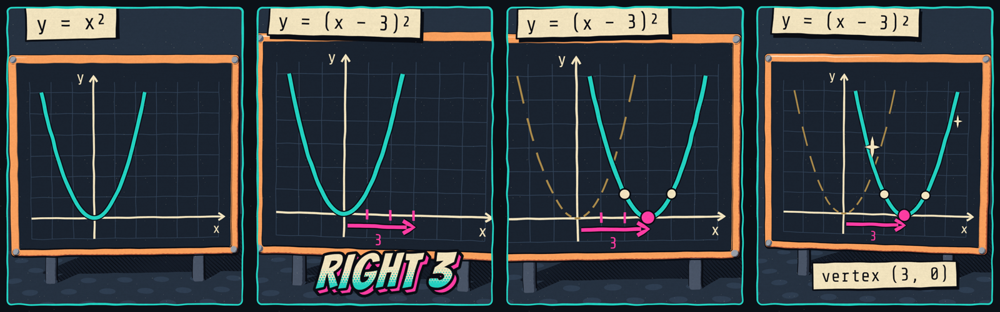

# Explainer clips: guide and kit

Short voiced motion graphics that explain one maths idea on a wasteland chalkboard. They are built in code with three.js and rendered to video with nobody watching. This folder holds the guide, the reusable style kit, one worked example (`shift-graph`) and the renderer.



## What a clip is

- **Just the maths.** A board, a graph or working, labels. No characters on screen, so nothing needs rigging. A talking head, if wanted, is separate art placed beside the video in the game.
- **One idea, 10 to 25 seconds, three to five beats.** Each beat is one change on the board and one narrator line.
- **Fully voiced, by the zone's tutor.** Every beat has a spoken line. A clip names its map zone, and `teachers.json` says which tutor narrates there, so the voice changes as the player moves across the map. Lines are recorded with the local voice model. A clip is fixed video, so the narrator can say this clip's numbers.
- **Full captions, on or off.** Captions are the narrator's words exactly, written to a `.vtt` file beside the video and never drawn into the picture, so the game can show or hide them.
- **Sound effects from our world.** Chalk on slate, paper, scrap metal, relays, struck pipe. They sit under the voice.
- **Fixed video.** three.js does not run inside Godot. The renderer writes an `.ogv` (Godot's `VideoStreamPlayer` plays Ogg Theora only) and an `.mp4` for review.

Clips sit beside the explainer player (FAL-375, FAL-429); they don't replace it. The player replays any question's worked steps and redraws when a number changes. A clip can't follow a question's numbers, so use it for the idea behind a topic, where one picture serves every question.

## The look: Salvage Ink

Everything that makes the style is in `lib/salvage-ink.js`. A clip that builds its objects with the kit comes out consistent without anyone tuning it.

| Part | Rule |
|---|---|
| Colour | Only `PAL` from the kit: the style guide's seven colours, each with a hand-picked shadow partner. Teal is the live curve or current object. Magenta marks the change (arrows, the key point, the number that matters). Dust is what was there before (ghosts, old positions). Paper is chalk: axes, labels, plain points. |
| Line | Every solid gets the ink outline (`solid`). Chalk marks on the board are flat strokes (`mark`, `strokes`). |
| Board | Slate slab in a rust frame on a charcoal dotted ground, lit by one hard sun. It fills the frame. Copy the board block from the example. |
| Type | Bangers for the one big word of a beat (`lettering`). Share Tech Mono on paper slips for equations and results (`caption`), and for chalk labels on the board. Fonts come from `game/assets/fonts/`. |
| Finish | The print filter (`ink.print()`): a teal ruled panel on a charcoal margin, wandering edges, paper tooth. No blur, bloom or grain. |
| Motion | Props move on twos (15 drawings a second) and snap between held poses with an overshoot. The camera alone moves on every frame: it drifts during a beat and whips to the next framing in a third of a second. |
| Sound | `sound(k)` scores the events that land, on the same frames as the picture: `stroke` with `material: 'chalk'` for drawing, `paper` for slips, `tock`, `stamp` and `thud` for metal and landings, `tick` and `click` for relays and counting, `ding` for struck pipe at the result. No chip-tune or interface sounds (`coin`, `powerup`, `blip`). Mark small sounds `minor` so they drop under the voice. |
| Frame | 1080×1350, so the video sits above captions and controls on the 1080×1920 game screen. |
| Text size | Labels are sized as a share of the frame width with `label(...)`. A slip is 0.4 to 0.65 of the width. At most two slips and one big word on screen at once. |

## Files

| Path | What it is |
|---|---|
| `lib/salvage-ink.js` | The house look. Change the look here and nowhere else. |
| `lib/stage.js`, `lib/sound.js` | The rendering kit and the sound-effect kit, unchanged from the source. Do not edit. |
| `styles/shift-graph.js` | The worked example. Copy it to start a clip. |
| `styles/ink-toon.reference.js` | The original coffee example, kept for technique (pouring, squash, steam). It does not run with the house kit. |
| `teachers.json` | Which tutor narrates each map zone, and whether their casting is approved. |
| `player.html` | Plays a clip live with a scrub bar, sound and a captions toggle: `player.html?clip=<id>`. |
| `render.mjs` | Renders stills, video, sound, captions, the voice script and a check report. |
| `reference/` | Stills of the example, to compare a new clip against. |
| `out/<clip>/` | Render output. Not committed. |

## Make a clip

Nothing here waits for a person. Each stage ends in files and an exit code for the next role.

1. **Script.** Pick one idea and three to five beats. Set the clip's `zone` (`foundations`, or an island id from `game/ui/map.gd`: `algebra`, `functions`, `geometry`, `stats`, `calculus`) and look up its tutor in `teachers.json`. Write one line for every beat, in the tutor's voice if they have a sheet and plainly if not: 8 to 12 words, numbers allowed, and no "just", "easy", "simple", "obvious" or "guess". Say the maths the way the board shows it: if the board says "right", the line says "right". Check every number and equation by hand.
2. **Build.** Copy `styles/shift-graph.js` to `styles/<id>.js` and keep its structure: content block, timing table `T`, `VOICE`, `BEATS`, `build(S)` returning `update(t)`, then `sound(k)`.
   - `update(t)` sets the whole scene for time `t`. Nothing builds up between calls. No `Math.random`, `Date` or timers; use `K.rng(seed)`.
   - Every event time sits on the 15-per-second grid in `T`, and `sound(k)` uses the same times.
   - Give each line a `slot` (the longest its recording may run): about 0.45 s per word. Leave 0.2 s between slots and half a second clear at the end.
   - Build everything in code from the kit. No downloaded models, images or textures.
3. **Storyboard.** `node render.mjs <id> storyboard` writes one still per beat, `storyboard.html` and `voice-script.json`. Open the stills, compare them with `reference/`, and fix anything cropped, overlapping or too small. About half a minute.
4. **Voice.** Once the zone's tutor is approved, the Audio Designer records each line in `voice-script.json` with the tutor's brief and saves it at the path given there (`game/assets/audio/voice/<teacher>/clips/<id>/01.ogg`, …). A take longer than its slot fails the check: record it shorter or re-time the beat.
5. **Render.** `node render.mjs <id> video` writes `<id>.mp4`, `<id>.ogv`, `<id>.vtt` and `report.json`. It mixes the recordings over the effects at −15 LUFS. Before the voice is recorded it still renders, so the picture can be reviewed, and the report says `voicePending` and `"ready": false`. Add `--draft` for a quick rough render; a draft is never ready.
6. **Hand over.** Attach `storyboard.html`, the `.mp4` and `report.json` to the issue. A clip is done when `report.json` says `"ready": true` and the reviewing roles have passed the maths, the tone and the look.

The renderer exits non-zero and lists the problem when the page throws an error, a beat has no voice line, a line uses a ruled-out word, slots overlap or run into the end, a recording is longer than its slot, the zone or tutor is not in `teachers.json`, recordings exist for an unapproved tutor, the first frame is empty, the duration is outside 5 to 30 seconds, or loudness is more than 1.5 LUFS from −15.

## Tutors by zone

`teachers.json` maps each map zone to the tutor who narrates there. The tutors are the regional cast being developed on GitHub issue #18. They are not the story characters: Spark, Gear Mira, Dax and Noma don't narrate clips.

| Zone | Island | Tutor (proposal on #18) |
|---|---|---|
| `foundations` | Prior knowledge | Tin-Can Tess |
| `algebra` | Scrap Fields | Mags the Ledger |
| `functions` | Signal Tower | Rook Dead-Air |
| `geometry` | Dry Flats | Kara Meridian |
| `stats` | Radio Spires | Lucien "Lucky" Lenoir |
| `calculus` | Engine Core | C.A.L.C. |

Every entry is that issue's starting proposal and none is approved. Casting, names, accents and the voice registry are decided there, and this file follows it. Until a zone's tutor is approved, clips for that zone can be scripted, built, storyboarded and rendered silent, but not recorded: the renderer fails a clip that has recordings for an unapproved tutor. Write the lines plainly first; the Writer puts them in the tutor's voice once the tutor has a sheet.

One clip has one narrator. The picture and timing don't depend on who speaks, so recasting a zone only means recording the lines again.

## In the game

The game's clip player is not built. It needs to play the `.ogv`, show the `.vtt` lines when captions are on, and give the player a captions switch that is remembered with the other settings. The voice is mixed into the video's sound, so the Voice bus toggle (FAL-429) cannot mute it alone; if that matters, ship the voice as a separate track and say so on the issue.

## Setup

```bash
npm ci
```

```bash
cd tools/explainer-clips && npm install
```

The first command, at the repo root, provides Playwright. The second provides three.js 0.187.0. `ffmpeg` must be on the path. Set `CHROMIUM_PATH` if Playwright's own browser is not installed.

## Not decided yet

- **Playing clips in the game.** Nothing in `game/` plays a clip yet, and the `.ogv` has not been tried in the Godot web build. Check playback and file size there before making many clips; on the web the fallback is an HTML `<video>` over the canvas.
- **Where finished clips live.** Video is large for a repository. Choose between `game/assets/video/`, Git LFS and a release asset before the first clip ships.
- **Casting and voices.** No tutor is approved yet (#18), so no clip can be finished. The example's four lines are plain drafts and are not recorded.
- **Licence.** See Provenance.

## Provenance

`lib/stage.js`, `lib/sound.js` and `styles/ink-toon.reference.js` were copied on 2026-11-14 from the "Ink and Toon" style prompt in Futurepedia's motion style library, which hands them out for building animations in that style. The page states no licence. Rendered clips are our own work; whether the kit source may be redistributed in this repository is unconfirmed, so settle that before these files are made public. `lib/salvage-ink.js` is derived from the reference style's `inkKit`.
